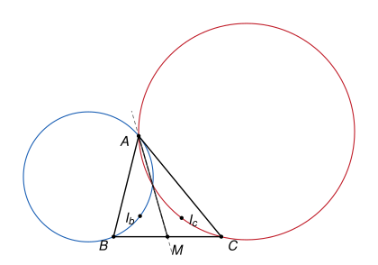

## Statement

Soit $ABC$ un triangle dont l'angle en $A$ n'est pas droit, et $M$ le milieu de $[BC]$. On note $I_b$ le centre du cercle inscrit dans le triangle $AMB$, et $I_c$ le centre du cercle inscrit dans le triangle $AMC$.

Le cercle circonscrit au triangle $ABI_b$ et le cercle circonscrit au triangle $ACI_c$ passent tous les deux par $A$. Montrer qu'ils se recoupent en un second point, et que ce point est sur la droite $(AM)$.

## Hints

1. Il suffit de trouver un point de la droite $(AM)$, autre que $A$, qui soit sur les deux cercles. Les points $B$ et $C$ jouent des rôles semblables : cherche un point de $(AM)$ qui se définit aussi bien à partir de $B$ qu'à partir de $C$.
2. Note $\varphi = \widehat{AMB}$. Exprime l'angle $\widehat{AI_bB}$ en fonction de $\varphi$, en utilisant les bissectrices du triangle $AMB$.
3. Essaie le point $T$ de la demi-droite $[MA)$ tel que $MT = MB = MC$. Le triangle $MBT$ est isocèle en $M$ : calcule $\widehat{MTB}$, puis $\widehat{ATB}$. Sépare deux cas : $T$ est entre $M$ et $A$, ou bien au-delà de $A$.
4. Utilise la réciproque du théorème de l'angle inscrit. Vérifie aussi que les deux cercles ne sont pas un seul et même cercle.

## Solution

On utilise deux résultats sur les angles.

- **L'angle entre deux bissectrices.** Dans un triangle $XYZ$ de centre du cercle inscrit $I$, on a $\widehat{XIY} = 90^\circ + \frac{1}{2}\widehat{XZY}$. En effet, $(XI)$ et $(YI)$ sont des bissectrices, donc $\widehat{IXY} = \frac{1}{2}\widehat{X}$ et $\widehat{IYX} = \frac{1}{2}\widehat{Y}$, et dans le triangle $XIY$ :
$$\widehat{XIY} = 180^\circ - \frac{\widehat{X} + \widehat{Y}}{2} = 180^\circ - \frac{180^\circ - \widehat{Z}}{2} = 90^\circ + \frac{\widehat{Z}}{2}.$$
- **Le théorème de l'angle inscrit et sa réciproque.** Soient $A$ et $B$ deux points, et $P$ et $Q$ deux points hors de la droite $(AB)$. Si $P$ et $Q$ sont du même côté de $(AB)$, alors $A$, $B$, $P$, $Q$ sont sur un même cercle si et seulement si $\widehat{APB} = \widehat{AQB}$. S'ils sont de part et d'autre de $(AB)$, alors $A$, $B$, $P$, $Q$ sont sur un même cercle si et seulement si $\widehat{APB} + \widehat{AQB} = 180^\circ$.

On note $\varphi = \widehat{AMB}$. Comme $M$ est sur le segment $[BC]$, on a $\widehat{AMC} = 180^\circ - \varphi$.

**Étape 1. Le point $T$.**

Soit $T$ le point de la demi-droite $[MA)$ tel que $MT = MB$. Comme $M$ est le milieu de $[BC]$, on a aussi $MT = MC$.

Le point $T$ est différent de $A$. En effet, $MA = MB = MC$ signifierait que $A$ est sur le cercle de diamètre $[BC]$, c'est-à-dire que l'angle en $A$ est droit, ce qui est exclu. Donc $MA \neq MB$.

**Étape 2. $T$ est sur le cercle circonscrit à $ABI_b$.**

Dans le triangle $AMB$, le résultat sur les bissectrices, appliqué au sommet $M$, donne
$$\widehat{AI_bB} = 90^\circ + \frac{\varphi}{2}.$$

Le triangle $MBT$ est isocèle en $M$. Comme $T$ est sur la demi-droite $[MA)$, son angle en $M$ est $\widehat{TMB} = \widehat{AMB} = \varphi$. Ses deux autres angles sont égaux, donc
$$\widehat{MTB} = \frac{180^\circ - \varphi}{2} = 90^\circ - \frac{\varphi}{2}.$$

Le point $I_b$ est à l'intérieur du triangle $AMB$, donc du même côté de $(AB)$ que $M$. On sépare deux cas.

- **Si $MA > MB$.** Alors $MT < MA$, et $T$ est sur le segment $[MA]$, strictement entre $M$ et $A$. Les angles $\widehat{ATB}$ et $\widehat{MTB}$ sont supplémentaires, puisque $A$, $T$, $M$ sont alignés dans cet ordre, donc
$$\widehat{ATB} = 180^\circ - \left(90^\circ - \frac{\varphi}{2}\right) = 90^\circ + \frac{\varphi}{2} = \widehat{AI_bB}.$$
Le point $T$, comme tous les points du segment $[MA]$ autres que $A$, est du même côté de $(AB)$ que $M$, donc que $I_b$. D'après la réciproque du théorème de l'angle inscrit, $T$ est sur le cercle passant par $A$, $B$ et $I_b$.
- **Si $MA < MB$.** Alors $MT > MA$, et $A$ est strictement entre $M$ et $T$. Les demi-droites $[TA)$ et $[TM)$ sont les mêmes, donc
$$\widehat{ATB} = \widehat{MTB} = 90^\circ - \frac{\varphi}{2}, \qquad \text{et} \qquad \widehat{ATB} + \widehat{AI_bB} = 180^\circ.$$
Le segment $[MT]$ coupe la droite $(AB)$ en $A$, donc $T$ et $M$ sont de part et d'autre de $(AB)$, et $T$ et $I_b$ aussi. D'après la réciproque du théorème de l'angle inscrit, $T$ est encore sur le cercle passant par $A$, $B$ et $I_b$.

**Étape 3. $T$ est aussi sur le cercle circonscrit à $ACI_c$.**

On refait l'étape 2 en échangeant les rôles de $B$ et de $C$. Le point $T$ ne change pas, puisque $MT = MB = MC$, et l'angle $\widehat{AMB} = \varphi$ est remplacé par $\widehat{AMC} = 180^\circ - \varphi$. Le calcul est le même, et l'on obtient que $T$ est sur le cercle passant par $A$, $C$ et $I_c$.

**Étape 4. Les deux cercles sont différents.**

Supposons que ce soit le même cercle. Il passe alors par $A$, $B$, $C$ et $I_b$. Les points $C$ et $I_b$ sont du même côté de $(AB)$, celui de $M$, donc le théorème de l'angle inscrit donne $\widehat{AI_bB} = \widehat{ACB}$.

Or $\widehat{AI_bB} = 90^\circ + \frac{\varphi}{2} > \varphi$, puisque $\varphi < 180^\circ$. De plus, dans le triangle $AMC$, la somme des angles donne
$$\varphi = 180^\circ - \widehat{AMC} = \widehat{MAC} + \widehat{MCA} > \widehat{MCA} = \widehat{ACB}.$$
On aurait donc $\widehat{AI_bB} > \widehat{ACB}$, ce qui contredit l'égalité. Les deux cercles sont donc différents.

**Étape 5. Conclusion.**

Deux cercles différents ont au plus deux points communs. Les deux cercles passent par $A$ et, d'après les étapes 2 et 3, par $T$, avec $T \neq A$. Ils se recoupent donc en un second point, qui est $T$. Ce point est sur la demi-droite $[MA)$, donc sur la droite $(AM)$.

## Going further

Que se passe-t-il quand l'angle en $A$ est droit ? Le point $T$ est alors $A$ lui-même. Montre que les deux cercles sont tangents en $A$ : ils ont en $A$ la même tangente, et ils n'ont pas d'autre point commun.

Le point $T$ est aussi sur le cercle de diamètre $[BC]$, puisque $MT = MB = MC$. Explique, sans calcul, pourquoi l'angle $\widehat{BTC}$ est droit.
