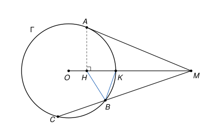

## Statement

Soit $\Gamma$ un cercle de centre $O$ et de rayon $r$, et $M$ un point situé à l'extérieur de $\Gamma$. Soit $A$ un point de $\Gamma$ tel que la droite $(MA)$ soit tangente à $\Gamma$.

Une droite passant par $M$, différente de la droite $(MO)$, coupe $\Gamma$ en deux points $B$ et $C$, le point $B$ étant situé entre $M$ et $C$.

On note $H$ le projeté orthogonal de $A$ sur le segment $[MO]$, et $K$ le point où le segment $[MO]$ coupe le cercle $\Gamma$.

Montrer que la droite $(BK)$ est la bissectrice de l'angle $\widehat{HBM}$.

## Hints

1. Place-toi dans un repère orthonormé d'origine $O$ dans lequel $M$ a pour coordonnées $(m\,;\,0)$, avec $m > r$. Calcule l'abscisse de $A$ à l'aide du théorème de Pythagore dans le triangle $OAM$, puis les coordonnées de $H$.
2. Tu dois trouver $H\left(\frac{r^2}{m}\,;\,0\right)$. Pour un point $P$ quelconque du cercle $\Gamma$, compare $PH^2$ et $PM^2$.
3. Le rapport $\frac{PH}{PM}$ est le même pour tous les points $P$ du cercle. Applique cela à $B$ et à $K$.
4. Il reste à montrer que si un point $K$ du segment $[HM]$ vérifie $\frac{KH}{KM} = \frac{BH}{BM}$, alors $(BK)$ est la bissectrice de $\widehat{HBM}$. Trace la vraie bissectrice, puis la parallèle à cette bissectrice qui passe par $M$, et utilise le théorème de Thalès.

## Solution

**Étape 1. Des coordonnées.**

On se place dans un repère orthonormé d'origine $O$ dont l'axe des abscisses est la droite $(OM)$, orienté de sorte que $M$ ait pour coordonnées $(m\,;\,0)$ avec $m = OM > r$. On note $(a\,;\,b)$ les coordonnées de $A$. Comme $A$ est sur $\Gamma$, on a $a^2 + b^2 = r^2$.

Une tangente à un cercle est perpendiculaire au rayon qui aboutit au point de contact. Le triangle $OAM$ est donc rectangle en $A$, et le théorème de Pythagore donne $OM^2 = OA^2 + AM^2$. Or
$$AM^2 = (m - a)^2 + b^2 = m^2 - 2am + a^2 + b^2 = m^2 - 2am + r^2.$$
On obtient $m^2 = r^2 + m^2 - 2am + r^2$, donc $a = \frac{r^2}{m}$.

Le projeté orthogonal de $A$ sur l'axe des abscisses est le point $H\left(\frac{r^2}{m}\,;\,0\right)$, et le point $K$ a pour coordonnées $(r\,;\,0)$. Comme $0 < \frac{r^2}{m} < r < m$, les points $O$, $H$, $K$, $M$ sont rangés dans cet ordre sur le segment $[OM]$. En particulier, $K$ est sur le segment $[HM]$.

**Étape 2. Le rapport $\frac{PH}{PM}$ est le même pour tous les points du cercle.**

Soit $P(x\,;\,y)$ un point de $\Gamma$, de sorte que $x^2 + y^2 = r^2$. Alors
$$PM^2 = (x - m)^2 + y^2 = x^2 + y^2 - 2mx + m^2 = r^2 - 2mx + m^2,$$
$$PH^2 = \left(x - \frac{r^2}{m}\right)^2 + y^2 = r^2 - \frac{2r^2 x}{m} + \frac{r^4}{m^2} = \frac{r^2}{m^2}\left(m^2 - 2mx + r^2\right).$$
Ainsi $PH^2 = \frac{r^2}{m^2} \times PM^2$. Les longueurs étant positives, et $PM$ n'étant pas nul puisque $M$ n'est pas sur $\Gamma$,
$$\frac{PH}{PM} = \frac{r}{m} \quad \text{pour tout point } P \text{ de } \Gamma. \qquad (1)$$

**Étape 3. On applique $(1)$ à $B$ et à $K$.**

Les points $B$ et $K$ sont sur $\Gamma$, donc
$$\frac{BH}{BM} = \frac{r}{m} = \frac{KH}{KM}. \qquad (2)$$
On peut aussi le vérifier directement pour $K$ : $KH = r - \frac{r^2}{m} = \frac{r(m - r)}{m}$ et $KM = m - r$.

**Étape 4. Une propriété de la bissectrice.**

Le point $B$ n'est pas sur la droite $(OM)$ : la droite $(MB)$ est différente de $(MO)$, donc elle ne la coupe qu'en $M$, et $B \neq M$. Les points $H$, $B$, $M$ forment donc un vrai triangle.

La bissectrice de l'angle $\widehat{HBM}$ coupe le côté $[HM]$ en un point $K'$. La parallèle à $(BK')$ passant par $M$ coupe la droite $(HB)$ en un point $N$, et comme $K'$ est sur le segment $[HM]$, le point $B$ est sur le segment $[HN]$.

- Les droites $(BK')$ et $(NM)$ sont parallèles. Avec la sécante $(HN)$, les angles correspondants $\widehat{HBK'}$ et $\widehat{BNM}$ sont égaux. Avec la sécante $(BM)$, les angles alternes-internes $\widehat{K'BM}$ et $\widehat{BMN}$ sont égaux.
- Comme $\widehat{HBK'} = \widehat{K'BM}$, on obtient $\widehat{BNM} = \widehat{BMN}$. Le triangle $BMN$ a deux angles égaux, il est isocèle en $B$ : $BN = BM$.
- Dans le triangle $HMN$, la droite $(BK')$ est parallèle à $(NM)$. Le théorème de Thalès donne $\frac{HK'}{HM} = \frac{HB}{HN}$, ce qui s'écrit aussi $\frac{K'H}{K'M} = \frac{BH}{BN}$, c'est-à-dire
$$\frac{K'H}{K'M} = \frac{BH}{BM}.$$

**Étape 5. Conclusion.**

D'après $(2)$ et l'étape 4, les points $K$ et $K'$ sont deux points du segment $[HM]$ qui vérifient
$$\frac{KH}{KM} = \frac{K'H}{K'M} = \frac{r}{m}.$$
Or un seul point $X$ du segment $[HM]$ vérifie $\frac{XH}{XM} = \frac{r}{m}$ : de $XH = \frac{r}{m}\,XM$ et $XH + XM = HM$, on tire $XM = \frac{HM}{1 + \frac{r}{m}}$, ce qui fixe la position de $X$. Donc $K = K'$.

**La droite $(BK)$ est bien la bissectrice de l'angle $\widehat{HBM}$.**

## Going further

1. Soit $L$ le second point d'intersection de la droite $(OM)$ avec $\Gamma$. Montre que $(BL)$ est perpendiculaire à $(BK)$. Que représente la droite $(BL)$ pour les droites $(BH)$ et $(BM)$ ?
2. Réciproquement, montre que tout point $P$ du plan qui vérifie $\frac{PH}{PM} = \frac{r}{m}$ est sur le cercle $\Gamma$.
