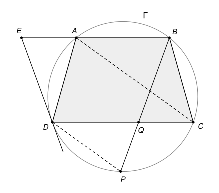

## Statement

Soit $ABCD$ un trapèze dont les côtés $(AB)$ et $(CD)$ sont parallèles. On suppose que
$AD < CD$ et que $ABCD$ est inscrit dans un cercle $\Gamma$.

Soit $P$ le point de $\Gamma$, autre que $D$, tel que la droite $(DP)$ soit parallèle à $(AC)$.
La tangente à $\Gamma$ en $D$ coupe la droite $(AB)$ en $E$, et les cordes $[BP]$ et $[CD]$ se
coupent en $Q$.

Montrer que $EQ = AC$.

## Hints

1. Un trapèze inscrit dans un cercle est isocèle : ses deux diagonales ont la même longueur. Il
   suffit donc de montrer que $EQ = BD$.
2. Le quadrilatère $EBQD$ a deux côtés parallèles, $[EB]$ et $[DQ]$. Si ses angles en $D$ et en
   $Q$ sont égaux, il est symétrique par rapport à la médiatrice de $[DQ]$.
3. Pour comparer les angles $\widehat{EDQ}$ et $\widehat{DQB}$, mesure les arcs du cercle : note
   $2x$ l'arc $AB$ et $2y$ l'arc $BC$. Que valent les arcs $DA$ et $CP$ ?
4. L'angle $\widehat{DQB}$ est un angle extérieur du triangle $DQP$.

## Solution

*Rappels.* On mesure un arc de cercle par l'angle au centre qui l'intercepte.

- *Angle inscrit.* Un angle inscrit dans un cercle vaut la moitié de l'arc qu'il intercepte.
- *Tangente et corde.* L'angle entre une corde et la tangente en l'une de ses extrémités vaut la
  moitié de l'arc intercepté, c'est-à-dire de l'arc situé à l'intérieur de l'angle. C'est le cas
  limite du théorème de l'angle inscrit, quand un côté de l'angle devient tangent.
- *Cordes parallèles.* Si deux cordes $[MN]$ et $[M'N']$ d'un cercle sont parallèles, la symétrie
  par rapport au diamètre perpendiculaire à ces cordes échange $M$ et $N$, et aussi $M'$ et $N'$.
  Les deux arcs compris entre les cordes sont donc égaux.

Dans tout ce qui suit, l'arc $AB$ est celui qui ne contient pas $C$ et $D$, l'arc $BC$ celui qui
ne contient ni $A$ ni $D$, et ainsi de suite en tournant autour du cercle.

### Étape 1 : les arcs du trapèze

Les cordes $[AB]$ et $[CD]$ sont parallèles, donc les arcs $BC$ et $DA$ sont égaux. La même
symétrie échange $A$ et $B$, et aussi $C$ et $D$ : elle échange donc les diagonales $[AC]$ et
$[BD]$, d'où
$$AC = BD.$$
Il suffit donc de montrer que $EQ = BD$.

Notons $2x$ l'arc $AB$, $2y$ les arcs $BC$ et $DA$, et $2z$ l'arc $CD$.

Les cordes $[AC]$ et $[DP]$ sont parallèles. La symétrie par rapport au diamètre perpendiculaire
à ces cordes échange $A$ et $C$, et aussi $D$ et $P$ : l'arc $CP$ est l'image de l'arc $AD$, donc
il mesure aussi $2y$. Comme $AD < CD$, l'arc $AD$ est plus petit que l'arc $CD$, et le point $P$
se trouve sur l'arc $CD$, entre $C$ et $D$ : en partant de $C$ vers $D$, on rencontre $P$ après un
arc $2y$. C'est bien pour cela que la corde $[BP]$ coupe la corde $[CD]$.

### Étape 2 : deux angles égaux

**L'angle $\widehat{EDQ}$.** Le point $Q$ est sur $[DC]$, donc cet angle est l'angle entre la
tangente $(DE)$ et la corde $[DC]$. Le point $E$ est sur la droite $(AB)$, du même côté de $(CD)$
que $A$ et $B$ : l'arc intercepté est l'arc $DC$ qui passe par $A$ et $B$. Il mesure
$2y + 2x + 2y$, donc
$$\widehat{EDQ} = x + 2y.$$

**L'angle $\widehat{DQB}$.** Les points $B$, $Q$, $P$ sont alignés dans cet ordre, donc
$\widehat{DQB}$ est un angle extérieur du triangle $DQP$ : il est égal à la somme des deux angles
de ce triangle en $D$ et en $P$,
$$\widehat{DQB} = \widehat{QDP} + \widehat{QPD} = \widehat{CDP} + \widehat{BPD}.$$
L'angle inscrit $\widehat{CDP}$ intercepte l'arc $CP$, qui mesure $2y$, donc il vaut $y$.
L'angle inscrit $\widehat{BPD}$ intercepte l'arc $BD$ qui passe par $A$, qui mesure $2x + 2y$,
donc il vaut $x + y$. Ainsi
$$\widehat{DQB} = y + (x + y) = x + 2y = \widehat{EDQ}.$$

### Étape 3 : une symétrie qui envoie $[EQ]$ sur $[BD]$

Soit $s$ la symétrie par rapport à la médiatrice de $[DQ]$. Elle échange $D$ et $Q$. Elle garde la
droite $(CD)$, et elle garde aussi la droite $(AB)$, qui est parallèle à $(CD)$, donc
perpendiculaire à l'axe.

La demi-droite $[DE)$ fait avec $[DQ)$ un angle $x + 2y$, du côté de $(CD)$ où se trouve $(AB)$.
Son image par $s$ part de $Q$ et fait le même angle avec $[QD)$, du même côté : c'est la
demi-droite $[QB)$, d'après l'étape 2. Le point $E$, intersection de $(DE)$ et de $(AB)$, a donc
pour image l'intersection de $(QB)$ et de $(AB)$, c'est-à-dire $B$.

La symétrie $s$ envoie $E$ sur $B$ et $Q$ sur $D$ : elle envoie le segment $[EQ]$ sur le segment
$[BD]$. Une symétrie conserve les longueurs, donc $EQ = BD$.

### Conclusion

D'après les étapes 1 et 3, $EQ = BD = AC$. **On a bien $EQ = AC$.**

## Going further

Montrer que le quadrilatère $ACQE$ est un parallélogramme.
