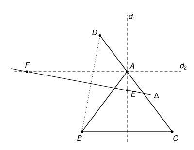

## Statement

Soit $ABC$ un triangle isocèle en $A$. Soit $D$ un point de la droite $(AC)$ tel que $A$ soit
situé entre $C$ et $D$, mais ne soit pas le milieu de $[CD]$.

On note $d_1$ et $d_2$ les bissectrices intérieure et extérieure de l'angle $\widehat{BAC}$, et
$\Delta$ la médiatrice du segment $[BD]$. Enfin, on note $E$ le point d'intersection de $\Delta$ et
de $d_1$, et $F$ le point d'intersection de $\Delta$ et de $d_2$.

Démontrer que les points $A$, $D$, $E$ et $F$ sont sur un même cercle.

## Hints

1. On peut montrer davantage : les cinq points $A$, $B$, $D$, $E$, $F$ sont sur le cercle $\Gamma$
   circonscrit au triangle $ABD$.
2. Vérifie que $d_2$ est la bissectrice de l'angle $\widehat{BAD}$, et que $AB \neq AD$.
3. La droite $d_2$ recoupe le cercle $\Gamma$ en un point $G$. À l'aide d'angles inscrits, montre
   que $GB = GD$. Qu'en déduis-tu pour le point $G$ ?
4. Pour le point $E$, regarde le point de $\Gamma$ diamétralement opposé à $F$.

## Solution

Les points $A$, $B$, $D$ ne sont pas alignés, car $B$ n'est pas sur la droite $(AC)$. Notons
$\Gamma$ le cercle circonscrit au triangle $ABD$ et $O$ son centre. Comme $OB = OD$, le centre $O$
est sur la médiatrice $\Delta$. Nous allons montrer que $E$ et $F$ sont sur $\Gamma$, ce qui
suffit.

### Étape 0 : deux remarques

**On a $AB \neq AD$.** Le triangle est isocèle en $A$, donc $AB = AC$. Comme $A$ est entre $C$ et
$D$ sans être le milieu de $[CD]$, on a $AD \neq AC$, donc $AD \neq AB$. Par conséquent, **$A$
n'est pas sur la médiatrice $\Delta$**. En particulier, $\Delta$ est différente de $d_1$ et de
$d_2$, qui passent par $A$, et les points $E$ et $F$ sont différents de $A$.

**La droite $d_2$ est la bissectrice de l'angle $\widehat{BAD}$.** La bissectrice extérieure de
l'angle $\widehat{BAC}$ est la bissectrice de l'angle formé par la demi-droite $[AB)$ et la
demi-droite opposée à $[AC)$. Comme $A$ est entre $C$ et $D$, cette demi-droite opposée est
$[AD)$. De plus, les angles $\widehat{BAC}$ et $\widehat{BAD}$ sont supplémentaires, et
$d_1$, $d_2$ partagent chacun d'eux en deux : l'angle entre $d_1$ et $d_2$ vaut donc
$\dfrac{180^\circ}{2} = 90^\circ$. **Les droites $d_1$ et $d_2$ sont perpendiculaires en $A$.**

### Étape 1 : le point $F$ est sur $\Gamma$

Dans le triangle $ABD$, la bissectrice $d_2$ issue de $A$ coupe le côté $[BD]$ en un point $K$.
Ce point $K$ est à l'intérieur du cercle $\Gamma$, donc la droite $d_2$ ressort du cercle en un
second point $G$, au-delà de $K$. Ainsi $G$ est de l'autre côté de la droite $(BD)$ par rapport à
$A$, et les points $A$, $B$, $G$, $D$ se suivent dans cet ordre sur le cercle.

Les angles inscrits $\widehat{GBD}$ et $\widehat{GAD}$ interceptent le même arc $GD$, donc ils sont
égaux. De même, les angles inscrits $\widehat{GDB}$ et $\widehat{GAB}$ interceptent le même arc
$GB$, donc ils sont égaux. Comme $d_2$ est la bissectrice de $\widehat{BAD}$, on a
$\widehat{GAB} = \widehat{GAD}$, et donc
$$\widehat{GBD} = \widehat{GAD} = \widehat{GAB} = \widehat{GDB}.$$
Le triangle $GBD$ a deux angles égaux : il est isocèle en $G$, et $GB = GD$. Le point $G$ est donc
sur la médiatrice $\Delta$.

Le point $G$ est à la fois sur $d_2$ et sur $\Delta$. Ces deux droites sont distinctes (étape 0),
donc elles ont au plus un point commun, qui est $F$. Ainsi $G = F$, et **$F$ est sur $\Gamma$.**

### Étape 2 : le point $E$ est sur $\Gamma$

Soit $H$ le point de $\Gamma$ diamétralement opposé à $F$. Les points $F$ et $O$ sont tous les deux
sur $\Delta$, et ils sont distincts ($F$ est sur le cercle, $O$ en est le centre). Le diamètre
$[FH]$ est porté par la droite $(FO)$, qui est $\Delta$ : donc **$H$ est sur $\Delta$**. En
particulier $H \neq A$, puisque $A$ n'est pas sur $\Delta$.

Le point $A$ est sur le cercle de diamètre $[FH]$ et distinct de $F$ et de $H$, donc l'angle
$\widehat{FAH}$ est droit. La droite $(AH)$ est donc la perpendiculaire à $(AF) = d_2$ passant par
$A$, c'est-à-dire $d_1$ (étape 0) : **$H$ est sur $d_1$.**

Le point $H$ est à la fois sur $d_1$ et sur $\Delta$, deux droites distinctes, donc $H = E$. Ainsi
**$E$ est sur $\Gamma$.**

### Conclusion

Les points $A$, $B$, $D$, $E$ et $F$ sont tous sur le cercle $\Gamma$. En particulier, **les
points $A$, $D$, $E$ et $F$ sont sur un même cercle.**

## Going further

1. À quel endroit de la solution a-t-on utilisé que le triangle $ABC$ est isocèle ?
2. Que se passe-t-il si $A$ est le milieu de $[CD]$ ?
