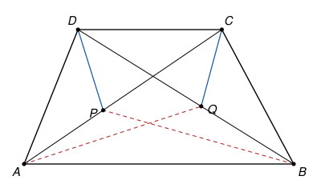

## Statement

Soit $ABCD$ un trapèze dont les côtés $[AB]$ et $[CD]$ sont parallèles. Soit $P$ un point du
segment $[AC]$ et $Q$ un point du segment $[BD]$, différents des extrémités de ces segments, tels
que
$$\widehat{APD} = \widehat{BQC}.$$

Démontrer que $\widehat{AQD} = \widehat{BPC}$.

## Hints

1. Appelle $O$ le point d'intersection des diagonales $[AC]$ et $[BD]$. Le théorème de Thalès te
   donne une égalité de rapports autour de $O$.
2. Compare $\widehat{APD}$ et $\widehat{AOD}$ selon que $P$ est entre $A$ et $O$ ou entre $O$ et
   $C$ (pense à l'angle extérieur d'un triangle). Fais de même pour $Q$. Que peux-tu en conclure
   sur les positions de $P$ et $Q$ ?
3. Montre que les triangles $OPD$ et $OQC$ sont semblables.
4. Déduis-en, avec Thalès, que $\dfrac{OP}{OQ} = \dfrac{OB}{OA}$, puis que les triangles $OPB$ et
   $OQA$ sont semblables.

## Solution

Notons $O$ le point d'intersection des diagonales $[AC]$ et $[BD]$, et $\omega = \widehat{AOD}$.
Les angles $\widehat{AOD}$ et $\widehat{BOC}$ sont opposés par le sommet, donc
$\widehat{BOC} = \omega$ aussi.

On utilisera deux outils :

- **l'angle extérieur** : dans un triangle, un angle extérieur est égal à la somme des deux angles
  intérieurs qui ne lui sont pas adjacents, il est donc plus grand que chacun d'eux ;
- **les cas de similitude** : deux triangles sont semblables s'ils ont deux angles égaux, ou s'ils
  ont un angle égal compris entre deux côtés proportionnels.

### Étape 1 : $P$ et $Q$ sont du même côté de $O$

Regardons où se trouve $P$ sur $[AC]$.

- Si $P$ est strictement entre $O$ et $C$, alors $\widehat{AOD}$ est un angle extérieur du
  triangle $OPD$, en $O$. Il est donc plus grand que l'angle intérieur en $P$, qui est
  $\widehat{APD}$ : on a $\widehat{APD} < \omega$.
- Si $P$ est strictement entre $A$ et $O$, alors $\widehat{APD}$ est un angle extérieur du
  triangle $POD$, en $P$. Il est plus grand que l'angle intérieur en $O$, qui est
  $\widehat{POD} = \omega$ : on a $\widehat{APD} > \omega$.
- Si $P = O$, alors $\widehat{APD} = \omega$.

De la même façon, avec le triangle $OQC$ et l'angle $\widehat{BOC} = \omega$ :
$\widehat{BQC} < \omega$ si $Q$ est strictement entre $O$ et $D$, $\widehat{BQC} > \omega$ si $Q$
est strictement entre $B$ et $O$, et $\widehat{BQC} = \omega$ si $Q = O$.

Comme $\widehat{APD} = \widehat{BQC}$, les points $P$ et $Q$ sont dans la même situation. Il y a
donc trois cas :

- **cas du bas** : $P$ est entre $A$ et $O$, et $Q$ est entre $B$ et $O$ ;
- **cas du haut** : $P$ est entre $O$ et $C$, et $Q$ est entre $O$ et $D$ ;
- **cas du milieu** : $P = Q = O$. Alors $\widehat{AQD} = \widehat{AOD}$ et
  $\widehat{BPC} = \widehat{BOC}$ sont opposés par le sommet, donc égaux, et c'est fini.

Il reste à traiter les deux premiers cas.

### Étape 2 : les triangles $OPD$ et $OQC$ sont semblables

**Les angles en $O$.** Dans le cas du bas, $\widehat{POD} = \widehat{AOD}$ et
$\widehat{QOC} = \widehat{BOC}$, qui sont égaux. Dans le cas du haut, $\widehat{POD}$ et
$\widehat{QOC}$ sont tous les deux l'angle $\widehat{COD}$.

**Les angles en $P$ et en $Q$.** Dans le cas du haut, $O$ est entre $A$ et $P$, donc
$\widehat{OPD} = \widehat{APD}$, et de même $\widehat{OQC} = \widehat{BQC}$ : ces deux angles sont
égaux par hypothèse. Dans le cas du bas, $\widehat{OPD} = \widehat{CPD} = 180^\circ - \widehat{APD}$
et $\widehat{OQC} = \widehat{DQC} = 180^\circ - \widehat{BQC}$ : ils sont encore égaux.

Les triangles $OPD$ et $OQC$ ont donc deux angles égaux, ils sont semblables, avec $P$ qui
correspond à $Q$ et $D$ qui correspond à $C$. Par conséquent
$$\frac{OP}{OQ} = \frac{OD}{OC}.$$

### Étape 3 : on fait entrer Thalès

Les droites $(AC)$ et $(BD)$ se coupent en $O$, et $(AB)$ est parallèle à $(CD)$. D'après le
théorème de Thalès,
$$\frac{OA}{OC} = \frac{OB}{OD}, \quad \text{donc} \quad \frac{OD}{OC} = \frac{OB}{OA}.$$
Avec l'étape 2, on obtient
$$\frac{OP}{OQ} = \frac{OB}{OA}, \quad \text{c'est-à-dire} \quad \frac{OP}{OB} = \frac{OQ}{OA}.$$

### Étape 4 : les triangles $OPB$ et $OQA$ sont semblables

**Les angles en $O$.** Dans le cas du bas, $\widehat{POB}$ et $\widehat{QOA}$ sont tous les deux
l'angle $\widehat{AOB}$. Dans le cas du haut, $\widehat{POB} = \widehat{COB}$ et
$\widehat{QOA} = \widehat{DOA}$, qui sont opposés par le sommet. Dans les deux cas, ces angles sont
égaux.

Les triangles $OPB$ et $OQA$ ont un angle égal en $O$, compris entre des côtés proportionnels
d'après l'étape 3. Ils sont donc semblables, avec $P$ qui correspond à $Q$ et $B$ qui correspond à
$A$. En particulier
$$\widehat{OPB} = \widehat{OQA}.$$

### Étape 5 : conclusion

- Dans le cas du bas, $P$ est entre $A$ et $O$, donc $\widehat{OPB} = \widehat{CPB}$. De même
  $\widehat{OQA} = \widehat{DQA}$. L'égalité de l'étape 4 s'écrit directement
  $\widehat{BPC} = \widehat{AQD}$.
- Dans le cas du haut, $\widehat{OPB} = \widehat{APB} = 180^\circ - \widehat{BPC}$ et
  $\widehat{OQA} = \widehat{BQA} = 180^\circ - \widehat{AQD}$. L'égalité de l'étape 4 donne encore
  $\widehat{BPC} = \widehat{AQD}$.

**Dans tous les cas, $\widehat{AQD} = \widehat{BPC}$.**

## Going further

Les étapes 2 et 4 disent en fait que les points $C$, $D$, $P$, $Q$ sont sur un même cercle, et que
les points $A$, $B$, $P$, $Q$ aussi. Retrouver ces deux cercles à l'aide des angles inscrits.
Pourquoi faut-il être prudent sur la position des points sur chaque cercle ?
