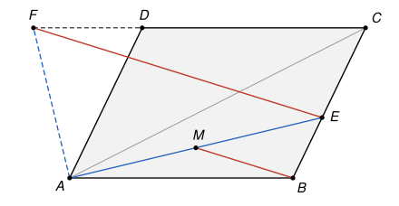

## Statement

Soit $ABCD$ un parallélogramme. La bissectrice intérieure de l'angle $\widehat{BAC}$ coupe le segment $[BC]$ en $E$, et sa bissectrice extérieure coupe la droite $(CD)$ en $F$. Soit $M$ le milieu du segment $[AE]$.

Démontrer que les droites $(EF)$ et $(BM)$ sont parallèles.

## Hints

1. On note $\vec{u}$ et $\vec{v}$ les vecteurs de longueur 1 qui ont la direction et le sens de $\overrightarrow{AB}$ et de $\overrightarrow{AC}$. Pourquoi la bissectrice intérieure de $\widehat{BAC}$ est-elle dirigée par $\vec{u} + \vec{v}$ ? Pense à un losange.
2. La bissectrice extérieure est perpendiculaire à la bissectrice intérieure. Elle est dirigée par $\vec{u} - \vec{v}$.
3. On pose $b = AB$ et $c = AC$. Écris $\overrightarrow{AE}$ de deux façons : comme un multiple de $\vec{u} + \vec{v}$, et comme $\overrightarrow{AB} + s\,\overrightarrow{BC}$. Les deux écritures en fonction de $\vec{u}$ et $\vec{v}$ doivent coïncider.
4. Fais de même pour $\overrightarrow{AF}$, puis calcule $\overrightarrow{EF}$ et $\overrightarrow{BM}$ en fonction de $\vec{u}$ et $\vec{v}$.

## Solution

On note $b = AB$ et $c = AC$, et $\vec{u}$, $\vec{v}$ les vecteurs de longueur 1 tels que
$$\overrightarrow{AB} = b\,\vec{u} \qquad \text{et} \qquad \overrightarrow{AC} = c\,\vec{v}.$$
Les points $A$, $B$, $C$ ne sont pas alignés, donc $\vec{u}$ et $\vec{v}$ ne sont pas colinéaires. On utilisera souvent la conséquence suivante : si $x\,\vec{u} + y\,\vec{v} = x'\,\vec{u} + y'\,\vec{v}$, alors $x = x'$ et $y = y'$. En effet, on aurait sinon $(x - x')\,\vec{u} = (y' - y)\,\vec{v}$ avec un coefficient non nul, et $\vec{u}$, $\vec{v}$ seraient colinéaires.

**Étape 1 : les directions des deux bissectrices.** Soit $P$, $Q$, $R$ les points tels que
$$\overrightarrow{AP} = \vec{u}, \qquad \overrightarrow{AQ} = \vec{v}, \qquad \overrightarrow{AR} = \vec{u} + \vec{v}.$$
Alors $APRQ$ est un parallélogramme dont deux côtés consécutifs ont la même longueur $AP = AQ = 1$ : c'est un losange. Dans un losange, chaque diagonale coupe en deux angles égaux les angles dont elle part, et les deux diagonales sont perpendiculaires.

- La diagonale $[AR]$ partage l'angle $\widehat{PAQ}$ en deux angles égaux. Comme $P$ est sur la demi-droite $[AB)$ et $Q$ sur la demi-droite $[AC)$, cet angle est $\widehat{BAC}$. La bissectrice intérieure est donc la droite passant par $A$ dirigée par $\vec{u} + \vec{v}$.
- L'autre diagonale $[PQ]$, dirigée par $\overrightarrow{PQ} = \vec{v} - \vec{u}$, est perpendiculaire à $[AR]$. La bissectrice extérieure est la perpendiculaire en $A$ à la bissectrice intérieure. Elle est donc dirigée par $\vec{u} - \vec{v}$.

**Étape 2 : le point $E$.** Comme $ABCD$ est un parallélogramme, $\overrightarrow{AD} = \overrightarrow{BC} = \overrightarrow{AC} - \overrightarrow{AB} = c\,\vec{v} - b\,\vec{u}$.

Le point $E$ est sur la bissectrice intérieure, donc $\overrightarrow{AE} = t\,(\vec{u} + \vec{v})$ pour un certain réel $t$. Il est aussi sur la droite $(BC)$, donc $\overrightarrow{AE} = \overrightarrow{AB} + s\,\overrightarrow{BC}$ pour un certain réel $s$, c'est-à-dire
$$\overrightarrow{AE} = b\,\vec{u} + s\,(c\,\vec{v} - b\,\vec{u}) = (1 - s)\,b\,\vec{u} + s\,c\,\vec{v}.$$
En comparant les deux écritures, $t = (1 - s)\,b$ et $t = s\,c$. Donc $s\,c = b - s\,b$, d'où
$$s = \frac{b}{b + c} \qquad \text{puis} \qquad t = s\,c = \frac{bc}{b + c}.$$
Ainsi
$$\overrightarrow{AE} = \frac{bc}{b + c}\,(\vec{u} + \vec{v}) \qquad \text{et} \qquad \overrightarrow{AM} = \frac{1}{2}\,\overrightarrow{AE} = \frac{bc}{2(b + c)}\,(\vec{u} + \vec{v}).$$

**Étape 3 : le point $F$.** La droite $(CD)$ est parallèle à $(AB)$, donc dirigée par $\vec{u}$ : il existe un réel $\lambda$ tel que $\overrightarrow{AF} = \overrightarrow{AC} + \lambda\,\vec{u} = \lambda\,\vec{u} + c\,\vec{v}$. Le point $F$ est aussi sur la bissectrice extérieure : il existe un réel $r$ tel que $\overrightarrow{AF} = r\,\vec{u} - r\,\vec{v}$. En comparant, $\lambda = r$ et $c = -r$. Donc
$$\overrightarrow{AF} = c\,\vec{v} - c\,\vec{u}.$$

**Étape 4 : les vecteurs $\overrightarrow{EF}$ et $\overrightarrow{BM}$.** On calcule
$$\overrightarrow{EF} = \overrightarrow{AF} - \overrightarrow{AE} = c\,\vec{v} - c\,\vec{u} - \frac{bc}{b + c}\,(\vec{u} + \vec{v}).$$
On met tout au dénominateur $b + c$ :
$$\overrightarrow{EF} = \frac{c}{b + c}\left((b + c)\,\vec{v} - (b + c)\,\vec{u} - b\,\vec{u} - b\,\vec{v}\right) = \frac{c}{b + c}\left(c\,\vec{v} - (2b + c)\,\vec{u}\right).$$
De même,
$$\overrightarrow{BM} = \overrightarrow{AM} - \overrightarrow{AB} = \frac{bc}{2(b + c)}\,(\vec{u} + \vec{v}) - b\,\vec{u} = \frac{b}{2(b + c)}\left(c\,\vec{v} - (2b + c)\,\vec{u}\right).$$
Les deux vecteurs sont des multiples du même vecteur $\vec{w} = c\,\vec{v} - (2b + c)\,\vec{u}$, qui n'est pas nul. Plus précisément,
$$\overrightarrow{EF} = \frac{2c}{b}\,\overrightarrow{BM}.$$

**Conclusion.** Les vecteurs $\overrightarrow{EF}$ et $\overrightarrow{BM}$ sont colinéaires, donc **les droites $(EF)$ et $(BM)$ sont parallèles.**

## Going further

- Le calcul de l'étape 3 donne aussi $\overrightarrow{CF} = \overrightarrow{AF} - \overrightarrow{AC} = -c\,\vec{u}$, donc $CF = c = CA$ : le triangle $ACF$ est isocèle en $C$. Le corrigé officiel part de là, sans vecteurs. Il appelle $G$ le point où $(EF)$ coupe $(AB)$, montre avec le théorème de Thalès que $B$ est le milieu de $[AG]$, et conclut avec la droite des milieux du triangle $AEG$. Cette méthode demande de bien justifier la position des points sur la figure.
- Le fait que $\vec{u} + \vec{v}$ dirige la bissectrice, quand $\vec{u}$ et $\vec{v}$ ont la même longueur, sert dans beaucoup de problèmes. Il donne par exemple une preuve rapide du théorème de la bissectrice : avec les notations ci-dessus, $EB / EC = AB / AC$. Essaie de le déduire de l'étape 2.
