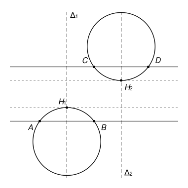

## Statement

Soit $A$, $B$, $C$ et $D$ quatre points distincts du plan. On suppose que **tout** cercle qui passe par $A$ et $B$ rencontre **tout** cercle qui passe par $C$ et $D$.

Montrer que les quatre points $A$, $B$, $C$, $D$ sont alignés, ou bien qu'ils sont tous les quatre sur un même cercle.

## Hints

1. Raisonne par l'absurde : suppose que les quatre points ne sont ni alignés ni sur un même cercle, et cherche un cercle passant par $A$ et $B$ et un cercle passant par $C$ et $D$ qui ne se rencontrent pas.
2. Où se trouve le centre d'un cercle qui passe par $A$ et $B$ ? Note $\Delta_1$ la médiatrice de $[AB]$ et $\Delta_2$ celle de $[CD]$.
3. Si $\Delta_1$ et $\Delta_2$ se coupent en un point $O$, pense à deux cercles de même centre $O$.
4. Si $\Delta_1$ et $\Delta_2$ sont parallèles, les droites $(AB)$ et $(CD)$ le sont aussi. Trace un cercle passant par $A$ et $B$ qui reste tout près de $(AB)$, et un autre passant par $C$ et $D$ qui reste tout près de $(CD)$.

## Solution

**Un rappel.** Le centre d'un cercle qui passe par $A$ et $B$ est à la même distance de $A$ et de $B$ : il est sur la médiatrice de $[AB]$. Inversement, un cercle dont le centre $O$ est sur cette médiatrice et qui passe par $A$ passe aussi par $B$, puisque $OB = OA$.

**Raisonnons par l'absurde.** Supposons que les quatre points ne soient ni alignés ni sur un même cercle. Notons $\Delta_1$ la médiatrice de $[AB]$ et $\Delta_2$ celle de $[CD]$. Nous allons trouver un cercle passant par $A$ et $B$ et un cercle passant par $C$ et $D$ qui ne se rencontrent pas, ce qui contredira l'énoncé.

**Premier cas : $\Delta_1$ et $\Delta_2$ ont un point commun $O$.** Soit $\Gamma_1$ le cercle de centre $O$ qui passe par $A$. Comme $O$ est sur $\Delta_1$, il passe aussi par $B$. Soit $\Gamma_2$ le cercle de centre $O$ qui passe par $C$ ; il passe aussi par $D$.

Si l'on avait $OA = OC$, les cercles $\Gamma_1$ et $\Gamma_2$ seraient le même cercle, qui contiendrait $A$, $B$, $C$ et $D$. C'est exclu. Donc $OA \neq OC$ : les cercles $\Gamma_1$ et $\Gamma_2$ ont le même centre et des rayons différents. Un point commun $P$ vérifierait $OP = OA$ et $OP = OC$, ce qui est impossible. Ces deux cercles ne se rencontrent pas : contradiction.

**Second cas : $\Delta_1$ et $\Delta_2$ n'ont pas de point commun.** Elles sont alors parallèles. La droite $(AB)$ est perpendiculaire à $\Delta_1$, et $(CD)$ est perpendiculaire à $\Delta_2$, donc $(AB)$ et $(CD)$ sont parallèles. Elles ne sont pas confondues, sinon les quatre points seraient alignés. Notons $d > 0$ la distance entre ces deux droites.

Pour fixer les idées, dessinons $(AB)$ horizontale et $(CD)$ au-dessus, à la hauteur $d$. Les médiatrices $\Delta_1$ et $\Delta_2$ sont alors verticales.

- Soit $H_1$ le point de $\Delta_1$ situé entre les deux droites, à la hauteur $\dfrac{d}{4}$. Soit $\Gamma_1$ le cercle qui passe par $A$, $B$ et $H_1$ (ces trois points ne sont pas alignés). Son centre est sur $\Delta_1$, donc sur la verticale de $H_1$.

  La droite $\Delta_1$ passe par le centre de $\Gamma_1$ : elle coupe $\Gamma_1$ en deux points, les deux extrémités d'un diamètre vertical. Le point le plus haut du cercle est l'une de ces deux extrémités. Or $\Delta_1$ traverse la corde $[AB]$ en son milieu, qui est à l'intérieur du cercle : l'une des extrémités est donc au-dessus de $(AB)$, c'est $H_1$, et l'autre au-dessous. Le point le plus haut de $\Gamma_1$ est donc $H_1$, et **tout le cercle $\Gamma_1$ est à une hauteur inférieure ou égale à $\dfrac{d}{4}$**.

- De la même façon, soit $H_2$ le point de $\Delta_2$ situé entre les deux droites, à la hauteur $d - \dfrac{d}{4} = \dfrac{3d}{4}$, et $\Gamma_2$ le cercle qui passe par $C$, $D$ et $H_2$. Son point le plus bas est $H_2$, donc **tout le cercle $\Gamma_2$ est à une hauteur supérieure ou égale à $\dfrac{3d}{4}$**.

Comme $\dfrac{d}{4} < \dfrac{3d}{4}$, les cercles $\Gamma_1$ et $\Gamma_2$ ne se rencontrent pas : contradiction.

**Conclusion.** Dans les deux cas, on aboutit à une contradiction. Les points $A$, $B$, $C$, $D$ sont donc alignés, ou bien sur un même cercle.

## Going further

1. La réciproque est fausse. Placer quatre points $A$, $B$, $C$, $D$ sur un même cercle, puis trouver un cercle passant par $A$ et $B$ et un cercle passant par $C$ et $D$ qui ne se rencontrent pas.
2. On suppose que $A$, $C$, $B$, $D$ sont sur un même cercle $\Gamma$, dans cet ordre. Montrer qu'alors tout cercle passant par $A$ et $B$ rencontre tout cercle passant par $C$ et $D$. On pourra montrer qu'un cercle passant par $A$ et $B$ a l'un des points $C$, $D$ à l'intérieur et l'autre à l'extérieur.
