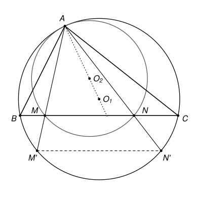

## Statement

Soit $ABC$ un triangle. Soient $M$ et $N$ deux points distincts du segment $[BC]$ tels que les angles $\widehat{BAM}$ et $\widehat{NAC}$ soient égaux.

On note $O_1$ le centre du cercle circonscrit au triangle $ABC$, et $O_2$ le centre du cercle circonscrit au triangle $AMN$.

Montrer que les points $A$, $O_1$ et $O_2$ sont alignés.

## Hints

1. La droite $(AM)$ recoupe le cercle circonscrit à $ABC$ en un second point $M'$, et la droite $(AN)$ le recoupe en $N'$. Fais une figure soignée : que remarques-tu sur la droite $(M'N')$ ?
2. Les angles inscrits $\widehat{BAM'}$ et $\widehat{N'AC}$ sont égaux. Que peux-tu dire des arcs $BM'$ et $N'C$ ? Pense à la symétrie par rapport à la médiatrice de $[BC]$.
3. Une fois que $(M'N')$ est parallèle à $(BC)$, le triangle $AM'N'$ est un agrandissement du triangle $AMN$ depuis le point $A$. Le cercle circonscrit à $AM'N'$ a pour centre $O_1$. Où se trouve le centre du cercle agrandi ?

## Solution

Notons $\theta$ la valeur commune des angles $\widehat{BAM}$ et $\widehat{NAC}$, et $\Gamma$ le cercle circonscrit au triangle $ABC$, de centre $O_1$.

**Rappel : l'angle inscrit.** Si $X$, $Y$, $Z$ sont trois points d'un cercle de centre $O$, l'angle inscrit $\widehat{XZY}$ vaut la moitié de l'angle au centre $\widehat{XOY}$ qui intercepte le même arc $XY$, celui qui ne contient pas $Z$. On le démontre en traçant le diamètre issu de $Z$ et en utilisant les deux triangles isocèles $OZX$ et $OZY$.

**Étape 1. Les points $M'$ et $N'$.** La droite $(AM)$ recoupe le cercle $\Gamma$ en un second point $M'$. Le point $M$ est sur la corde $[BC]$, donc à l'intérieur du disque : en partant de $A$, la droite traverse $(BC)$ en $M$ avant de ressortir du cercle. Ainsi $M'$ est de l'autre côté de $(BC)$ par rapport à $A$, c'est-à-dire sur l'arc $BC$ qui ne contient pas $A$. Appelons cet arc $\gamma$.

De même, la droite $(AN)$ recoupe $\Gamma$ en un point $N'$ de l'arc $\gamma$. Comme $M \neq N$, les droites $(AM)$ et $(AN)$ sont différentes, donc $M' \neq N'$.

**Étape 2. Deux angles au centre égaux.** Les angles inscrits $\widehat{BAM'} = \widehat{BAM}$ et $\widehat{N'AC} = \widehat{NAC}$ valent tous les deux $\theta$. Ils interceptent les arcs $BM'$ et $N'C$, qui sont des morceaux de l'arc $\gamma$. D'après le rappel,
$$\widehat{BO_1M'} = 2\theta \qquad \text{et} \qquad \widehat{N'O_1C} = 2\theta .$$
Autrement dit, sur l'arc $\gamma$, le point $M'$ est à « $2\theta$ » de $B$, et le point $N'$ est à « $2\theta$ » de $C$.

**Étape 3. La droite $(M'N')$ est parallèle à $(BC)$.** Soit $\Delta$ la médiatrice de $[BC]$. Elle passe par $O_1$, car $O_1B = O_1C$. La symétrie d'axe $\Delta$ :

- fixe $O_1$ et conserve les distances, donc envoie le cercle $\Gamma$ sur lui-même ;
- échange $B$ et $C$ ;
- envoie la droite $(BC)$ sur elle-même sans échanger ses deux côtés, donc envoie l'arc $\gamma$ sur lui-même ;
- conserve les angles.

Elle envoie donc le point de $\gamma$ situé à « $2\theta$ » de $B$ sur le point de $\gamma$ situé à « $2\theta$ » de $C$ : elle envoie $M'$ sur $N'$. Les points $M'$ et $N'$ sont symétriques par rapport à $\Delta$, donc la droite $(M'N')$ est perpendiculaire à $\Delta$. Comme $(BC)$ est aussi perpendiculaire à $\Delta$, on obtient
$$(M'N') \parallel (BC) .$$

**Étape 4. Le théorème de Thalès.** Dans le triangle $AM'N'$, le point $M$ est sur $[AM']$, le point $N$ est sur $[AN']$, et $(MN) \parallel (M'N')$. D'après le théorème de Thalès,
$$\frac{AM'}{AM} = \frac{AN'}{AN} .$$
Notons $k$ ce nombre. Comme $M'$ est sur la demi-droite $[AM)$ et $N'$ sur la demi-droite $[AN)$, on a, en vecteurs,
$$\overrightarrow{AM'} = k\,\overrightarrow{AM} \qquad \text{et} \qquad \overrightarrow{AN'} = k\,\overrightarrow{AN} .$$

**Étape 5. On agrandit le cercle de $AMN$.** Définissons le point $P$ par $\overrightarrow{AP} = k\,\overrightarrow{AO_2}$. Alors
$$\overrightarrow{PM'} = \overrightarrow{AM'} - \overrightarrow{AP} = k\left(\overrightarrow{AM} - \overrightarrow{AO_2}\right) = k\,\overrightarrow{O_2M},$$
donc $PM' = k \times O_2M$. De la même façon, $PN' = k \times O_2N$, et $PA = k \times O_2A$.

Or $O_2$ est le centre du cercle passant par $A$, $M$ et $N$, donc $O_2A = O_2M = O_2N$. On en déduit
$$PA = PM' = PN' .$$
Le point $P$ est à la même distance des trois points $A$, $M'$ et $N'$. Ces trois points sont distincts et sont sur le cercle $\Gamma$, donc ils ne sont pas alignés, et il n'y a qu'un seul point à égale distance des trois : le centre du cercle qui passe par eux, c'est-à-dire $O_1$. Ainsi $P = O_1$, et
$$\overrightarrow{AO_1} = k\,\overrightarrow{AO_2} .$$

**Conclusion.** Les vecteurs $\overrightarrow{AO_1}$ et $\overrightarrow{AO_2}$ sont colinéaires : les points $A$, $O_1$ et $O_2$ sont alignés.

## Going further

1. Montrer que les cercles circonscrits aux triangles $ABC$ et $AMN$ sont tangents au point $A$.
2. Une autre preuve, par les angles. On suppose que les trois angles du triangle $ABC$ sont aigus. Montrer que $\widehat{BAO_1} = 90^\circ - \widehat{ACB}$, puis que la hauteur issue de $A$ fait avec $(AC)$ ce même angle. En déduire que les droites $(AO_1)$ et $(AO_2)$ sont toutes les deux symétriques de la hauteur issue de $A$ par rapport à la bissectrice de l'angle $\widehat{BAC}$.
