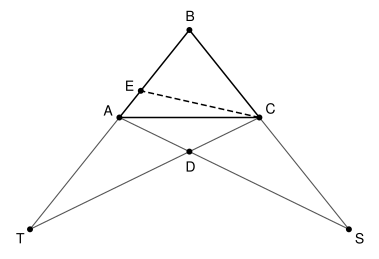

## Statement

Soit $ABC$ un triangle isocèle en $B$ (c'est-à-dire $AB = BC$), dont les trois angles sont aigus et qui n'est pas équilatéral.

- Soit $S$ le point de la demi-droite $[BC)$ tel que $AS = BS$.
- Soit $T$ le point de la demi-droite $[BA)$ tel que $BT = CT$.
- Soit $D$ le point d'intersection des droites $(AS)$ et $(CT)$.
- Soit $E$ le point du segment $[BA]$ tel que $BE = CD$.

Montrer que la droite $(CE)$ est la bissectrice de l'angle $\widehat{DCB}$.

## Hints

1. Commence par les longueurs : $TC = TB$ et $CD = BE$. Que peux-tu dire des rapports $\frac{TD}{TC}$ et $\frac{TE}{TB}$ ? Qu'en déduis-tu pour les droites $(DE)$ et $(BC)$ ?
2. Les égalités $SA = SB$ et $TB = TC$ donnent deux triangles isocèles. Écris les angles égaux qu'ils fournissent, en fonction de l'angle $\widehat{ABC}$.
3. Montre que le triangle $ADE$ est isocèle en $D$, puis que le triangle $ADC$ est isocèle en $D$.
4. Tu obtiens $DE = DC$. Que dit le triangle $DEC$, et que donne le parallélisme de $(DE)$ et $(BC)$ ?

## Solution

On note $\beta = \widehat{ABC}$. Le triangle $ABC$ est isocèle en $B$, donc

$$\widehat{BAC} = \widehat{BCA} = \frac{180^\circ - \beta}{2} = 90^\circ - \frac{\beta}{2}.$$

On fait la démonstration dans le cas de la figure, où $\beta > 60^\circ$ : alors $S$ est au-delà de $C$ et $T$ au-delà de $A$. Le cas $\beta < 60^\circ$ se traite de la même façon (voir la remarque à la fin).

**Étape 1 : les droites $(DE)$ et $(BC)$ sont parallèles.**

Le point $D$ est sur le segment $[CT]$, et $E$ est sur le segment $[BT]$. Comme $TC = TB$ et $CD = BE$,

$$\frac{TD}{TC} = \frac{TC - CD}{TC} = \frac{TB - BE}{TB} = \frac{TE}{TB}.$$

D'après la réciproque du théorème de Thalès dans le triangle $TBC$, les droites $(DE)$ et $(BC)$ sont parallèles.

**Étape 2 : le triangle $ADE$ est isocèle en $D$.**

Comme $SA = SB$, le triangle $SAB$ est isocèle en $S$, donc $\widehat{SAB} = \widehat{SBA} = \beta$. Le point $D$ est sur $[AS]$ et $E$ sur $[AB]$, donc

$$\widehat{DAE} = \widehat{SAB} = \beta.$$

D'autre part, $(ED)$ est parallèle à $(BC)$, donc les angles correspondants $\widehat{AED}$ et $\widehat{ABC}$ sont égaux : $\widehat{AED} = \beta$.

Le triangle $ADE$ a deux angles égaux, en $A$ et en $E$ : il est isocèle en $D$, et $DA = DE$.

**Étape 3 : le triangle $ADC$ est isocèle en $D$.**

Comme $TB = TC$, le triangle $TBC$ est isocèle en $T$, donc $\widehat{TCB} = \widehat{TBC} = \beta$, c'est-à-dire $\widehat{DCB} = \beta$.

Sur la figure, la demi-droite $[AC)$ est à l'intérieur de l'angle $\widehat{DAB}$, et $[CA)$ est à l'intérieur de l'angle $\widehat{DCB}$. Donc

$$\widehat{DAC} = \widehat{DAB} - \widehat{CAB} = \beta - \left(90^\circ - \frac{\beta}{2}\right) \qquad \text{et} \qquad \widehat{DCA} = \widehat{DCB} - \widehat{ACB} = \beta - \left(90^\circ - \frac{\beta}{2}\right).$$

Les angles $\widehat{DAC}$ et $\widehat{DCA}$ sont égaux : le triangle $ADC$ est isocèle en $D$, et $DA = DC$.

**Étape 4 : conclusion.**

Des étapes 2 et 3, on tire $DE = DA = DC$. Le triangle $DEC$ est donc isocèle en $D$, et

$$\widehat{DCE} = \widehat{DEC}.$$

Enfin, $(DE)$ et $(BC)$ sont parallèles, et la droite $(EC)$ les coupe. Les angles $\widehat{DEC}$ et $\widehat{ECB}$ sont alternes-internes, donc égaux. On obtient

$$\widehat{DCE} = \widehat{DEC} = \widehat{ECB}.$$

La droite $(CE)$ partage l'angle $\widehat{DCB}$ en deux angles égaux : c'est sa bissectrice.

**Remarque sur l'autre cas.** Si $\beta < 60^\circ$, les points $S$ et $T$ sont sur les segments $[BC]$ et $[BA]$, et $D$ est à l'intérieur du triangle $ABC$. Les étapes 1, 2 et 4 sont inchangées. À l'étape 3, ce sont cette fois $[AD)$ et $[CD)$ qui sont à l'intérieur des angles $\widehat{CAB}$ et $\widehat{ACB}$, et l'on trouve $\widehat{DAC} = \widehat{DCA} = 90^\circ - \frac{\beta}{2} - \beta$. Pour $\beta = 60^\circ$, le triangle est équilatéral, $S = C$ et $T = A$, et les droites $(AS)$ et $(CT)$ sont confondues : c'est pourquoi ce cas est exclu.

*Une autre idée.* La médiatrice de $[AC]$ est un axe de symétrie du triangle $ABC$. Elle échange $A$ et $C$, donc aussi $S$ et $T$, donc les droites $(AS)$ et $(CT)$ : leur point commun $D$ est sur cet axe, ce qui redonne $DA = DC$ directement.

## Going further

Montrer que la droite $(BD)$ est la bissectrice de l'angle $\widehat{ABC}$, puis que les droites $(BD)$ et $(CE)$ sont symétriques l'une de l'autre par rapport à la médiatrice de $[BC]$.
