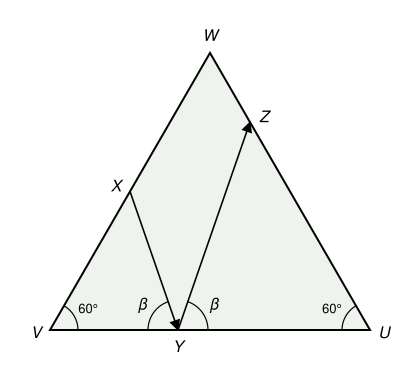
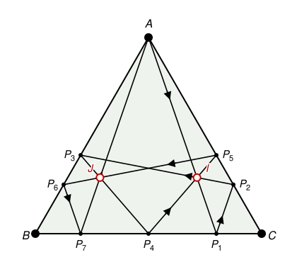

## Statement

$ABC$ est une table de billard en forme de triangle équilatéral, de côté $AB = BC = CA = 200$ cm. Il y a un trou à chacun des trois coins $A$, $B$, $C$. Les bords sont élastiques : quand la boule touche un bord, elle rebondit, et l'angle que fait sa trajectoire avec ce bord en arrivant est égal à l'angle qu'elle fait avec ce bord en repartant.

Soit $P$ le point du côté $[BC]$ tel que $BP = 160$ cm et $PC = 40$ cm. Un joueur lance la boule depuis $A$, en direction de $P$.

![Le triangle équilatéral ABC, le point P sur le côté [BC] et le premier trajet de A vers P](13611-figure-1.svg)

a) Démontrer qu'après sept rebonds sur les bords du triangle, la boule tombe dans le trou $A$.

b) Démontrer qu'il y a deux points de la table par lesquels la boule passe trois fois chacun.

## Hints

1. Fais un dessin soigné à l'échelle et suis la boule. Combien de rebonds vois-tu, et sur quels côtés ?
2. Regarde le triangle formé par le sommet $B$, le point de départ $A$ et le point d'arrivée $P$. Il a un angle de $60^\circ$ en $B$, et $BA : BP = 200 : 160 = 5 : 4$.
3. Après le rebond en $P$, la boule va vers le côté $[CA]$. Le triangle formé par $C$, $P$ et le point de rebond suivant a lui aussi un angle de $60^\circ$ en $C$. Compare ses angles à ceux du triangle précédent : que fait l'égalité des angles au rebond ?
4. Pour b), place-toi dans un repère avec $B = (0\,;0)$ et $C = (200\,;0)$. Calcule les coordonnées des points de rebond, puis cherche trois morceaux du trajet qui passent par un même point.

## Solution

**a) Une propriété de chaque morceau du trajet.**

Chaque morceau du trajet va d'un côté du triangle à un autre côté. Ces deux côtés ont un sommet commun $V$, et le morceau forme avec $V$ un petit triangle qui a un angle de $60^\circ$ en $V$. Appelons $X$ le point de départ et $Y$ le point d'arrivée du morceau. On regarde le rapport $\frac{VX}{VY}$.

Pour le premier morceau, de $A$ à $P$, le sommet commun est $B$ et le rapport vaut $\frac{BA}{BP} = \frac{200}{160} = \frac{5}{4}$.

*Le rapport s'inverse à chaque rebond.* Prenons un morceau de $X$ à $Y$, de sommet $V$, où $Y$ est sur le côté $[VU]$. Notons $\beta$ l'angle $\widehat{VYX}$, que fait le morceau avec le bord en arrivant. D'après la règle du rebond, le morceau suivant part de $Y$ en faisant le même angle $\beta$ avec le bord, mais du côté de $U$. La demi-droite qui part de $Y$ avec cet angle coupe la demi-droite $[UW)$ en un point $Z$, où $W$ est le troisième sommet : le triangle $UYZ$ existe, car ses angles en $U$ et en $Y$ ont une somme $60^\circ + \beta$ inférieure à $180^\circ$ (en effet $\beta$ est un angle du triangle $VXY$, qui a déjà un angle de $60^\circ$).

Comparons les triangles $VXY$ et $UZY$ :

- le triangle $VXY$ a un angle de $60^\circ$ en $V$ et un angle $\beta$ en $Y$ ;
- le triangle $UZY$ a un angle de $60^\circ$ en $U$ et un angle $\widehat{UYZ} = \beta$ en $Y$.

Ils ont deux angles égaux, donc ils sont semblables, avec $V \leftrightarrow U$, $Y \leftrightarrow Y$, $X \leftrightarrow Z$. Les côtés opposés aux angles égaux sont proportionnels : $VX$ (opposé à l'angle $\beta$) correspond à $UZ$, et $VY$ (opposé au troisième angle) correspond à $UY$. Donc

$$\frac{VX}{VY} = \frac{UZ}{UY}, \qquad \text{c'est-à-dire} \qquad \frac{UY}{UZ} = \frac{VY}{VX} .$$

Pour le nouveau morceau, de $Y$ à $Z$ avec le sommet $U$, le rapport « départ sur arrivée » est donc l'inverse du précédent. Il vaut alternativement $\frac{5}{4}$ et $\frac{4}{5}$. Enfin, le point $Z$ est bien sur le côté $[UW]$ tant que la longueur $UZ$ calculée est inférieure à $200$ cm ; si elle vaut exactement $200$ cm, la boule arrive au sommet $W$, donc dans un trou.

*On suit la boule.* À chaque rebond, le sommet suivant est l'autre extrémité du côté qu'on vient de toucher. Le rapport vaut d'abord $\frac{5}{4}$ (de $A$ vers $P$), puis $\frac{4}{5}$, puis $\frac{5}{4}$, et ainsi de suite.

| Morceau | Sommet | Départ | Rapport | Arrivée | Côté d'arrivée |
|---|---|---|---|---|---|
| $A \to P_1$ | $B$ | $BA = 200$ | $\frac{5}{4}$ | $BP_1 = 160$ | $[BC]$ |
| $P_1 \to P_2$ | $C$ | $CP_1 = 40$ | $\frac{4}{5}$ | $CP_2 = 50$ | $[CA]$ |
| $P_2 \to P_3$ | $A$ | $AP_2 = 150$ | $\frac{5}{4}$ | $AP_3 = 120$ | $[AB]$ |
| $P_3 \to P_4$ | $B$ | $BP_3 = 80$ | $\frac{4}{5}$ | $BP_4 = 100$ | $[BC]$ |
| $P_4 \to P_5$ | $C$ | $CP_4 = 100$ | $\frac{5}{4}$ | $CP_5 = 80$ | $[CA]$ |
| $P_5 \to P_6$ | $A$ | $AP_5 = 120$ | $\frac{4}{5}$ | $AP_6 = 150$ | $[AB]$ |
| $P_6 \to P_7$ | $B$ | $BP_6 = 50$ | $\frac{5}{4}$ | $BP_7 = 40$ | $[BC]$ |
| $P_7 \to$ ? | $C$ | $CP_7 = 160$ | $\frac{4}{5}$ | $200$ | sommet $A$ |

Ici $P_1 = P$. Dans chaque ligne, on obtient la distance d'arrivée en divisant la distance de départ par le rapport, par exemple $40 \div \frac{4}{5} = 50$. La distance de départ de la ligne suivante est le reste du côté : $CP_1 = 200 - 160 = 40$, puis $AP_2 = 200 - 50 = 150$, et ainsi de suite.

Les points $P_1, \ldots, P_7$ sont tous strictement à l'intérieur d'un côté (leurs distances aux sommets sont entre $40$ et $160$ cm), donc la boule ne tombe dans aucun trou avant la fin. Après le septième rebond, en $P_7$, elle arrive à $200$ cm de $C$ sur le côté $[CA]$, c'est-à-dire en $A$.

**Conclusion de a).** La boule rebondit sept fois, en $P_1, \ldots, P_7$, puis tombe dans le trou $A$.

**b) Deux points traversés trois fois.**

Le trajet complet est dessiné sur la figure ci-dessous.

*Un repère.* On prend $B = (0\,;0)$, $C = (200\,;0)$ et $A = (100\,;100\sqrt{3})$, car la hauteur d'un triangle équilatéral de côté $200$ vaut $100\sqrt{3}$. Un point situé sur $[CA]$ à la distance $d$ de $C$ s'obtient en avançant de $C$ vers $A$ de la fraction $\frac{d}{200}$ du chemin, et de même sur les autres côtés. Avec les distances trouvées en a) :

$$P_1 = (160\,;0), \quad P_2 = (175\,;25\sqrt{3}), \quad P_3 = (40\,;40\sqrt{3}), \quad P_4 = (100\,;0),$$

$$P_5 = (160\,;40\sqrt{3}), \quad P_6 = (25\,;25\sqrt{3}), \quad P_7 = (40\,;0) .$$

*Trois droites.* Calculons les équations de trois morceaux du trajet.

- La droite $(AP_1)$ passe par $(160\,;0)$ avec le coefficient directeur $\frac{0 - 100\sqrt{3}}{160 - 100} = -\frac{5\sqrt{3}}{3}$, donc $y = -\frac{5\sqrt{3}}{3}(x - 160)$.
- La droite $(P_4P_5)$ passe par $(100\,;0)$ avec le coefficient directeur $\frac{40\sqrt{3}}{60} = \frac{2\sqrt{3}}{3}$, donc $y = \frac{2\sqrt{3}}{3}(x - 100)$.
- La droite $(P_2P_3)$ passe par $(40\,;40\sqrt{3})$ avec le coefficient directeur $\frac{25\sqrt{3} - 40\sqrt{3}}{175 - 40} = -\frac{\sqrt{3}}{9}$, donc $y = 40\sqrt{3} - \frac{\sqrt{3}}{9}(x - 40)$.

Les deux premières droites se coupent quand $-5(x - 160) = 2(x - 100)$ (on a multiplié par $\frac{3}{\sqrt{3}}$), soit $7x = 1000$ et $x = \frac{1000}{7}$. Alors $y = \frac{2\sqrt{3}}{3} \times \frac{300}{7} = \frac{200\sqrt{3}}{7}$. Notons $I$ ce point.

Vérifions que $I$ est aussi sur la troisième droite :

$$40\sqrt{3} - \frac{\sqrt{3}}{9}\left(\frac{1000}{7} - 40\right) = 40\sqrt{3} - \frac{\sqrt{3}}{9} \times \frac{720}{7} = 40\sqrt{3} - \frac{80\sqrt{3}}{7} = \frac{200\sqrt{3}}{7} .$$

C'est bien l'ordonnée de $I$. De plus l'abscisse $\frac{1000}{7} \approx \text{142,9}$ est entre celles des extrémités de chacun des trois segments : entre $100$ et $160$ pour $[AP_1]$, entre $100$ et $160$ pour $[P_4P_5]$, entre $40$ et $175$ pour $[P_2P_3]$. Le point $I$ est donc sur les trois segments $[AP_1]$, $[P_2P_3]$ et $[P_4P_5]$ : **la boule passe trois fois par $I$**.

*Le deuxième point, par symétrie.* La droite d'équation $x = 100$ est un axe de symétrie du triangle : la symétrie $s$ par rapport à cet axe échange $B$ et $C$ et laisse $A$ fixe. Elle envoie un point $(x\,;y)$ sur $(200 - x\,;y)$. Avec les coordonnées ci-dessus, on voit que

$$s(P_1) = P_7, \quad s(P_2) = P_6, \quad s(P_3) = P_5, \quad s(P_4) = P_4 .$$

Donc $s$ envoie le segment $[AP_1]$ sur $[AP_7]$, le segment $[P_2P_3]$ sur $[P_6P_5]$ et le segment $[P_4P_5]$ sur $[P_4P_3]$. Ces trois segments font eux aussi partie du trajet, et ils passent tous par le point $J = s(I) = \left(\frac{400}{7}\,;\frac{200\sqrt{3}}{7}\right)$. Comme $\frac{400}{7} \neq \frac{1000}{7}$, le point $J$ est différent de $I$.

**Conclusion de b).** La boule passe trois fois par chacun des deux points $I\left(\frac{1000}{7}\,;\frac{200\sqrt{3}}{7}\right)$ et $J\left(\frac{400}{7}\,;\frac{200\sqrt{3}}{7}\right)$.

## Going further

Une autre méthode pour a) : au lieu de faire rebondir la boule, on fait « rebondir la table ». À chaque rebond, on dessine le symétrique du triangle par rapport au côté touché, et la boule continue tout droit. La trajectoire devient la demi-droite $[AP)$, qui traverse une bande de triangles équilatéraux collés les uns aux autres. Dessine cette bande et montre que la demi-droite $[AP)$ arrive, après avoir traversé sept côtés, sur un sommet qui est une copie de $A$.
