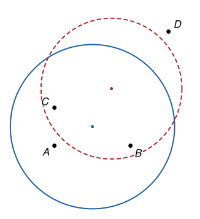

## Statement

Soient un point $P$ et un cercle $\mathcal{C}$ du plan. On appelle **distance de $P$ à $\mathcal{C}$** la plus petite longueur $PM$, quand $M$ parcourt le cercle $\mathcal{C}$. Par exemple, si $P$ est sur le cercle, sa distance au cercle est nulle, et si $P$ est le centre du cercle, sa distance au cercle est égale au rayon.

On se donne quatre points $A$, $B$, $C$, $D$ qui ne sont pas sur un même cercle, et dont trois ne sont jamais alignés.

Combien peut-il y avoir, au maximum, de cercles qui sont à la même distance des quatre points $A$, $B$, $C$ et $D$ ?

## Hints

1. Si $\mathcal{C}$ a pour centre $\Omega$ et pour rayon $r$, montre que la distance de $P$ à $\mathcal{C}$ vaut $|\Omega P - r|$.
2. Un cercle à la même distance des quatre points peut-il les avoir tous les quatre à l'intérieur ? Tous à l'extérieur ?
3. Les points se répartissent donc en deux groupes, ceux de l'intérieur et ceux de l'extérieur. Dans chaque groupe, que dire des distances au centre $\Omega$ ?
4. Traite séparément les répartitions « trois et un » et les répartitions « deux et deux ». Pour ces dernières, le centre est sur deux médiatrices.

## Solution

La réponse est **$7$**.

**La distance d'un point à un cercle.** Soit $\mathcal{C}$ un cercle de centre $\Omega$ et de rayon $r$, et $P$ un point. Pour tout point $M$ du cercle, l'inégalité triangulaire dans le triangle $\Omega PM$ donne $PM \ge |\Omega M - \Omega P| = |r - \Omega P|$. Et si $M$ est le point du cercle sur la demi-droite $[\Omega P)$, on a exactement $PM = |\Omega P - r|$. (Si $P = \Omega$, tous les points du cercle sont à la distance $r$.) Donc

$$\text{distance de } P \text{ à } \mathcal{C} = |\Omega P - r| .$$

**Les points se répartissent en deux groupes.** Soit $\mathcal{C}$ un cercle de centre $\Omega$ et de rayon $r$, à la même distance $\delta$ des quatre points. Si $\delta = 0$, les quatre points sont sur $\mathcal{C}$, ce qui est exclu. Donc $\delta > 0$, et pour chacun des quatre points $P$ :

- soit $P$ est à l'extérieur du cercle, et $\Omega P = r + \delta$ ;
- soit $P$ est à l'intérieur du cercle, et $\Omega P = r - \delta$.

Les quatre points ne peuvent pas être tous à l'extérieur : ils seraient tous à la distance $r + \delta$ de $\Omega$, donc sur un même cercle de centre $\Omega$, ce qui est exclu. De même, ils ne peuvent pas être tous à l'intérieur. Les points se répartissent donc en deux groupes non vides : ceux de l'intérieur, tous à la distance $r - \delta$ de $\Omega$, et ceux de l'extérieur, tous à la distance $r + \delta$.

Deux cercles qui ne mettent pas les mêmes points à l'intérieur sont forcément différents. On va donc compter, pour chaque façon de répartir les quatre points en deux groupes, combien de cercles conviennent.

**Les répartitions « trois et un ».** Supposons par exemple que $A$, $B$, $C$ sont d'un même côté du cercle, et $D$ de l'autre. Le centre $\Omega$ est à la même distance de $A$, de $B$ et de $C$. Comme ces trois points ne sont pas alignés, c'est forcément le centre $O_D$ du cercle circonscrit au triangle $ABC$. Notons $R$ le rayon de ce cercle circonscrit et $d = O_D D$. On a $d \ne R$, sinon les quatre points seraient sur un même cercle.

Les deux nombres $R$ et $d$ sont, dans un certain ordre, $r - \delta$ et $r + \delta$. Leur moyenne est donc $r$ :

$$r = \frac{R + d}{2} .$$

Le cercle est donc entièrement déterminé : il y en a au plus un. Réciproquement, le cercle de centre $O_D$ et de rayon $\frac{R + d}{2}$ convient : les points $A$, $B$ et $C$ sont à la distance $\left|R - \frac{R + d}{2}\right| = \frac{|R - d|}{2}$ de ce cercle, et le point $D$ à la distance $\left|d - \frac{R + d}{2}\right| = \frac{|R - d|}{2}$ aussi.

Il y a donc exactement un cercle pour chaque choix du point isolé : cela fait **$4$ cercles**.

**Les répartitions « deux et deux ».** Supposons par exemple que $A$ et $B$ sont d'un même côté du cercle, et $C$ et $D$ de l'autre. Alors $\Omega A = \Omega B$ et $\Omega C = \Omega D$ : le centre $\Omega$ est à la fois sur la médiatrice de $[AB]$ et sur la médiatrice de $[CD]$.

*Si les droites $(AB)$ et $(CD)$ ne sont pas parallèles*, leurs médiatrices non plus, et elles se coupent en un seul point $\Omega$. On pose $R_1 = \Omega A = \Omega B$ et $R_2 = \Omega C = \Omega D$. On a $R_1 \ne R_2$, sinon les quatre points seraient sur le cercle de centre $\Omega$. Comme plus haut, le rayon est forcément $r = \frac{R_1 + R_2}{2}$, et ce cercle convient : il y a exactement un cercle.

*Si les droites $(AB)$ et $(CD)$ sont parallèles*, leurs médiatrices sont parallèles aussi.

- Si ces médiatrices sont distinctes, aucun point n'est sur les deux : il n'y a aucun cercle.
- Elles ne peuvent pas être confondues. En effet, les médiatrices de $[AB]$ et de $[AC]$ se coupent en un point $\Omega'$, car $A$, $B$, $C$ ne sont pas alignés, et $\Omega' A = \Omega' B = \Omega' C$. Si la médiatrice de $[AB]$ était aussi celle de $[CD]$, on aurait de plus $\Omega' C = \Omega' D$, et les quatre points seraient sur un même cercle de centre $\Omega'$.

Chaque répartition « deux et deux » donne donc **au plus un cercle**, et exactement un quand les deux droites correspondantes ne sont pas parallèles. Il y a trois répartitions de ce type : $\{A, B\}$ et $\{C, D\}$, $\{A, C\}$ et $\{B, D\}$, $\{A, D\}$ et $\{B, C\}$. Cela fait **au plus $3$ cercles**.

**Le maximum.** En tout, il y a au plus $4 + 3 = 7$ cercles à la même distance des quatre points. Il y en a exactement $7$ quand aucune des trois paires de droites $(AB)$ et $(CD)$, $(AC)$ et $(BD)$, $(AD)$ et $(BC)$ n'est formée de deux droites parallèles.

**Un exemple avec $7$ cercles.** Dans un repère orthonormé, prenons $A = (0\,;\,0)$, $B = (2\,;\,0)$, $C = (0\,;\,1)$ et $D = (3\,;\,3)$.

- Trois points ne sont jamais alignés : $ABC$ est un triangle rectangle en $A$, et $D$ n'est ni sur l'axe des abscisses $(AB)$, ni sur l'axe des ordonnées $(AC)$, ni sur la droite $(BC)$, d'équation $x + 2y = 2$, puisque $3 + 6 \ne 2$.
- Les quatre points ne sont pas sur un même cercle : le cercle circonscrit au triangle rectangle $ABC$ a pour centre le milieu $(1\,;\,\text{0,5})$ de l'hypoténuse $[BC]$ et pour rayon au carré $1^2 + \text{0,5}^2 = \text{1,25}$, alors que le carré de la distance de ce centre à $D$ vaut $2^2 + \text{2,5}^2 = \text{10,25}$.
- Aucune paire de droites n'est parallèle : les vecteurs $\overrightarrow{AB} = (2\,;\,0)$ et $\overrightarrow{CD} = (3\,;\,2)$ ne sont pas colinéaires, ni $\overrightarrow{AC} = (0\,;\,1)$ et $\overrightarrow{BD} = (1\,;\,3)$, ni $\overrightarrow{AD} = (3\,;\,3)$ et $\overrightarrow{BC} = (-2\,;\,1)$.

Ces quatre points ont donc exactement $7$ cercles à la même distance d'eux. La figure en montre deux.

**Conclusion.** Il peut y avoir au maximum $7$ cercles à la même distance de quatre points non cocycliques dont trois ne sont jamais alignés : quatre qui isolent un des points, et trois qui séparent les points deux par deux.

## Going further

Dans l'énoncé d'origine, on ne supposait pas que trois des points ne sont jamais alignés. Place quatre points $A$, $B$, $C$, $D$ sur une même droite, de sorte que $[AB]$ et $[CD]$ aient le même milieu. Combien y a-t-il alors de cercles à la même distance des quatre points ?
