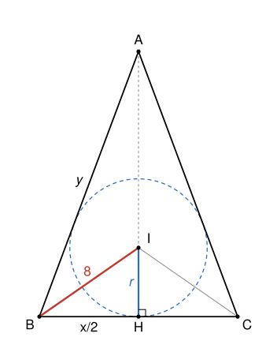

## Statement

Soit $ABC$ un triangle isocèle en $A$, tel que les longueurs $AB$ et $BC$ soient des nombres entiers. Les bissectrices des angles $\widehat{ABC}$ et $\widehat{ACB}$ se coupent en un point $I$, et on suppose que $BI = 8$.

Calculer $AB + BC$.

## Hints

1. Note $H$ le milieu de $[BC]$. Pourquoi le point $I$ est-il sur la droite $(AH)$ ? Que représente la longueur $IH$ ?
2. Pose $x = BC$, $y = AB$ et $r = IH$. Le théorème de Pythagore dans le triangle $BHI$ donne une première relation, et une majoration de $x$.
3. Calcule l'aire du triangle $ABC$ de deux façons : avec la base $[BC]$ et la hauteur $[AH]$, puis en découpant le triangle en trois triangles qui ont $I$ pour sommet.
4. En éliminant $r$ et $AH$, tu dois arriver à $y(x^2 - 128) = 64x$. Il ne reste alors que quelques valeurs de $x$ à essayer.

## Solution

On note $x = BC$ et $y = AB = AC$, qui sont des entiers, et $H$ le milieu de $[BC]$.

**Le point $I$ est sur la hauteur $(AH)$.** Le triangle est isocèle en $A$, donc il est symétrique par rapport à la droite $(AH)$, qui est à la fois la médiane, la hauteur et la médiatrice de $[BC]$. Cette symétrie échange $B$ et $C$, donc elle échange la bissectrice de $\widehat{ABC}$ et celle de $\widehat{ACB}$. Leur point commun $I$ est donc envoyé sur lui-même : il est sur l'axe $(AH)$.

Le point $I$ est le centre du cercle inscrit dans le triangle : il est à la même distance $r$ des trois côtés. Comme $(IH)$ est perpendiculaire à $(BC)$, cette distance est $r = IH$.

**Première relation.** Le triangle $BHI$ est rectangle en $H$, avec $BH = \frac{x}{2}$. Le théorème de Pythagore donne

$$\frac{x^2}{4} + r^2 = 64 . \qquad (1)$$

En particulier $\frac{x^2}{4} < 64$, donc $x^2 < 256$ et $x < 16$.

**Deuxième relation, avec les aires.** L'aire du triangle $ABC$ vaut $\frac{x \times AH}{2}$. On peut aussi découper $ABC$ en trois triangles $IBC$, $ICA$ et $IAB$. Chacun a pour hauteur issue de $I$ la distance $r$, et pour bases $x$, $y$ et $y$. Donc

$$\frac{x \times AH}{2} = \frac{r x}{2} + \frac{r y}{2} + \frac{r y}{2}, \qquad \text{c'est-à-dire} \qquad x \times AH = r(x + 2y) . \qquad (2)$$

**Troisième relation.** Le triangle $ABH$ est rectangle en $H$, donc

$$AH^2 = y^2 - \frac{x^2}{4} = \frac{(2y - x)(2y + x)}{4} . \qquad (3)$$

**On élimine $r$ et $AH$.** On élève $(2)$ au carré : $x^2 \times AH^2 = r^2 (x + 2y)^2$. On remplace $AH^2$ grâce à $(3)$, et $r^2 = 64 - \frac{x^2}{4} = \frac{256 - x^2}{4}$ grâce à $(1)$ :

$$x^2 \times \frac{(2y - x)(2y + x)}{4} = \frac{256 - x^2}{4} \times (2y + x)^2 .$$

On multiplie par $4$ et on divise par $2y + x$, qui n'est pas nul :

$$x^2 (2y - x) = (256 - x^2)(2y + x) .$$

On développe : $2x^2 y - x^3 = 512 y + 256 x - 2x^2 y - x^3$. Les termes $-x^3$ se simplifient, et il reste $4x^2 y = 512 y + 256 x$. En divisant par $4$ et en regroupant les termes en $y$ :

$$y\,(x^2 - 128) = 64 x .$$

**Les valeurs possibles.** Comme $x$ et $y$ sont positifs, $64x > 0$, donc $x^2 - 128 > 0$, soit $x^2 > 128$. Or $11^2 = 121$ et $12^2 = 144$, donc $x \ge 12$. Avec $x < 16$, il ne reste que quatre valeurs, et $y = \frac{64 x}{x^2 - 128}$ :

| $x$ | 12 | 13 | 14 | 15 |
|---|---|---|---|---|
| $x^2 - 128$ | 16 | 41 | 68 | 97 |
| $64x$ | 768 | 832 | 896 | 960 |
| $y$ | $48$ | pas entier | pas entier | pas entier |

En effet $832 = 20 \times 41 + 12$, $896 = 13 \times 68 + 12$ et $960 = 9 \times 97 + 87$. La seule possibilité est donc $x = 12$ et $y = 48$.

**Vérification.** Avec $BC = 12$ et $AB = AC = 48$, on a bien un triangle, car $48 + 48 > 12$. D'après $(3)$, $AH^2 = 48^2 - 6^2 = 2304 - 36 = 2268 = 324 \times 7$, donc $AH = 18\sqrt{7}$. D'après $(2)$, $r = \frac{12 \times 18\sqrt{7}}{12 + 96} = 2\sqrt{7}$, donc $r^2 = 28$. Enfin $BI^2 = BH^2 + r^2 = 36 + 28 = 64$, et $BI = 8$ comme voulu.

**Conclusion.** Le triangle a pour côtés $AB = AC = 48$ et $BC = 12$, donc $AB + BC = 60$.

## Going further

1. Refaire l'exercice avec $BI = 4$. Puis avec $BI = 5$ : peut-on encore trouver des côtés entiers ?
2. Montrer que la relation $y(x^2 - 128) = 64x$ s'obtient aussi avec le théorème de la bissectrice : dans le triangle $ABH$, la bissectrice issue de $B$ coupe $[AH]$ en $I$, et $\frac{IH}{IA} = \frac{BH}{BA}$.
