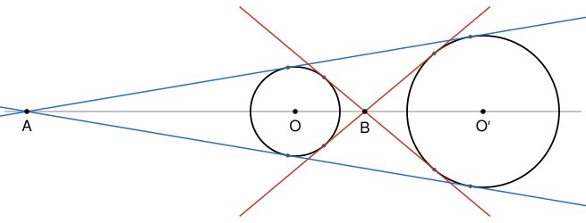

## Statement

Quatre points $A$, $O$, $B$, $O'$ sont alignés dans cet ordre sur une droite. On note $\mathcal{C}$ le cercle de centre $O$ et de rayon $2015$, et $\mathcal{C}'$ le cercle de centre $O'$ et de rayon $2016$.

On suppose que le point $A$ est le point d'intersection de deux tangentes communes aux deux cercles, et que le point $B$ est, lui aussi, le point d'intersection de deux tangentes communes aux deux cercles. On suppose enfin que les longueurs $AO$, $AO'$ et $AB$ sont des nombres entiers.

Trouver toutes les valeurs possibles de $AB$. Quelle est la plus petite ?

## Hints

1. Soit une tangente commune qui passe par $A$. Elle touche $\mathcal{C}$ en un point $M$ et $\mathcal{C}'$ en un point $M'$. Que peux-tu dire des droites $(OM)$ et $(O'M')$ ? Applique le théorème de Thalès.
2. Note $x = OO'$. Exprime $AO$, puis $BO$, en fonction de $x$. Pourquoi $x$ est-il un nombre entier ?
3. La longueur $BO = AB - AO$ est un entier. Remarque que $4031 = 2 \times 2015 + 1$, et déduis-en que $4031$ divise $x$.
4. Le point $B$ est sur deux tangentes différentes au cercle $\mathcal{C}$. Peut-il être sur ce cercle ? À l'intérieur ?

## Solution

On note $x = OO'$.

**Les tangentes qui passent par $A$.** Soit $\ell$ l'une des tangentes communes qui passent par $A$. Elle touche $\mathcal{C}$ en $M$ et $\mathcal{C}'$ en $M'$. Une tangente est perpendiculaire au rayon qui aboutit au point de contact, donc $(OM)$ et $(O'M')$ sont toutes deux perpendiculaires à $\ell$ : elles sont parallèles. Les points $A$, $O$, $O'$ sont alignés, les points $A$, $M$, $M'$ aussi, et le théorème de Thalès donne

$$\frac{AO}{AO'} = \frac{OM}{O'M'} = \frac{2015}{2016} .$$

Comme $A$, $O$, $O'$ sont dans cet ordre, $AO' = AO + x$. Donc $2016 \times AO = 2015 \times (AO + x)$, ce qui donne

$$AO = 2015\,x \qquad \text{et} \qquad AO' = 2016\,x .$$

**Les tangentes qui passent par $B$.** De même, soit $\ell'$ l'une des tangentes communes qui passent par $B$. Elle touche $\mathcal{C}$ en $N$ et $\mathcal{C}'$ en $N'$, et $(ON)$ est parallèle à $(O'N')$. Le théorème de Thalès, dans la configuration « papillon » cette fois, donne

$$\frac{BO}{BO'} = \frac{ON}{O'N'} = \frac{2015}{2016} .$$

Comme $B$ est entre $O$ et $O'$, $BO' = x - BO$. Donc $2016 \times BO = 2015 \times (x - BO)$, c'est-à-dire

$$4031 \times BO = 2015\,x . \qquad (\star)$$

**Les conditions entières.** La longueur $x = AO' - AO$ est un entier, comme différence de deux entiers. Comme $A$, $O$, $B$ sont dans cet ordre, $BO = AB - AO$ est aussi un entier. Or $4031 = 2 \times 2015 + 1$, donc, grâce à $(\star)$,

$$x = 4031\,x - 2 \times 2015\,x = 4031\,x - 2 \times 4031 \times BO = 4031\,(x - 2\,BO) .$$

Ainsi $x$ est un multiple de $4031$ : on écrit $x = 4031\,k$, avec $k$ un entier au moins égal à $1$. Alors $(\star)$ donne $BO = 2015\,k$, puis $BO' = x - BO = 2016\,k$, et

$$AB = AO + BO = 2015 \times 4031\,k + 2015\,k = 2015 \times 4032\,k = 8\,124\,480\,k .$$

**Le point $B$ est à l'extérieur du cercle $\mathcal{C}$.** Soit une droite tangente à $\mathcal{C}$ en un point $T$. Pour tout autre point $P$ de cette droite, le triangle $OTP$ est rectangle en $T$, donc $OP > OT = 2015$. Ainsi un point situé à l'intérieur du cercle n'est sur aucune tangente, et un point du cercle n'est que sur une seule tangente, celle en ce point. Comme $B$ est sur deux tangentes différentes à $\mathcal{C}$, il est à l'extérieur de $\mathcal{C}$ :

$$BO > 2015, \qquad \text{donc} \qquad 2015\,k > 2015, \qquad \text{donc} \qquad k \ge 2 .$$

Le cas $k = 1$ est donc impossible. Il donnerait $BO = 2015$ et $BO' = 2016$ : le point $B$ serait sur les deux cercles, qui seraient tangents en $B$, et une seule tangente commune passerait par $B$.

**Réciproquement, tout $k \ge 2$ convient.** Soit $k \ge 2$ et $x = 4031\,k$. On place $O$ et $O'$ à la distance $x$, puis $A$ sur la droite $(OO')$, du côté de $O$, avec $AO = 2015\,x$ (donc $AO' = 2016\,x$), et $B$ sur le segment $[OO']$ avec $BO = 2015\,k$ (donc $BO' = 2016\,k$). Les longueurs $AO$, $AO'$ et $AB = 8\,124\,480\,k$ sont bien des entiers. Il reste à voir que deux tangentes communes passent par $A$, et deux par $B$.

- Comme $AO = 2015\,x > 2015$, le point $A$ est à l'extérieur de $\mathcal{C}$, et on peut mener de $A$ deux tangentes à $\mathcal{C}$. Soit $\ell$ l'une d'elles, qui touche $\mathcal{C}$ en $M$. On place $M'$ sur la demi-droite $[AM)$ avec $AM' = \frac{2016}{2015}\,AM$. Alors $\frac{AM}{AM'} = \frac{2015}{2016} = \frac{AO}{AO'}$, avec les points dans le même ordre, donc, d'après la réciproque du théorème de Thalès, $(O'M')$ est parallèle à $(OM)$, donc perpendiculaire à $\ell$. Et le théorème de Thalès donne $O'M' = OM \times \frac{AO'}{AO} = 2016$. La droite $\ell$ est donc tangente à $\mathcal{C}'$ en $M'$ : c'est une tangente commune. Il en va de même pour l'autre tangente issue de $A$.
- Comme $BO = 2015\,k > 2015$, le point $B$ est lui aussi à l'extérieur de $\mathcal{C}$. Le même raisonnement s'applique, en plaçant cette fois $N'$ de l'autre côté de $B$ par rapport à $N$, avec $BN' = \frac{2016}{2015}\,BN$ : on obtient deux tangentes communes qui passent par $B$.

**Conclusion.** Les valeurs possibles de $AB$ sont les nombres $8\,124\,480\,k$ avec $k$ entier au moins égal à $2$. La plus petite est

$$AB = 2 \times 8\,124\,480 = 16\,248\,960,$$

obtenue avec $OO' = 8062$, $AO = 16\,244\,930$, $AO' = 16\,252\,992$ et $BO = 4030$.

## Going further

1. L'énoncé d'origine demandait de calculer $AB$ « sachant que $AB$ est un entier inférieur à $10^7$ », et la réponse publiée était $8\,124\,480$. Que se passe-t-il dans la figure pour cette valeur ? Pourquoi le problème d'origine n'a-t-il en fait aucune solution ?
2. Refaire l'exercice avec deux cercles de rayons $n$ et $n + 1$, pour un entier $n \ge 1$ quelconque.
