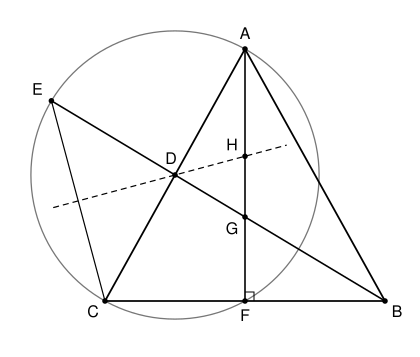

## Statement

Soit $ABC$ un triangle isocèle en $A$. Soit $D$ le milieu du segment $[AC]$ et $G$ le centre de
gravité du triangle $ABC$. La droite $(BD)$ recoupe le cercle de diamètre $[AC]$ en un point
$E$, situé de l'autre côté de la droite $(AC)$ par rapport à $B$. La médiatrice du segment
$[EC]$, en pointillés sur la figure, coupe la droite $(AG)$ au point $H$.

1. Montrer que la droite $(BH)$ est la bissectrice de l'angle $\widehat{GBA}$.
2. Soit $F$ le pied de la hauteur issue de $A$ dans le triangle $ABC$. Montrer que les droites
   $(EF)$ et $(BH)$ sont parallèles.

## Hints

1. Pour la question 1, montre que $H$ est le centre du cercle inscrit du triangle $ABD$.
2. Le point $D$ est le centre du cercle de diamètre $[AC]$. Compare $DE$ et $DC$. Que peux-tu en
   déduire pour la médiatrice de $[EC]$ ?
3. Dans un triangle isocèle, la médiatrice de la base est aussi la bissectrice de l'angle au
   sommet. Et deux angles opposés par le sommet ont la même bissectrice.
4. Pour la question 2, le point $F$ est lui aussi sur le cercle de diamètre $[AC]$. Pourquoi ?
   Que peux-tu dire du triangle $DEF$ ?
5. La droite $(DF)$ joint les milieux de deux côtés du triangle $ABC$.

## Solution

Rappelons deux faits sur le triangle $ABC$, isocèle en $A$. La médiane issue de $A$ est aussi sa
hauteur et la bissectrice de l'angle $\widehat{BAC}$ ; elle passe par $G$, donc c'est la droite
$(AG)$, et elle coupe $[BC]$ en son milieu, qui est le point $F$ de la question 2. D'autre part, la
médiane issue de $B$ est la droite $(BD)$, qui passe aussi par $G$.

**Question 1. Le point $H$ est le centre du cercle inscrit du triangle $ABD$.**

- *$H$ est sur la bissectrice issue de $A$.* La droite $(AG)$ est la bissectrice de
  $\widehat{BAC}$, et comme $D$ est sur $[AC]$, c'est aussi celle de $\widehat{BAD}$.
- *$H$ est sur la bissectrice issue de $D$.* Le point $D$ est le centre du cercle de diamètre
  $[AC]$, et $E$ et $C$ sont sur ce cercle, donc $DE = DC$. Ainsi $D$ est sur la médiatrice de
  $[EC]$, qui est donc la droite $(DH)$. Dans le triangle $EDC$, isocèle en $D$, la médiatrice de
  la base $[EC]$ est la bissectrice de l'angle $\widehat{EDC}$. Les points $E, D, B$ sont alignés
  dans cet ordre, et $A, D, C$ aussi : les angles $\widehat{EDC}$ et $\widehat{ADB}$ sont opposés
  par le sommet, et ont donc la même bissectrice. La droite $(DH)$ est la bissectrice de
  $\widehat{ADB}$.

Les bissectrices issues de $A$ et de $D$ dans le triangle $ABD$ sont deux droites distinctes, qui
se coupent en un seul point : le centre de son cercle inscrit. Comme $H$ est sur les deux, c'est
ce point. La bissectrice issue de $B$ passe donc aussi par $H$ : la droite $(BH)$ est la
bissectrice de $\widehat{ABD}$. Comme $G$ est sur le segment $[BD]$, on a
$\widehat{ABD} = \widehat{ABG}$, et **$(BH)$ est la bissectrice de $\widehat{GBA}$**.

En particulier, $\widehat{HBD} = \dfrac{1}{2}\,\widehat{ABD}$.

**Question 2.**

*Le triangle $DEF$ est isocèle.* L'angle $\widehat{AFC}$ est droit, donc $F$ est sur le cercle
de diamètre $[AC]$. Ainsi $DF = DC = DE$, et le triangle $DEF$ est isocèle en $D$, avec
$\widehat{DEF} = \widehat{DFE}$.

*L'angle en $E$.* Les points $E$, $D$, $B$ sont alignés dans cet ordre, donc l'angle
$\widehat{FDB}$ est l'angle extérieur en $D$ du triangle $DEF$ :

$$\widehat{FDB} = 180^\circ - \widehat{EDF} = \widehat{DEF} + \widehat{DFE} = 2\,\widehat{DEF}.$$

*La droite des milieux.* Les points $D$ et $F$ sont les milieux de $[CA]$ et $[CB]$, donc
$(DF)$ est parallèle à $(AB)$. Les points $F$ et $A$ sont de part et d'autre de la droite $(BD)$,
car $F$ est du même côté que $C$ et le segment $[AC]$ traverse $(BD)$ en $D$. Les angles
$\widehat{FDB}$ et $\widehat{DBA}$ sont donc alternes-internes, et ils sont égaux.

*Conclusion.* En rassemblant ces égalités et la fin de la question 1,

$$\widehat{DEF} = \frac{1}{2}\,\widehat{FDB} = \frac{1}{2}\,\widehat{DBA} = \widehat{HBD}.$$

Or $H$, centre du cercle inscrit de $ABD$, est du même côté de $(BD)$ que $A$, donc de l'autre
côté que $F$. Les angles $\widehat{FED}$ et $\widehat{HBD}$, formés par la droite $(EB)$ avec les
droites $(EF)$ et $(BH)$, sont donc alternes-internes. Comme ils sont égaux, **les droites
$(EF)$ et $(BH)$ sont parallèles**.

## Going further

Une autre façon de faire la question 2 : comme $E$ est sur le cercle de diamètre $[AC]$, l'angle
$\widehat{AEC}$ est droit, donc $(AE)$ et $(DH)$ sont toutes deux perpendiculaires à $(EC)$, et
donc parallèles. Le théorème de Thalès dans les triangles $GDH$ et $GEA$ donne
$\dfrac{GE}{GD} = \dfrac{GA}{GH}$. Avec $GB = 2\,GD$ et $GA = 2\,GF$, propriété du centre de
gravité, on en tire $\dfrac{GE}{GB} = \dfrac{GF}{GH}$, et la réciproque du théorème de Thalès
conclut.
