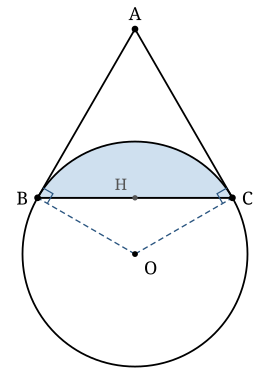

## Statement

$ABC$ est un triangle équilatéral. Un cercle est tangent au côté $[AB]$ en $B$ et au côté
$[AC]$ en $C$.

Quelle fraction de l'aire du triangle $ABC$ se trouve **à l'extérieur** du cercle ?

## Hints

1. Note $O$ le centre du cercle et $r$ son rayon. Un rayon et une tangente au point de contact sont perpendiculaires : que valent les angles $\widehat{OBA}$ et $\widehat{OCA}$ ?
2. Dans le quadrilatère $ABOC$, tu connais maintenant trois angles. Calcule le quatrième, $\widehat{BOC}$.
3. Exprime la longueur $BC$ en fonction de $r$, à l'aide du triangle isocèle $OBC$. Tu peux couper ce triangle en deux par sa hauteur issue de $O$.
4. La partie du triangle qui est à l'intérieur du cercle est le morceau situé au-dessus de la corde $[BC]$. Son aire est la différence de l'aire d'un secteur et de l'aire d'un triangle.

## Solution

**L'idée : tout exprimer en fonction du rayon $r$. Le rayon disparaît à la fin, puisqu'on
demande un rapport.**

Notons $O$ le centre du cercle et $r$ son rayon.

**Étape 1. L'angle au centre.**

Le cercle est tangent à la droite $(AB)$ en $B$, donc le rayon $[OB]$ est perpendiculaire à
$(AB)$ : $\widehat{OBA} = 90°$. De même $\widehat{OCA} = 90°$.

Le triangle $ABC$ étant équilatéral, $\widehat{BAC} = 60°$.

La somme des angles d'un quadrilatère vaut $360°$, donc dans $ABOC$ :
$$\widehat{BOC} = 360° - 90° - 90° - 60° = 120° .$$

**Étape 2. Le côté du triangle.**

Le triangle $OBC$ est isocèle en $O$ avec $OB = OC = r$ et $\widehat{BOC} = 120°$. Notons $H$
le milieu de $[BC]$ : la droite $(OH)$ est à la fois hauteur, médiane et bissectrice, donc
$\widehat{BOH} = 60°$ et le triangle $OHB$ est rectangle en $H$.

Alors
$$BH = OB \times \sin 60° = r\,\frac{\sqrt3}{2}, \qquad\text{donc}\qquad BC = 2\,BH = r\sqrt3 .$$

On note au passage $OH = OB \times \cos 60° = \dfrac{r}{2}$.

**Étape 3. L'aire du triangle $ABC$.**

Un triangle équilatéral de côté $a$ a pour aire $\dfrac{a^2\sqrt3}{4}$. Avec $a = r\sqrt3$ :
$$\mathcal{A}_{ABC} = \frac{(r\sqrt3)^2 \sqrt3}{4} = \frac{3r^2\sqrt3}{4} .$$

**Étape 4. L'aire commune au triangle et au disque.**

Le centre $O$ est situé de l'autre côté de $(BC)$ par rapport à $A$ (l'étape 2 donne
$OH = \frac r2$, alors que la hauteur du triangle vaut $\frac{3r}{2}$). La partie du triangle
située dans le disque est donc le **segment circulaire** délimité par la corde $[BC]$ et
l'arc $BC$ tourné vers $A$ : c'est la zone grisée de la figure.

Son aire est la différence entre l'aire du secteur circulaire d'angle $120°$ et l'aire du
triangle $OBC$ :

- secteur de $120°$ : c'est le tiers du disque, soit $\dfrac{\pi r^2}{3}$ ;
- triangle $OBC$ : base $BC = r\sqrt3$, hauteur $OH = \dfrac r2$, donc son aire vaut
  $\dfrac12 \times r\sqrt3 \times \dfrac r2 = \dfrac{r^2\sqrt3}{4}$.

$$\mathcal{A}_{\text{intérieure}} = \frac{\pi r^2}{3} - \frac{r^2\sqrt3}{4} .$$

**Étape 5. L'aire extérieure et la fraction demandée.**

$$\mathcal{A}_{\text{extérieure}}
= \frac{3r^2\sqrt3}{4} - \left(\frac{\pi r^2}{3} - \frac{r^2\sqrt3}{4}\right)
= \frac{3r^2\sqrt3}{4} + \frac{r^2\sqrt3}{4} - \frac{\pi r^2}{3}
= r^2\sqrt3 - \frac{\pi r^2}{3} .$$

La fraction cherchée vaut donc
$$\frac{\mathcal{A}_{\text{extérieure}}}{\mathcal{A}_{ABC}}
= \frac{r^2\sqrt3 - \dfrac{\pi r^2}{3}}{\dfrac{3r^2\sqrt3}{4}}
= \frac{4}{3\sqrt3}\left(\sqrt3 - \frac{\pi}{3}\right)
= \frac{4}{3} - \frac{4\pi}{9\sqrt3} .$$

En rendant le dénominateur rationnel ($\frac{1}{\sqrt3} = \frac{\sqrt3}{3}$) :
$$\boxed{\ \frac43 - \frac{4\pi\sqrt3}{27}\ }$$

**Valeur approchée.** $\dfrac43 \approx \text{1,333}$ et $\dfrac{4\pi\sqrt3}{27} \approx \text{0,806}$,
donc la fraction vaut environ $\text{0,527}$ : un peu plus de la moitié du triangle est à
l'extérieur du cercle.

## Going further

Le rayon $r$ a disparu du résultat, et c'est normal : deux figures de cette sorte sont
toujours semblables l'une à l'autre, et un rapport d'aires ne dépend pas de l'échelle. On
aurait donc pu poser $r = 1$ dès le début.

Un contrôle rapide du résultat : l'aire intérieure vaut $\frac{\pi}{3} - \frac{\sqrt3}{4}
\approx \text{1,047} - \text{0,433} = \text{0,614}$ pour $r = 1$, à comparer à l'aire totale
$\frac{3\sqrt3}{4} \approx \text{1,299}$. La part extérieure est bien
$1 - \frac{\text{0,614}}{\text{1,299}} \approx \text{0,527}$.
