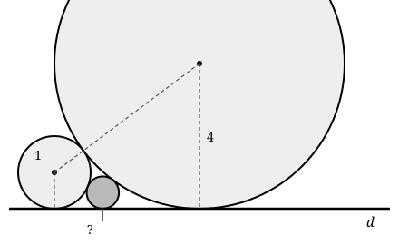

## Statement

Une droite $d$ est posée horizontalement. Deux cercles reposent dessus, du même côté :

- l'un a pour rayon $1$,
- l'autre a pour rayon $4$,

et ils sont **tangents entre eux**, chacun étant aussi **tangent à la droite $d$**.

On glisse un troisième cercle dans le creux entre les deux premiers, de façon qu'il soit tangent aux deux cercles et à la droite $d$.

Quel est le rayon de ce troisième cercle ?

## Hints

1. Un cercle de rayon $r$ tangent à la droite $d$ a son centre à la hauteur $r$ au-dessus de $d$, et son point de contact est juste en dessous du centre.
2. Commence par une question plus simple : deux cercles de rayons $R$ et $r$ sont posés sur $d$ et tangents entre eux. Quelle est la distance entre leurs deux points de contact avec $d$ ?
3. Pour y répondre, relie les deux centres. Que vaut cette distance ? Puis fabrique un triangle rectangle dont l'hypoténuse est ce segment et dont un côté est horizontal.
4. Tu devrais trouver $2\sqrt{Rr}$. Applique cette formule trois fois : grand-petit, petit-minuscule, minuscule-grand. Comment les trois distances se combinent-elles ?
5. L'équation obtenue devient simple si tu la divises par $2\sqrt{R\,r\,\rho}$, où $\rho$ est le rayon cherché.

## Solution

**Étape 1 : la distance entre deux points de contact.**

Commençons par établir un petit résultat général.

*Deux cercles de rayons $R$ et $r$ sont tangents à une même droite $d$, du même côté, et tangents entre eux. Alors leurs deux points de contact avec $d$ sont distants de $2\sqrt{Rr}$.*

Prenons $d$ pour axe des abscisses. Le centre du premier cercle est en $A(a\,;\,R)$ et le second en $B(b\,;\,r)$, et leurs points de contact avec $d$ sont respectivement $A'(a\,;\,0)$ et $B'(b\,;\,0)$. La distance cherchée est $A'B' = |b - a|$.

Les deux cercles étant tangents extérieurement, la distance entre les centres vaut la somme des rayons :
$$AB = R + r .$$

Par ailleurs, en projetant, le triangle de sommets $A$, $B$ et $(b\,;\,R)$ est rectangle, de côtés $|b-a|$ (horizontal) et $|R - r|$ (vertical), d'hypoténuse $AB$. Le théorème de Pythagore donne
$$(b-a)^2 = AB^2 - (R-r)^2 = (R+r)^2 - (R-r)^2 .$$

En développant : $(R+r)^2 - (R-r)^2 = \left(R^2 + 2Rr + r^2\right) - \left(R^2 - 2Rr + r^2\right) = 4Rr$. Donc
$$A'B' = |b - a| = \sqrt{4Rr} = 2\sqrt{Rr} .$$

**Étape 2 : les trois points de contact s'alignent.**

Notons $R = 4$, $r = 1$ les rayons des deux grands cercles, et $\rho$ le rayon du petit cercle cherché. Notons $P$, $Q$, $S$ leurs points de contact respectifs avec la droite $d$.

Le petit cercle est glissé **entre** les deux autres, donc son point de contact $S$ est situé entre $P$ et $Q$ :
$$PS + SQ = PQ .$$

En appliquant trois fois l'étape 1 :
$$2\sqrt{R\rho} + 2\sqrt{r\rho} = 2\sqrt{Rr} .$$

**Étape 3 : résolution.**

Divisons par $2$, puis par $\sqrt{R\,r\,\rho}$, qui est strictement positif :
$$\frac{\sqrt{R\rho}}{\sqrt{Rr\rho}} + \frac{\sqrt{r\rho}}{\sqrt{Rr\rho}} = \frac{\sqrt{Rr}}{\sqrt{Rr\rho}},$$
c'est-à-dire
$$\frac{1}{\sqrt{r}} + \frac{1}{\sqrt{R}} = \frac{1}{\sqrt{\rho}} .$$

Avec $R = 4$ et $r = 1$ :
$$\frac{1}{\sqrt{\rho}} = \frac{1}{1} + \frac{1}{2} = \frac{3}{2}, \qquad \text{donc} \qquad \sqrt{\rho} = \frac{2}{3}, \qquad \rho = \frac{4}{9}.$$

$$\boxed{\text{Le troisième cercle a pour rayon } \frac{4}{9} \approx \text{0,44} .}$$

**Vérification.** Plaçons la droite $d$ sur l'axe des abscisses et le petit cercle de rayon $1$ centré en $(0\,;\,1)$. D'après l'étape 1, le grand cercle a son centre en $(2\sqrt{4}\,;\,4) = (4\,;\,4)$ ; la distance entre les centres vaut $\sqrt{4^2 + 3^2} = 5 = 4 + 1$, c'est bien la tangence. Le troisième cercle a son centre en $\left(2\sqrt{1 \times \tfrac49}\,;\,\tfrac49\right) = \left(\tfrac43\,;\,\tfrac49\right)$. Sa distance au centre $(0\,;\,1)$ vaut $\sqrt{\left(\tfrac43\right)^2 + \left(\tfrac59\right)^2} = \sqrt{\tfrac{16}{9} + \tfrac{25}{81}} = \sqrt{\tfrac{169}{81}} = \tfrac{13}{9} = 1 + \tfrac49$. Sa distance à $(4\,;\,4)$ vaut $\sqrt{\left(\tfrac83\right)^2 + \left(\tfrac{32}{9}\right)^2} = \sqrt{\tfrac{64}{9} + \tfrac{1024}{81}} = \sqrt{\tfrac{1600}{81}} = \tfrac{40}{9} = 4 + \tfrac49$. Les trois tangences sont vérifiées.

## Going further

La relation $\dfrac{1}{\sqrt{\rho}} = \dfrac{1}{\sqrt{R}} + \dfrac{1}{\sqrt{r}}$ est jolie et ne dépend pas des valeurs choisies. On peut alors recommencer : glisser un quatrième cercle entre le petit et l'un des grands, puis un cinquième, et ainsi de suite. On obtient une suite infinie de cercles dont les rayons se calculent tous de la même façon, ce qu'on appelle une chaîne de cercles tangents.
