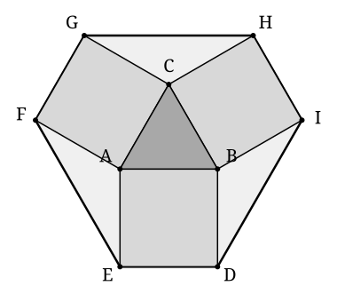

## Statement

$ABC$ est un triangle équilatéral de côté $1$. On construit à l'**extérieur** du triangle trois carrés, un sur chaque côté :

- le carré $ABDE$ sur le côté $[AB]$ ;
- le carré $BCHI$ sur le côté $[BC]$ ;
- le carré $CAFG$ sur le côté $[CA]$.

Calculer l'aire de l'hexagone $DEFGHI$.

## Hints

1. L'hexagone se découpe en morceaux que l'on connaît déjà : le triangle, les trois carrés, et trois pièces qui restent. Combien y a-t-il de pièces en tout ?
2. Les trois pièces restantes sont des triangles. Où se trouvent leurs sommets ?
3. Regarde la pièce qui a son sommet en $A$ : c'est le triangle $AEF$. Combien valent $AE$ et $AF$ ?
4. Autour du point $A$, les angles font un tour complet, soit $360°$. Trois de ces angles sont connus : deux angles droits et un angle du triangle équilatéral. Que vaut le quatrième ?
5. Pour l'aire d'un triangle isocèle de côtés $1$, $1$ et d'angle au sommet $120°$, trace la hauteur issue du sommet : elle coupe l'angle en deux angles de $60°$.

## Solution

**Le découpage.**

L'hexagone $DEFGHI$ se partage en sept morceaux qui ne se recouvrent pas :

- le triangle équilatéral $ABC$ ;
- les trois carrés $ABDE$, $BCHI$ et $CAFG$ ;
- trois triangles « de coin », un à chaque sommet du triangle : $AEF$ au sommet $A$, $BID$ au sommet $B$ et $CGH$ au sommet $C$.

**Aire du triangle équilatéral.**

Pour un triangle équilatéral de côté $a$, la hauteur vaut $\dfrac{a\sqrt3}{2}$, donc l'aire vaut $\dfrac{a^2\sqrt3}{4}$. Ici $a = 1$ :

$$\mathcal{A}_{ABC} = \frac{\sqrt3}{4} .$$

**Aire des trois carrés.**

Chaque carré a pour côté $1$, donc pour aire $1$. Les trois ensemble :

$$3 \times 1 = 3 .$$

**Les triangles de coin.**

Prenons celui du sommet $A$, c'est-à-dire $AEF$.

Le segment $[AE]$ est un côté du carré $ABDE$, donc $AE = 1$. Le segment $[AF]$ est un côté du carré $CAFG$, donc $AF = 1$. Le triangle $AEF$ est donc isocèle de côtés $1$ et $1$.

Autour du point $A$, quatre angles se succèdent et font un tour complet :

$$\underbrace{\widehat{EAB}}_{90°} + \underbrace{\widehat{BAC}}_{60°} + \underbrace{\widehat{CAF}}_{90°} + \widehat{FAE} = 360° ,$$

d'où

$$\widehat{FAE} = 360° - 90° - 60° - 90° = 120° .$$

*Son aire.* Traçons la hauteur issue de $A$ dans le triangle isocèle $AEF$. Elle est aussi bissectrice de l'angle au sommet et médiatrice de $[EF]$ : elle coupe l'angle de $120°$ en deux angles de $60°$, et coupe $[EF]$ en son milieu $M$.

Dans le triangle rectangle $AME$ :

$$EM = AE \times \sin(60°) = \frac{\sqrt3}{2}, \qquad AM = AE \times \cos(60°) = \frac12 .$$

Donc $EF = 2 \times EM = \sqrt3$, et

$$\mathcal{A}_{AEF} = \frac{EF \times AM}{2} = \frac{\sqrt3 \times \frac12}{2} = \frac{\sqrt3}{4} .$$

Par symétrie, les triangles $BID$ et $CGH$ sont identiques à $AEF$ : ils ont eux aussi deux côtés de longueur $1$ et un angle de $120°$ entre eux. Les trois ensemble :

$$3 \times \frac{\sqrt3}{4} = \frac{3\sqrt3}{4} .$$

**On additionne.**

$$\mathcal{A}_{DEFGHI} = \underbrace{\frac{\sqrt3}{4}}_{\text{triangle}} + \underbrace{3}_{\text{carrés}} + \underbrace{\frac{3\sqrt3}{4}}_{\text{coins}} = 3 + \frac{\sqrt3}{4} + \frac{3\sqrt3}{4} = 3 + \sqrt3 .$$

**Conclusion.** L'aire de l'hexagone $DEFGHI$ vaut

$$3 + \sqrt{3} \approx \text{4,73} .$$

Curieusement, le triangle équilatéral de départ, qui a pourtant lancé toute la construction, ne pèse que $\dfrac{\sqrt3}{4} \approx \text{0,43}$ dans ce total : c'est moins d'un dixième.

## Going further

1. Vérifier que les trois triangles de coin ont exactement la même aire que le triangle équilatéral de départ.
2. Reprendre le calcul pour un triangle équilatéral de côté $a$ : l'aire de l'hexagone est-elle proportionnelle à $a$ ou à $a^2$ ?
3. Faire la même construction sur un **carré** de côté $1$ : quatre carrés extérieurs, et l'octogone obtenu en joignant leurs sommets extérieurs. Quelle est son aire ?
