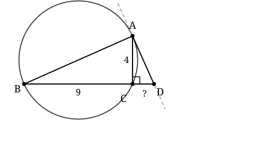

## Statement

Trois points $A$, $B$ et $C$ appartiennent à un même cercle.

On prolonge le segment $[BC]$ au-delà de $C$ jusqu'à un point $D$ tel que la droite $(AD)$ soit tangente au cercle en $A$.

On sait que $AC = 4$, que $BC = 9$ et que l'angle $\widehat{ACD}$ est droit.

Combien vaut $CD$ ?

## Hints

1. Les points $B$, $C$ et $D$ sont alignés. Que peux-tu dire de l'angle $\widehat{ACB}$ ?
2. Un triangle inscrit dans un cercle et rectangle en $C$ : où se trouve le centre du cercle ? Que représente $[AB]$ pour ce cercle ?
3. Une tangente est perpendiculaire au rayon qui aboutit au point de contact. Quel angle du triangle $ABD$ cela rend-il droit ?
4. Cherche maintenant deux triangles semblables contenant les longueurs $AC$, $BC$ et $CD$.

## Solution

**Étape 1. Un second angle droit.**

Les points $B$, $C$ et $D$ sont alignés, et $C$ est entre $B$ et $D$. Les angles $\widehat{ACB}$ et $\widehat{ACD}$ sont donc supplémentaires :

$$\widehat{ACB} = 180° - \widehat{ACD} = 180° - 90° = 90°$$

Le triangle $ABC$ est donc rectangle en $C$.

**Étape 2. $[AB]$ est un diamètre.**

Le cercle de l'énoncé passe par $A$, $B$ et $C$ : c'est le cercle circonscrit au triangle $ABC$.

Or le centre du cercle circonscrit à un triangle rectangle est le milieu de son hypoténuse. Comme le triangle $ABC$ est rectangle en $C$, son hypoténuse est $[AB]$, donc le centre $O$ du cercle est le milieu de $[AB]$, et $[AB]$ est un diamètre.

**Étape 3. Le triangle $ABD$ est rectangle en $A$.**

La droite $(AD)$ est tangente au cercle en $A$, donc elle est perpendiculaire au rayon $[OA]$.

Comme $O$ est sur le segment $[AB]$, la droite $(OA)$ est la droite $(AB)$. Donc $(AD) \perp (AB)$ :

$$\widehat{BAD} = 90°$$

Le triangle $ABD$ est rectangle en $A$, et $[AC]$ en est la hauteur issue de $A$, puisque $(AC) \perp (BD)$.

**Étape 4. Deux triangles semblables.**

Comparons les triangles $ACD$ et $BCA$.

- Ils ont chacun un angle droit en $C$ : $\widehat{ACD} = \widehat{BCA} = 90°$.
- Dans le triangle $ACD$, la somme des angles donne $\widehat{CAD} = 90° - \widehat{ADC}$.
- Dans le triangle $ABD$, rectangle en $A$, on a de même $\widehat{ABD} = 90° - \widehat{ADB}$. Or $\widehat{ADB}$ et $\widehat{ADC}$ sont le même angle, puisque $C$ est sur $[BD]$.

Donc $\widehat{CAD} = \widehat{ABD} = \widehat{CBA}$.

Les triangles $ACD$ et $BCA$ ont deux angles égaux deux à deux : ils sont semblables, avec la correspondance

$$A \leftrightarrow B, \qquad C \leftrightarrow C, \qquad D \leftrightarrow A$$

**Étape 5. Écrire les rapports et conclure.**

Cette correspondance donne l'égalité des rapports des côtés homologues :

$$\frac{AC}{BC} = \frac{CD}{CA}$$

En remplaçant par les valeurs de l'énoncé :

$$\frac{4}{9} = \frac{CD}{4}$$

$$CD = \frac{4 \times 4}{9} = \frac{16}{9}$$

**Réponse.** $CD = \dfrac{16}{9}$, c'est-à-dire environ $\text{1,78}$.

**Vérification.** On peut refaire le calcul autrement. Dans le triangle $ABD$ rectangle en $A$, la hauteur $[AC]$ issue de l'angle droit vérifie la relation

$$AC^2 = CB \times CD$$

soit $16 = 9 \times CD$, donc $CD = \dfrac{16}{9}$. On retrouve bien le même résultat.

## Going further

Toutes les autres longueurs de la figure se calculent maintenant. Le diamètre vaut

$$AB = \sqrt{AC^2 + BC^2} = \sqrt{16 + 81} = \sqrt{97}$$

et dans le triangle $ACD$ rectangle en $C$ :

$$AD = \sqrt{AC^2 + CD^2} = \sqrt{16 + \frac{256}{81}} = \sqrt{\frac{1296 + 256}{81}} = \frac{\sqrt{1552}}{9} = \frac{4\sqrt{97}}{9}$$

On vérifie au passage que $AD^2 = DC \times DB$ : en effet $DC \times DB = \frac{16}{9} \times \left(\frac{16}{9} + 9\right) = \frac{16}{9} \times \frac{97}{9} = \frac{1552}{81}$. C'est la relation de la puissance d'un point par rapport à un cercle, appliquée au point $D$.
