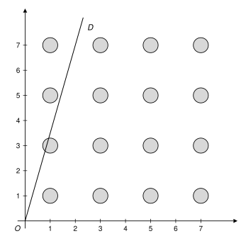

## Statement

Un observateur se trouve dans une forêt parfaitement régulière, où tous les troncs d'arbres ont le
même diamètre. On ne tient pas compte de la hauteur, ce qui ramène à un problème dans le plan,
muni d'un repère orthonormé. L'observateur est à l'origine $O$, et les troncs sont représentés par
des cercles de même rayon $R > 0$, centrés aux points de coordonnées $(a, b)$ où $a$ et $b$ sont
des entiers impairs. On veut savoir ce que voit l'observateur.

Pour des raisons de symétrie, on se restreint au quart de plan $x > 0$, $y > 0$ : on ne regarde que
les demi-droites issues de $O$ contenues dans ce quart de plan, et on ne tient compte que des arbres
plantés dans ce quart de plan, c'est-à-dire centrés en $(a, b)$ avec $a$ et $b$ entiers naturels
impairs. On dit que l'observateur **voit à travers la forêt** s'il existe une telle demi-droite qui
ne rencontre aucun des cercles.

Pour tout réel $m > 0$, on note $\mathcal{D}_m$ la demi-droite formée des points $(x, mx)$ avec
$x > 0$. Ce sont exactement les demi-droites issues de $O$ contenues dans le quart de plan.

**On admet le résultat suivant :** si $m$ est un nombre irrationnel positif, alors pour tout réel
$\varepsilon > 0$, il existe deux entiers naturels impairs $a$ et $b$ tels que
$\lvert b - ma \rvert \leqslant \varepsilon$.

1. Soit $a$, $b$, $m$ des réels strictement positifs. Montrer que $\mathcal{D}_m$ rencontre le
   cercle de rayon $R$ centré en $(a, b)$ si et seulement si
   $\lvert b - ma \rvert \leqslant R\sqrt{1 + m^2}$.
2. En déduire que si $m$ est irrationnel, alors $\mathcal{D}_m$ rencontre un arbre.
3. On suppose que $m = \frac{b}{a}$, où $a$ et $b$ sont des entiers naturels non nuls premiers
   entre eux.

   a) On suppose que $a$ et $b$ sont impairs. La demi-droite $\mathcal{D}_m$ rencontre-t-elle un
   arbre ?

   b) On suppose que $a$ et $b$ sont de parités différentes et que $\mathcal{D}_m$ rencontre un
   arbre. Montrer que $1 \leqslant R\sqrt{a^2 + b^2}$.

4. En déduire que si toutes les demi-droites $\mathcal{D}_m$, avec $m > 0$, rencontrent un arbre,
   alors $R \geqslant \frac{1}{\sqrt{5}}$.
5. On suppose réciproquement que $R \geqslant \frac{1}{\sqrt{5}}$. Montrer que toute demi-droite
   $\mathcal{D}_m$, avec $m > 0$, rencontre un arbre planté en un point $(\alpha, 1)$ ou en un point
   $(1, \alpha)$, où $\alpha$ est un entier naturel impair.

On appelle **première rangée** d'arbres l'ensemble des arbres plantés aux points $(\alpha, 1)$ et
$(1, \alpha)$, où $\alpha$ est un entier naturel impair.

6. Conclure que si l'observateur voit à travers la première rangée, alors il voit à travers la
   forêt.

## Hints

1. **Question 1.** Notons $P = (a, b)$ et $Q = (a, ma)$ le point de $\mathcal{D}_m$ qui a la même
   abscisse que $P$. Calculer l'aire du triangle $OPQ$ de deux façons pour trouver la distance de
   $P$ à la droite $(OQ)$.
2. **Question 1.** Soit $H$ le pied de la perpendiculaire à $(OQ)$ passant par $P$. La demi-droite
   rencontre le cercle exactement quand $PH \leqslant R$. Pour le prouver, utiliser le théorème de
   Pythagore dans un triangle $PHM$, où $M$ est un point de la droite.
3. **Question 2.** Appliquer le résultat admis avec un $\varepsilon$ bien choisi.
4. **Question 3b.** Si $\mathcal{D}_m$ rencontre l'arbre planté en $(\alpha, \beta)$, écrire
   l'inégalité de la question 1 et la multiplier par $a$. Le nombre $a\beta - b\alpha$ est un
   entier : quelle est sa parité ?
5. **Question 4.** Choisir une valeur de $m$ très simple à laquelle appliquer la question 3b.
6. **Question 5.** Pour $m \geqslant 1$, chercher l'arbre parmi ceux plantés en $(1, \alpha)$ : il
   faut un entier impair $\alpha$ assez proche de $m$. Séparer les cas $1 \leqslant m \leqslant 2$
   (essayer $\alpha = 1$) et $m \geqslant 2$.
7. **Question 5.** Pour $m < 1$, chercher l'arbre parmi ceux plantés en $(\alpha, 1)$, et diviser
   l'inégalité de la question 1 par $m$ pour se ramener au cas précédent avec $\frac{1}{m}$.
8. **Question 6.** Que dit la question 5 si une demi-droite traverse la première rangée ? Puis
   regarder la demi-droite $\mathcal{D}_2$.

## Solution

**1.** Notons $P = (a, b)$ le centre du cercle, $Q = (a, ma)$ le point de $\mathcal{D}_m$ de même
abscisse que $P$, et $d$ la distance de $P$ à la droite $(OQ)$, c'est-à-dire la longueur $PH$, où
$H$ est le pied de la perpendiculaire à $(OQ)$ passant par $P$.

*Calcul de $d$.* Si $P = Q$, alors $b = ma$ et $d = 0$. Sinon, calculons l'aire $\mathcal{A}$ du
triangle $OPQ$ de deux façons.

- Le côté $[PQ]$ est vertical, de longueur $\lvert b - ma \rvert$, et la hauteur issue de $O$ est
  la distance de $O$ à la droite verticale $x = a$, c'est-à-dire $a$. Donc
  $\mathcal{A} = \frac{1}{2}\, a \lvert b - ma \rvert$.
- Le côté $[OQ]$ a pour longueur $OQ = \sqrt{a^2 + m^2 a^2} = a\sqrt{1 + m^2}$, et la hauteur
  issue de $P$ est $d$. Donc $\mathcal{A} = \frac{1}{2}\, a\sqrt{1 + m^2}\, d$.

En égalant les deux expressions et en simplifiant par $\frac{a}{2} > 0$, on obtient
$$d = \frac{\lvert b - ma \rvert}{\sqrt{1 + m^2}}.$$
Cette formule reste vraie si $P = Q$. La condition $\lvert b - ma \rvert \leqslant R\sqrt{1 + m^2}$
s'écrit donc simplement $d \leqslant R$.

*Le point $H$ est sur la demi-droite.* Si $P$ est sur la droite, $H = P = Q$, qui est sur
$\mathcal{D}_m$. Sinon, les demi-droites $[OP)$ et $\mathcal{D}_m$ sont toutes deux dans le quart de
plan $x > 0$, $y > 0$, qui forme un angle droit en $O$ ; l'angle $\widehat{POQ}$ qu'elles forment
est donc aigu. Le point $H$ ne peut pas être $O$ : l'angle $\widehat{POQ}$ serait alors droit. Il ne
peut pas non plus être sur l'autre demi-droite, celle qui part de $O$ dans la direction opposée à
$\mathcal{D}_m$ : le triangle $OHP$, rectangle en $H$, aurait un angle aigu $\widehat{POH}$, et
l'angle $\widehat{POQ} = 180^\circ - \widehat{POH}$ serait obtus. Donc $H$ appartient à
$\mathcal{D}_m$.

*Si $d > R$.* Pour tout point $M$ de la droite $(OQ)$ autre que $H$, le triangle $PHM$ est rectangle
en $H$, donc $PM^2 = PH^2 + HM^2 \geqslant d^2 > R^2$. Ainsi $PM > R$ pour tout point $M$ de la droite
(y compris $M = H$) : la demi-droite ne rencontre pas le cercle.

*Si $d \leqslant R$.* Plaçons sur $\mathcal{D}_m$, au-delà de $H$ (du côté opposé à $O$), le point $M$
tel que $HM = \sqrt{R^2 - d^2}$. Il est bien sur la demi-droite, et par le théorème de Pythagore
(ou directement si $M = H$),
$$PM^2 = PH^2 + HM^2 = d^2 + R^2 - d^2 = R^2,$$
donc $M$ est sur le cercle.

**Conclusion :** $\mathcal{D}_m$ rencontre le cercle de rayon $R$ centré en $(a, b)$ si et
seulement si $\lvert b - ma \rvert \leqslant R\sqrt{1 + m^2}$.

**2.** Soit $m$ irrationnel positif. Appliquons le résultat admis avec
$\varepsilon = R\sqrt{1 + m^2}$, qui est strictement positif : il existe des entiers naturels
impairs $a$ et $b$ tels que $\lvert b - ma \rvert \leqslant R\sqrt{1 + m^2}$. Ces entiers impairs
sont au moins égaux à $1$, donc $(a, b)$ est le centre d'un arbre du quart de plan, et d'après la
question 1, $\mathcal{D}_m$ rencontre cet arbre.

**3. a)** Oui. Le point $(a, b)$ est le centre d'un arbre, car $a$ et $b$ sont des entiers naturels
impairs, et il est sur $\mathcal{D}_m$ puisque $b = ma$. Avec la question 1 :
$\lvert b - ma \rvert = 0 \leqslant R\sqrt{1 + m^2}$, donc $\mathcal{D}_m$ rencontre cet arbre. (La
demi-droite passe par le centre du cercle, elle le rencontre forcément.)

**b)** Supposons que $\mathcal{D}_m$ rencontre l'arbre centré en $(\alpha, \beta)$, avec $\alpha$ et
$\beta$ entiers naturels impairs. D'après la question 1,
$$\left\lvert \beta - \frac{b}{a}\,\alpha \right\rvert \leqslant R\sqrt{1 + \frac{b^2}{a^2}} = \frac{R\sqrt{a^2 + b^2}}{a}.$$
En multipliant par $a > 0$, on obtient $\lvert a\beta - b\alpha \rvert \leqslant R\sqrt{a^2 + b^2}$.

Le nombre $a\beta - b\alpha$ est un entier. Comme $\alpha$ et $\beta$ sont impairs, $a\beta$ a la
même parité que $a$, et $b\alpha$ la même parité que $b$. Puisque $a$ et $b$ sont de parités
différentes, $a\beta - b\alpha$ est impair. Il n'est donc pas nul, et
$\lvert a\beta - b\alpha \rvert \geqslant 1$.

**Conclusion :** $1 \leqslant \lvert a\beta - b\alpha \rvert \leqslant R\sqrt{a^2 + b^2}$.

**4.** Prenons $m = 2 = \frac{2}{1}$, c'est-à-dire $a = 1$ et $b = 2$, premiers entre eux et de
parités différentes. Si $\mathcal{D}_2$ rencontre un arbre, la question 3b donne
$1 \leqslant R\sqrt{1 + 4} = R\sqrt{5}$, donc $R \geqslant \frac{1}{\sqrt{5}}$.

**Conclusion :** si toutes les demi-droites rencontrent un arbre, en particulier $\mathcal{D}_2$,
alors $R \geqslant \frac{1}{\sqrt{5}}$.

**5.** Supposons $R \geqslant \frac{1}{\sqrt{5}}$, et soit $m > 0$.

*Cas $m \geqslant 1$ : un arbre $(1, \alpha)$.* D'après la question 1, $\mathcal{D}_m$ rencontre
l'arbre planté en $(1, \alpha)$ si $\lvert \alpha - m \rvert \leqslant R\sqrt{1 + m^2}$. Comme
$R\sqrt{1 + m^2} \geqslant \frac{\sqrt{1 + m^2}}{\sqrt{5}}$, il suffit de trouver un entier naturel
impair $\alpha$ tel que
$$\lvert \alpha - m \rvert \leqslant \frac{\sqrt{1 + m^2}}{\sqrt{5}}, \quad \text{c'est-à-dire} \quad 5(\alpha - m)^2 \leqslant 1 + m^2 .$$

- Si $1 \leqslant m \leqslant 2$, prenons $\alpha = 1$. On a
  $1 + m^2 - 5(m - 1)^2 = -4m^2 + 10m - 4 = -2(2m - 1)(m - 2)$. Pour $1 \leqslant m \leqslant 2$,
  on a $2m - 1 > 0$ et $m - 2 \leqslant 0$, donc cette quantité est positive ou nulle : l'arbre
  $(1, 1)$ convient.
- Si $m \geqslant 2$, le réel $m$ est compris entre deux entiers impairs consécutifs
  $2q - 1 \leqslant m \leqslant 2q + 1$, avec $q \geqslant 1$. Ces deux impairs sont à distance $2$
  l'un de l'autre, donc l'un d'eux, noté $\alpha$, vérifie $\lvert \alpha - m \rvert \leqslant 1$. Or
  $1 + m^2 \geqslant 5$, donc $\frac{\sqrt{1 + m^2}}{\sqrt{5}} \geqslant 1 \geqslant \lvert \alpha - m \rvert$ :
  l'arbre $(1, \alpha)$ convient.

*Cas $0 < m < 1$ : un arbre $(\alpha, 1)$.* Posons $m' = \frac{1}{m}$, qui est supérieur à $1$.
D'après la question 1, $\mathcal{D}_m$ rencontre l'arbre planté en $(\alpha, 1)$ si
$\lvert 1 - m\alpha \rvert \leqslant R\sqrt{1 + m^2}$. En divisant par $m > 0$, cette condition
s'écrit
$$\lvert m' - \alpha \rvert \leqslant R\,\frac{\sqrt{1 + m^2}}{m} = R\sqrt{\frac{1}{m^2} + 1} = R\sqrt{1 + m'^2}.$$
C'est exactement la condition du cas précédent pour la pente $m' \geqslant 1$ : il existe donc un
entier naturel impair $\alpha$ qui la vérifie. (Géométriquement, la symétrie par rapport à la droite
$y = x$ échange $\mathcal{D}_m$ et $\mathcal{D}_{1/m}$, et les arbres $(\alpha, 1)$ et $(1, \alpha)$.)

**Conclusion :** si $R \geqslant \frac{1}{\sqrt{5}}$, toute demi-droite $\mathcal{D}_m$ rencontre un
arbre de la première rangée.

**6.** Supposons que l'observateur voie à travers la première rangée : il existe un $m > 0$ tel que
$\mathcal{D}_m$ ne rencontre aucun arbre de la première rangée. D'après la question 5, on ne peut
pas avoir $R \geqslant \frac{1}{\sqrt{5}}$, donc $R < \frac{1}{\sqrt{5}}$.

Alors $\mathcal{D}_2$ ne rencontre aucun arbre de la forêt : si elle en rencontrait un, la
question 3b (avec $a = 1$, $b = 2$) donnerait $R \geqslant \frac{1}{\sqrt{5}}$. L'observateur voit
donc à travers la forêt, dans la direction de pente $2$.

**Conclusion :** si l'observateur voit à travers la première rangée, il voit à travers la forêt.

**Bilan.** L'observateur voit à travers la forêt si et seulement si $R < \frac{1}{\sqrt{5}}$ : dans
ce cas, il voit à travers dans la direction de pente $2$ (et, par symétrie, de pente
$\frac{1}{2}$), et si $R \geqslant \frac{1}{\sqrt{5}}$, la première rangée suffit déjà à tout
cacher. Les directions de pente irrationnelle, ou de pente $\frac{b}{a}$ avec $a$ et $b$ impairs, sont
toujours bouchées.

## Going further

- Que devient le résultat si les arbres sont plantés en **tous** les points à coordonnées entières
  du quart de plan, et pas seulement aux points à coordonnées impaires ?
- Pour $R < \frac{1}{\sqrt{5}}$, quelles pentes autres que $2$ et $\frac{1}{2}$ permettent de voir à
  travers la forêt ? La question 3b montre que la pente $\frac{b}{a}$, avec $a$ et $b$ premiers
  entre eux et de parités différentes, est dégagée dès que $R\sqrt{a^2 + b^2} < 1$. En classe de
  terminale, avec le théorème de Bézout, on peut montrer qu'elle est bouchée dans le cas contraire.
- Les arbres hors du quart de plan ne changent rien à la conclusion : quand $R < \frac{1}{\sqrt{5}}$,
  un arbre centré en $(a, b)$ avec $a \leqslant -1$ ou $b \leqslant -1$ reste entièrement hors du
  quart de plan, puisque $R < 1$.
