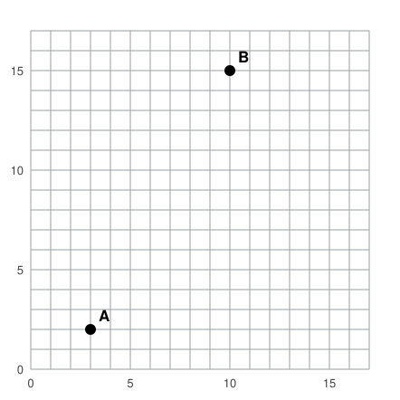
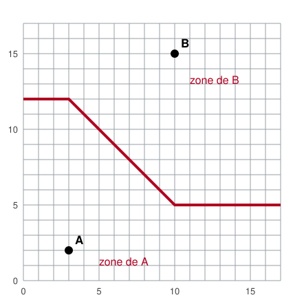

## Statement

La ville de Quadrillon est bâtie sur un quadrillage parfait. Un carrefour est repéré par deux nombres entiers $(x\,;\,y)$, avec $0 \leqslant x \leqslant 17$ et $0 \leqslant y \leqslant 17$. Les camions de pompiers **ne peuvent rouler que dans les rues** : la distance de $P(x_1\,;\,y_1)$ à $Q(x_2\,;\,y_2)$ pour un camion vaut donc
$$d(P, Q) = |x_2 - x_1| + |y_2 - y_1| ,$$
comptée en pâtés de maisons.

La ville a deux casernes : $A(3\,;\,2)$ et $B(10\,;\,15)$.

Le maire veut afficher une carte qui dit, pour chaque carrefour de la ville, quelle caserne doit s'en occuper : celle dont le camion arrive le premier.

**a)** Vérifier que le carrefour $(0\,;\,12)$ est à la même distance des deux casernes.

**b)** Déterminer **tous** les carrefours situés à égale distance de $A$ et de $B$.

**c)** En déduire la carte : quelle est la zone de $A$, quelle est la zone de $B$ ?

**d)** La frontière obtenue est-elle la médiatrice du segment $[AB]$ ?

## Hints

1. Pour un point $M(x\,;\,y)$, écris $d(A, M)$ et $d(B, M)$ avec des valeurs absolues, puis étudie la différence $d(A,M) - d(B,M)$.
2. Cette différence se coupe en deux morceaux indépendants : un morceau qui ne dépend que de $x$, et un morceau qui ne dépend que de $y$. Traite-les séparément.
3. Pour $|x - 3| - |x - 10|$, distingue trois cas : $x \leqslant 3$, puis $3 \leqslant x \leqslant 10$, puis $x \geqslant 10$. Que vaut cette expression dans chaque cas ? Entre quelles bornes reste-t-elle toujours ?
4. Fais la même chose pour $|y - 2| - |y - 15|$, avec les cas $y \leqslant 2$, $2 \leqslant y \leqslant 15$, $y \geqslant 15$.
5. Pour $x$ fixé, le morceau en $y$ est croissant : la différence change de signe une seule fois. Il suffit donc de trouver, pour chaque $x$, la hauteur où elle s'annule.
6. Attention à une surprise : la réponse n'est pas une droite, et ce n'est pas non plus un ensemble de points isolés.

## Solution

**a) Le carrefour $(0\,;\,12)$.**

$$d(A, (0\,;\,12)) = |0 - 3| + |12 - 2| = 3 + 10 = 13, \qquad d(B, (0\,;\,12)) = |0 - 10| + |12 - 15| = 10 + 3 = 13 .$$

Les deux camions mettent le même temps.

**b) Tous les carrefours à égale distance.**

Soit $M(x\,;\,y)$. On étudie
$$\Delta = d(A, M) - d(B, M) = \underbrace{\big(|x - 3| - |x - 10|\big)}_{\text{ne dépend que de } x} + \underbrace{\big(|y - 2| - |y - 15|\big)}_{\text{ne dépend que de } y} .$$

*Le morceau en $x$.* On l'appelle $u(x)$.

| si | $|x-3|$ | $|x-10|$ | $u(x)$ |
|---|---|---|---|
| $x \leqslant 3$ | $3 - x$ | $10 - x$ | $-7$ |
| $3 \leqslant x \leqslant 10$ | $x - 3$ | $10 - x$ | $2x - 13$ |
| $x \geqslant 10$ | $x - 3$ | $x - 10$ | $7$ |

Au milieu, $2x - 13$ va de $-7$ (pour $x = 3$) à $7$ (pour $x = 10$). Donc $u(x)$ reste toujours entre $-7$ et $7$.

*Le morceau en $y$.* On l'appelle $v(y)$, et le calcul est le même.

| si | $v(y)$ |
|---|---|
| $y \leqslant 2$ | $-13$ |
| $2 \leqslant y \leqslant 15$ | $2y - 17$ |
| $y \geqslant 15$ | $13$ |

La fonction $v$ est croissante, et elle reste entre $-13$ et $13$.

*Les points d'égale distance.* Ils vérifient $u(x) + v(y) = 0$.

- Si $y \leqslant 2$ : $v(y) = -13$ et $u(x) \leqslant 7$, donc $\Delta \leqslant -6 < 0$. La caserne $A$ est strictement plus proche, jamais d'égalité.
- Si $y \geqslant 15$ : $v(y) = 13$ et $u(x) \geqslant -7$, donc $\Delta \geqslant 6 > 0$. La caserne $B$ est strictement plus proche.
- Si $2 \leqslant y \leqslant 15$, alors $v(y) = 2y - 17$ et l'égalité s'écrit $2y - 17 = -u(x)$, c'est-à-dire
$$y = \frac{17 - u(x)}{2} .$$

Il reste à remplacer $u(x)$ par sa valeur dans les trois zones :

- si $x \leqslant 3$ : $u(x) = -7$ donc $y = \dfrac{17 + 7}{2} = 12$ ;
- si $3 \leqslant x \leqslant 10$ : $u(x) = 2x - 13$ donc $y = \dfrac{17 - 2x + 13}{2} = 15 - x$ ;
- si $x \geqslant 10$ : $u(x) = 7$ donc $y = \dfrac{17 - 7}{2} = 5$.

Dans les trois cas la hauteur trouvée est bien comprise entre $2$ et $15$, donc tous ces points conviennent.

**Les carrefours à égale distance des deux casernes sont donc :**

- ceux de la rue horizontale $y = 12$, pour $x$ de $0$ à $3$ ;
- ceux de la diagonale $y = 15 - x$, pour $x$ de $3$ à $10$ (soit $(3\,;\,12)$, $(4\,;\,11)$, ..., $(10\,;\,5)$) ;
- ceux de la rue horizontale $y = 5$, pour $x$ de $10$ à $17$.

**c) La carte.**

Pour $x$ fixé, la fonction $v$ est croissante, donc $\Delta$ augmente quand on monte. Au-dessous de la frontière, $\Delta < 0$ : la caserne $A$ est plus proche. Au-dessus, $\Delta > 0$ : c'est $B$.

Par exemple, en $(7\,;\,7)$ : $d(A,M) = 4 + 5 = 9$ et $d(B,M) = 3 + 8 = 11$, donc c'est $A$ ; et en $(7\,;\,9)$ : $d(A,M) = 4+7 = 11$ et $d(B,M) = 3+6 = 9$, donc c'est $B$. Ces deux carrefours encadrent bien le point $(7\,;\,8)$ de la frontière.

**d) Comparaison avec la médiatrice.**

Non, ce n'est pas la médiatrice de $[AB]$. La médiatrice est une droite ; ici la frontière est une ligne brisée, formée de deux demi-droites horizontales et d'un morceau de diagonale.

Il y a même plus étonnant : sur les deux parties horizontales, **des segments entiers de rue** sont à égale distance des deux casernes. En géométrie ordinaire, l'ensemble des points équidistants de deux points est une droite, jamais une bande ni une ligne brisée. Ce que montre cet exercice, c'est que la forme de la « médiatrice » dépend de la façon dont on mesure les distances.

On peut noter au passage que la frontière passe bien par le milieu de $[AB]$, le point $(\text{6,5}\,;\,\text{8,5})$ : il est sur la partie diagonale, puisque $15 - \text{6,5} = \text{8,5}$.

## Going further

1. La ville construit une troisième caserne $C(15\,;\,6)$. Comment la carte change-t-elle ?
2. Où faudrait-il placer une caserne unique pour que le carrefour le plus mal desservi de la ville soit le moins loin possible ?
3. Que devient la frontière si les deux casernes sont placées sur une même rue horizontale ? Et si elles sont aux deux bouts d'une diagonale, comme $(0\,;\,0)$ et $(6\,;\,6)$ ?
