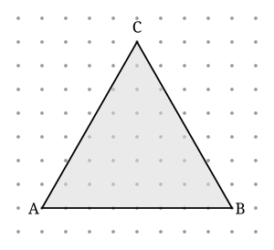

## Statement

On appelle **nœud** un point du plan dont les deux coordonnées sont des entiers.

Peut-on tracer un **triangle équilatéral** dont les trois sommets sont des nœuds ?

Attention : rien n'oblige le triangle à avoir un côté horizontal, et rien n'oblige ses côtés à
être courts. Il faut donc répondre pour toutes les positions à la fois.

*On utilisera librement le théorème de Pick : pour un polygone dont tous les sommets sont des
nœuds et dont les côtés ne se croisent pas,*
$$A = I + \frac{B}{2} - 1 ,$$
*où $A$ est l'aire, $I$ le nombre de nœuds strictement intérieurs et $B$ le nombre de nœuds du
bord.*

## Hints

1. Essaie d'abord quelques triangles, tu vas t'apercevoir qu'on s'approche sans jamais y
   arriver. Cela oriente vers un raisonnement par l'absurde : suppose qu'un tel triangle
   existe et cherche la contradiction.
2. Deux nœuds étant donnés, que peut-on dire du **carré** de la distance qui les sépare ?
3. Écris l'aire d'un triangle équilatéral de côté $s$ en fonction de $s$. *(Indication : trace
   une hauteur et applique le théorème de Pythagore.)*
4. Le théorème de Pick dit quelque chose de très fort sur l'aire d'un polygone sur nœuds : ce
   n'est pas n'importe quel nombre. Lequel exactement ?
5. Tu obtiens deux renseignements incompatibles sur le même nombre. Il ne reste qu'à savoir si
   $\sqrt{3}$ est un nombre rationnel.

## Solution

**La réponse est non : un tel triangle n'existe pas.**

Raisonnons par l'absurde et supposons qu'il existe un triangle équilatéral $ABC$ dont les
trois sommets sont des nœuds. Notons $s$ la longueur de son côté.

**Premier fait : $s^2$ est un entier strictement positif.**

Les points $A$ et $B$ ont des coordonnées entières. En notant $p$ et $q$ les différences de
leurs abscisses et de leurs ordonnées, ce sont deux entiers, et le théorème de Pythagore donne

$$s^2 = p^2 + q^2 .$$

C'est donc un entier, et il est strictement positif puisque $A \ne B$.

**Deuxième fait : l'aire du triangle vaut $\dfrac{s^2\sqrt{3}}{4}$.**

Traçons la hauteur issue de $C$ : dans un triangle équilatéral elle tombe au milieu de
$[AB]$ et la coupe en deux triangles rectangles de côtés $\dfrac{s}{2}$ et $h$, d'hypoténuse
$s$. Pythagore donne

$$h^2 = s^2 - \frac{s^2}{4} = \frac{3s^2}{4}, \qquad h = \frac{s\sqrt{3}}{2} ,$$

d'où

$$A = \frac{s \times h}{2} = \frac{s^2\sqrt{3}}{4} .$$

**Troisième fait : l'aire est un nombre rationnel.**

Le théorème de Pick s'applique, car les trois sommets sont des nœuds :

$$A = I + \frac{B}{2} - 1 .$$

Or $I$ et $B$ sont des entiers. Donc $A$ est un entier ou un entier plus un demi. Dans tous
les cas, **$A$ est un nombre rationnel**, et même $2A$ est un entier.

**La contradiction.**

En rapprochant les deux expressions de l'aire :

$$\frac{s^2\sqrt{3}}{4} = A, \qquad \text{donc} \qquad \sqrt{3} = \frac{4A}{s^2} .$$

À droite, $4A$ est rationnel et $s^2$ est un entier non nul : le quotient est **rationnel**.
Donc $\sqrt{3}$ serait rationnel. Or il ne l'est pas, comme on le montre maintenant.

**$\sqrt{3}$ est irrationnel.**

Supposons $\sqrt{3} = \dfrac{p}{q}$ avec $p$ et $q$ entiers strictement positifs, la fraction
étant déjà réduite au maximum, c'est-à-dire $\mathrm{PGCD}(p, q) = 1$. En élevant au carré :

$$p^2 = 3q^2 .$$

Donc $p^2$ est un multiple de $3$. Or si $p$ n'était pas un multiple de $3$, il s'écrirait
$p = 3a + 1$ ou $p = 3a + 2$, et alors

$$p^2 = 9a^2 + 6a + 1 = 3(3a^2 + 2a) + 1 \qquad \text{ou} \qquad p^2 = 9a^2 + 12a + 4 = 3(3a^2 + 4a + 1) + 1 ,$$

c'est-à-dire que $p^2$ laisserait le reste $1$ dans la division par $3$. Ce n'est pas le cas,
donc $p$ est un multiple de $3$ : écrivons $p = 3p_1$. Alors

$$9p_1^2 = 3q^2, \qquad \text{donc} \qquad q^2 = 3p_1^2 ,$$

et le même argument montre que $q$ est lui aussi un multiple de $3$. Mais alors $p$ et $q$
ont $3$ comme diviseur commun, ce qui contredit $\mathrm{PGCD}(p, q) = 1$.

Donc $\sqrt{3}$ est irrationnel, la contradiction est complète, et

$$\boxed{\text{aucun triangle équilatéral n'a ses trois sommets sur des nœuds.}}$$

**On s'en approche pourtant de très près.**

Le triangle $ABC$ ci-dessus a pour côtés $AB = 8$ et $AC = BC = \sqrt{65} \approx \text{8,06}$.
L'écart est inférieur à un pour cent, et l'œil ne le voit pas. Mais il est là, et la
démonstration dit qu'il y sera toujours, si loin qu'on cherche.

## Going further

1. Et un **carré** dont les quatre sommets sont des nœuds : est-ce possible ? Et un
   **hexagone régulier** ?
2. Montre plus généralement qu'un polygone régulier à $n$ côtés n'a ses sommets sur des nœuds
   que si $n = 4$.
3. Dans l'espace, on appelle nœud un point à trois coordonnées entières. Trouve un triangle
   équilatéral dont les trois sommets sont des nœuds de l'espace. *(Indication : regarde trois
   sommets bien choisis d'un cube.)*
