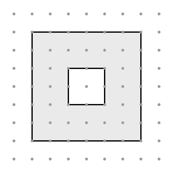

## Statement

On appelle **nœud** un point du plan dont les deux coordonnées sont des entiers. Le
**théorème de Pick** dit que l'aire d'un polygone dont tous les sommets sont des nœuds vaut

$$A = I + \frac{B}{2} - 1 ,$$

où $I$ compte les nœuds strictement intérieurs et $B$ les nœuds du bord. Il y a une condition
que l'on oublie souvent d'énoncer : le polygone ne doit pas avoir de trou.

Voici justement une figure avec un trou : un carré de $6$ sur $6$ dans lequel on a découpé un
carré de $2$ sur $2$. La partie grise est la figure, le carré blanc du milieu n'en fait pas
partie.

1. Calcule l'aire de la partie grise directement, puis compte $I$ et $B$ et calcule
   $I + \dfrac{B}{2} - 1$. Que constates-tu ?
2. On admet le théorème de Pick pour les polygones **sans** trou. Démontre que pour une figure
   à un trou, la formule correcte est
   $$A = I + \frac{B}{2} .$$
3. Que deviendrait la formule pour une figure à $n$ trous ?

## Hints

1. Pour compter $B$, n'oublie pas que le bord de la figure grise comporte **deux** lignes
   fermées : le grand carré et le petit.
2. Pour compter $I$, méfie-toi : les nœuds posés sur le bord du trou ne sont pas des nœuds
   intérieurs de la figure grise, ce sont des nœuds de son bord. Et le nœud du centre du trou
   n'est ni l'un ni l'autre : il n'appartient pas du tout à la figure.
3. Pour la question 2, donne des noms : $A_e$, $I_e$, $B_e$ pour le grand polygone extérieur
   seul (trou rebouché), et $A_t$, $I_t$, $B_t$ pour le polygone du trou seul. Écris la
   formule de Pick pour chacun d'eux : ils n'ont pas de trou, donc elle s'applique.
4. Exprime ensuite $A$, $I$ et $B$ de la figure trouée en fonction de ces six nombres. C'est
   le point délicat : un nœud du bord du trou compte dans $B$, mais il était un nœud
   **intérieur** du grand polygone.
5. Il ne reste plus qu'à calculer $I + \dfrac{B}{2} - 1$ et à faire apparaître
   $A_e - A_t$.

## Solution

**1. Ce que l'on constate sur l'exemple.**

L'aire de la partie grise vaut

$$A = 6 \times 6 - 2 \times 2 = 36 - 4 = 32 .$$

*Les nœuds du bord.* Le bord du grand carré porte $4 \times 6 = 24$ nœuds ; le bord du petit
carré en porte $4 \times 2 = 8$. Au total

$$B = 24 + 8 = 32 .$$

*Les nœuds intérieurs.* À l'intérieur du grand carré il y a $5 \times 5 = 25$ nœuds. Parmi
eux, $8$ sont sur le bord du trou (ce sont des nœuds du bord de la figure grise, pas de son
intérieur) et $1$ est au centre du trou (il n'appartient pas du tout à la figure grise). Il
reste

$$I = 25 - 8 - 1 = 16 .$$

*La formule de Pick, appliquée sans réfléchir :*

$$I + \frac{B}{2} - 1 = 16 + 16 - 1 = 31 .$$

**Elle se trompe exactement de $1$** : l'aire vaut $32$.

**2. La démonstration.**

Appelons $P_e$ le polygone extérieur, trou rebouché, et $P_t$ le polygone du trou. Ni l'un ni
l'autre n'a de trou, donc le théorème de Pick s'applique aux deux :

$$A_e = I_e + \frac{B_e}{2} - 1, \qquad A_t = I_t + \frac{B_t}{2} - 1 .$$

*Les aires.* La figure grise est $P_e$ privé de $P_t$, donc

$$A = A_e - A_t .$$

*Les nœuds du bord.* Le bord de la figure grise est fait du bord de $P_e$ et du bord de
$P_t$, qui sont disjoints, donc

$$B = B_e + B_t .$$

*Les nœuds intérieurs.* Un nœud est intérieur à la figure grise exactement lorsqu'il est
intérieur à $P_e$ **et** qu'il n'est ni sur le bord du trou ni dedans. Les nœuds intérieurs de
$P_e$ se répartissent donc en trois familles sans recouvrement : les $I$ nœuds intérieurs de
la figure grise, les $B_t$ nœuds du bord du trou, et les $I_t$ nœuds intérieurs du trou. D'où

$$I_e = I + B_t + I_t, \qquad \text{c'est-à-dire} \qquad I = I_e - B_t - I_t .$$

*Le calcul.*

$$I + \frac{B}{2} = (I_e - B_t - I_t) + \frac{B_e + B_t}{2} = I_e + \frac{B_e}{2} - I_t - \frac{B_t}{2} .$$

On reconnaît à droite les deux membres de droite des formules de Pick, à un $-1$ près chacun :

$$I_e + \frac{B_e}{2} = A_e + 1 \qquad \text{et} \qquad I_t + \frac{B_t}{2} = A_t + 1 .$$

Donc

$$I + \frac{B}{2} = (A_e + 1) - (A_t + 1) = A_e - A_t = A .$$

$$\boxed{\text{Avec un trou : } A = I + \frac{B}{2} .}$$

*Vérification sur l'exemple :* $16 + \dfrac{32}{2} = 16 + 16 = 32$. C'est bien l'aire.

**3. Avec $n$ trous.**

Le même calcul, avec $n$ polygones-trous $P_1$, ..., $P_n$ deux à deux disjoints à
l'intérieur de $P_e$, donne

$$A = A_e - (A_1 + \cdots + A_n), \qquad B = B_e + (B_1 + \cdots + B_n),$$

$$I = I_e - (B_1 + I_1) - \cdots - (B_n + I_n) ,$$

d'où, en regroupant comme ci-dessus,

$$I + \frac{B}{2} = (I_e + \frac{B_e}{2}) - (I_1 + \frac{B_1}{2}) - \cdots - (I_n + \frac{B_n}{2}) ,$$

c'est-à-dire

$$I + \frac{B}{2} = (A_e + 1) - (A_1 + 1) - \cdots - (A_n + 1) = A + 1 - n .$$

Autrement dit

$$\boxed{A = I + \frac{B}{2} - 1 + n .}$$

Chaque trou ajoute $1$ à la formule. Pour $n = 0$ on retrouve la formule de Pick ordinaire, et
pour $n = 1$ le $-1$ et le $+1$ se compensent, ce qui donne bien $A = I + \dfrac{B}{2}$.

## Going further

1. Fabrique une figure à deux trous et vérifie la formule dessus.
2. Le $-1 + n$ ressemble beaucoup au nombre qui apparaît dans la formule d'Euler pour les
   polyèdres. Ce n'est pas un hasard : renseigne-toi sur la **caractéristique d'Euler** d'une
   surface.
3. Une figure grise a $I = 0$, $B = 40$ et une aire de $22$. Combien a-t-elle de trous ?
