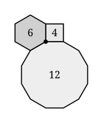

## Statement

Trois polygones réguliers, ayant respectivement $p$, $q$ et $r$ côtés, sont posés autour d'un
même point : ils se touchent deux à deux le long d'un côté entier, ils ne se chevauchent pas,
et ils ne laissent aucun trou autour du point.

Voici un exemple avec un carré, un hexagone régulier et un dodécagone régulier :

Trouve **tous** les triplets $(p, q, r)$ possibles, avec $3 \leqslant p \leqslant q \leqslant r$.

## Hints

1. Écris la mesure d'un angle d'un polygone régulier à $n$ côtés.
2. La condition « aucun trou et aucun chevauchement autour du point » se traduit par une seule
   égalité. Écris-la, puis divise tout par $180°$.
3. Tu devrais arriver à $\dfrac{1}{p} + \dfrac{1}{q} + \dfrac{1}{r} = \dfrac{1}{2}$. C'est une
   équation en nombres entiers : il n'y aura qu'un nombre fini de solutions.
4. Pour n'avoir qu'un nombre fini de cas à examiner, sers-toi de $p \leqslant q \leqslant r$ :
   la plus grande des trois fractions est $\dfrac{1}{p}$. Que peux-tu en déduire sur $p$ ?
5. Une fois $p$ fixé, recommence le même encadrement sur $q$, puis $r$ se calcule tout seul.
6. Vérifie chaque solution trouvée en additionnant réellement les trois angles.

## Solution

**La mise en équation.**

Un polygone régulier à $n$ côtés a une somme d'angles de $(n-2) \times 180°$, donc chacun de
ses angles mesure

$$\alpha_n = \frac{(n-2) \times 180°}{n} = 180° - \frac{360°}{n} .$$

Autour du point, les trois angles se suivent sans trou et sans chevauchement : leur somme fait
un tour complet.

$$(180° - \frac{360°}{p}) + (180° - \frac{360°}{q}) + (180° - \frac{360°}{r}) = 360° .$$

On divise tout par $180°$ :

$$3 - 2(\frac{1}{p} + \frac{1}{q} + \frac{1}{r}) = 2, \qquad \text{donc} \qquad \boxed{\frac{1}{p} + \frac{1}{q} + \frac{1}{r} = \frac{1}{2}}$$

**On encadre $p$.**

Comme $p \leqslant q \leqslant r$, on a $\dfrac{1}{p} \geqslant \dfrac{1}{q} \geqslant \dfrac{1}{r}$, donc

$$\frac{1}{2} = \frac{1}{p} + \frac{1}{q} + \frac{1}{r} \leqslant \frac{3}{p}, \qquad \text{d'où} \qquad p \leqslant 6 .$$

Par ailleurs $\dfrac{1}{p} < \dfrac{1}{2}$ (les deux autres fractions sont strictement
positives), donc $p > 2$. Au total $p \in \{3 ; 4 ; 5 ; 6\}$.

**On examine les quatre cas.**

Dans chaque cas on pose $\dfrac{1}{q} + \dfrac{1}{r} = \dfrac{1}{2} - \dfrac{1}{p} = S$, puis
on encadre $q$ de la même façon : $\dfrac{1}{q} < S$ donne une borne inférieure, et
$S \leqslant \dfrac{2}{q}$ donne une borne supérieure.

**Cas $p = 3$.** $S = \dfrac{1}{2} - \dfrac{1}{3} = \dfrac{1}{6}$, donc $6 < q \leqslant 12$.

| $q$ | $\dfrac{1}{r} = \dfrac{1}{6} - \dfrac{1}{q}$ | $r$ |
| --- | --- | --- |
| $7$ | $\dfrac{1}{42}$ | $42$ |
| $8$ | $\dfrac{1}{24}$ | $24$ |
| $9$ | $\dfrac{1}{18}$ | $18$ |
| $10$ | $\dfrac{1}{15}$ | $15$ |
| $11$ | $\dfrac{5}{66}$ | pas entier |
| $12$ | $\dfrac{1}{12}$ | $12$ |

**Cas $p = 4$.** $S = \dfrac{1}{4}$, donc $4 < q \leqslant 8$.

| $q$ | $\dfrac{1}{r} = \dfrac{1}{4} - \dfrac{1}{q}$ | $r$ |
| --- | --- | --- |
| $5$ | $\dfrac{1}{20}$ | $20$ |
| $6$ | $\dfrac{1}{12}$ | $12$ |
| $7$ | $\dfrac{3}{28}$ | pas entier |
| $8$ | $\dfrac{1}{8}$ | $8$ |

**Cas $p = 5$.** $S = \dfrac{1}{2} - \dfrac{1}{5} = \dfrac{3}{10}$, et $S \leqslant \dfrac{2}{q}$
donne $q \leqslant \dfrac{20}{3}$, donc $q \in \{5 ; 6\}$. Pour $q = 5$ :
$\dfrac{1}{r} = \dfrac{3}{10} - \dfrac{1}{5} = \dfrac{1}{10}$, donc $r = 10$. Pour $q = 6$ :
$\dfrac{1}{r} = \dfrac{3}{10} - \dfrac{1}{6} = \dfrac{2}{15}$, qui ne donne pas d'entier.

**Cas $p = 6$.** $S = \dfrac{1}{3}$ et $S \leqslant \dfrac{2}{q}$ donne $q \leqslant 6$, donc
$q = 6$ et $r = 6$.

**Les dix solutions.**

| $(p, q, r)$ | les trois angles | somme |
| --- | --- | --- |
| $(3, 7, 42)$ | $60° + \dfrac{900°}{7} + \dfrac{1200°}{7}$ | $360°$ |
| $(3, 8, 24)$ | $60° + 135° + 165°$ | $360°$ |
| $(3, 9, 18)$ | $60° + 140° + 160°$ | $360°$ |
| $(3, 10, 15)$ | $60° + 144° + 156°$ | $360°$ |
| $(3, 12, 12)$ | $60° + 150° + 150°$ | $360°$ |
| $(4, 5, 20)$ | $90° + 108° + 162°$ | $360°$ |
| $(4, 6, 12)$ | $90° + 120° + 150°$ | $360°$ |
| $(4, 8, 8)$ | $90° + 135° + 135°$ | $360°$ |
| $(5, 5, 10)$ | $108° + 108° + 144°$ | $360°$ |
| $(6, 6, 6)$ | $120° + 120° + 120°$ | $360°$ |

**Il y a exactement dix triplets possibles.** Le dessin de l'énoncé montre le septième,
$(4, 6, 12)$.

*Petite vérification du premier :* pour $p = 3$, $q = 7$, $r = 42$ :
$\dfrac{1}{3} + \dfrac{1}{7} + \dfrac{1}{42} = \dfrac{14 + 6 + 1}{42} = \dfrac{21}{42} = \dfrac{1}{2}$.

## Going further

1. **Attention au piège.** Ces dix triplets disent seulement ce qui peut se passer autour
   d'**un** point. Cela ne garantit pas que la figure se prolonge en un pavage de tout le
   plan. Essaie avec $(5, 5, 10)$ : dessine un décagone régulier, entoure-le de
   pentagones réguliers, et regarde ce qui se passe au deuxième rang. *(Ce triplet ne donne aucun
   pavage ; $(4, 6, 12)$ et $(6, 6, 6)$, si.)*
2. Reprends le même travail avec **quatre** polygones réguliers autour d'un point : quelle
   équation obtiens-tu, et combien de solutions ?
3. Et avec $k$ polygones ? Montre d'abord que $k \leqslant 6$.
