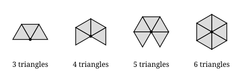

## Statement

Un **solide de Platon**, ou polyèdre régulier convexe, est un solide convexe tel que :

- toutes ses faces sont des polygones réguliers **identiques** ;
- le **même nombre** de faces se rejoignent à chacun de ses sommets.

Le cube en est un : six carrés, trois par sommet.

Il existe une infinité de polygones réguliers : le triangle équilatéral, le carré, le
pentagone régulier, l'hexagone régulier, et ainsi de suite sans fin. On pourrait croire qu'il
existe de même une infinité de solides de Platon. Il n'en est rien.

Montre qu'il y a **au plus cinq** solides de Platon, et dis, pour chacun, quelle est sa face
et combien de faces se rejoignent en chaque sommet.

*On utilisera le fait suivant, qu'on admettra : en un sommet d'un solide convexe, la somme des
angles des faces qui s'y rejoignent est strictement inférieure à $360°$. En effet, si cette
somme valait exactement $360°$, les faces se refermeraient à plat, dans un même plan, et il n'y
aurait pas de coin ; et si elle dépassait $360°$, les faces ne pourraient pas se ranger autour
du sommet sans se chevaucher ou former un creux.*

## Hints

1. Note $n$ le nombre de côtés de la face et $k$ le nombre de faces qui se rejoignent en un
   sommet. Combien vaut $k$ au minimum ? Deux faces suffisent-elles à fabriquer un coin ?
2. Écris la mesure d'un angle d'un polygone régulier à $n$ côtés, puis traduis en inégalité le
   fait admis de l'énoncé.
3. Tu obtiens $k(n-2) < 2n$. Isole $k$.
4. Écris $\dfrac{2n}{n-2}$ sous la forme $2 + \dfrac{4}{n-2}$ : tu verras tout de suite pour
   quelles valeurs de $n$ il reste de la place au-dessus de $3$.
5. Chaque couple $(n, k)$ trouvé est **possible**. Il reste à savoir si chacun existe
   vraiment : nomme le solide correspondant.

## Solution

**Mise en équation.**

Notons $n$ le nombre de côtés d'une face et $k$ le nombre de faces qui se rejoignent en chaque
sommet. On a $n \geqslant 3$, et aussi $k \geqslant 3$ : avec deux faces seulement, on obtient
un livre entrouvert, pas un coin fermé.

Un angle d'un polygone régulier à $n$ côtés mesure

$$180° - \frac{360°}{n} .$$

En un sommet, $k$ de ces angles se rejoignent, et leur somme est strictement inférieure à un
tour :

$$k(180° - \frac{360°}{n}) < 360° .$$

On divise par $180°$ :

$$k(1 - \frac{2}{n}) < 2, \qquad \text{c'est-à-dire} \qquad k \times \frac{n-2}{n} < 2, \qquad \text{donc} \qquad k < \frac{2n}{n-2} .$$

**On lit la condition.**

Écrivons $2n = 2(n-2) + 4$ :

$$\frac{2n}{n-2} = 2 + \frac{4}{n-2} .$$

La condition devient

$$3 \leqslant k < 2 + \frac{4}{n-2} .$$

Pour qu'un tel entier $k$ existe, il faut déjà $2 + \dfrac{4}{n-2} > 3$, c'est-à-dire
$\dfrac{4}{n-2} > 1$, soit $n - 2 < 4$, soit

$$n < 6 .$$

**Il ne reste donc que trois faces possibles : le triangle, le carré et le pentagone
régulier.** Dès l'hexagone, l'angle vaut $120°$, trois hexagones font exactement $360°$ et se
referment à plat : c'est un pavage du plan, pas un coin de solide. Au-delà, c'est pire.

Examinons les trois cas.

| $n$ | angle | $2 + \dfrac{4}{n-2}$ | valeurs de $k$ possibles |
| --- | --- | --- | --- |
| $3$ | $60°$ | $6$ | $3$, $4$, $5$ |
| $4$ | $90°$ | $4$ | $3$ |
| $5$ | $108°$ | $2 + \dfrac{4}{3} \approx \text{3,33}$ | $3$ |

Cela fait $3 + 1 + 1 = 5$ couples $(n, k)$ possibles, et **pas un de plus**.

Le dessin montre ce qui se passe avec des triangles. Avec $3$, $4$ ou $5$ triangles il reste
un trou : en refermant ce trou, la figure se soulève et forme un coin. Avec $6$ triangles, le
tour est bouclé à plat, la figure reste dans le plan et aucun coin n'apparaît.

**Les cinq couples donnent cinq solides, qui existent tous.**

| $n$ | $k$ | somme des angles au sommet | nom | nombre de faces |
| --- | --- | --- | --- | --- |
| $3$ | $3$ | $180°$ | tétraèdre | $4$ triangles |
| $3$ | $4$ | $240°$ | octaèdre | $8$ triangles |
| $3$ | $5$ | $300°$ | icosaèdre | $20$ triangles |
| $4$ | $3$ | $270°$ | cube | $6$ carrés |
| $5$ | $3$ | $324°$ | dodécaèdre | $12$ pentagones |

$$\boxed{\text{Il existe exactement cinq solides de Platon.}}$$

**Ce que la démonstration prouve et ce qu'elle ne prouve pas.** Le calcul montre qu'aucun
autre couple $(n, k)$ n'est possible : c'est un résultat d'**impossibilité**, et il est
complet. Il ne construit pas les cinq solides ; il faut les exhiber, ce que font les modèles
en carton depuis l'Antiquité. Les deux moitiés du travail sont nécessaires : sans la seconde,
rien ne dit qu'un couple autorisé par les angles se referme vraiment en un solide.

## Going further

1. Combien d'arêtes et de sommets a chacun des cinq solides ? *(Indication : compte les côtés
   de toutes les faces, puis demande-toi combien de fois chaque arête a été comptée.)*
2. Vérifie sur les cinq la formule d'Euler $S - A + F = 2$, où $S$, $A$ et $F$ sont les nombres
   de sommets, d'arêtes et de faces.
3. Le tétraèdre a autant de faces que de sommets ; le cube et l'octaèdre échangent leurs
   nombres de faces et de sommets, de même que le dodécaèdre et l'icosaèdre. Cherche ce qu'est
   le **solide dual** d'un polyèdre.
4. La boule noire « Magic 8-Ball », qui donne au hasard une réponse parmi vingt, contient l'un
   de ces solides. Lequel ?
