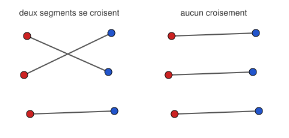

## Statement

On place $2n$ points dans le plan, de façon que trois d'entre eux ne soient jamais alignés.
On en colorie $n$ en rouge et les $n$ autres en bleu.

Montrer qu'on peut tracer $n$ segments, **deux à deux sans point commun**, de sorte que chaque
point rouge soit relié à un point bleu et chaque point bleu à un point rouge.

## Hints

1. Il y a un nombre **fini** de façons d'apparier les rouges avec les bleus. Peux-tu en
   choisir une qui soit extrême pour une certaine quantité ?
2. Choisis l'appariement pour lequel la **somme des longueurs** des $n$ segments est la plus
   petite possible.
3. Suppose que dans cet appariement, deux segments se croisent. Que peux-tu faire des quatre
   extrémités ?
4. Dessine deux segments $[RB]$ et $[R'B']$ qui se croisent en $I$, et remplace-les par
   $[RB']$ et $[R'B]$. Compare les deux sommes de longueurs avec l'inégalité triangulaire.

## Solution

**L'idée : prendre l'appariement le plus court.**

Un **appariement** est une façon de relier chaque point rouge à un point bleu, chaque point
bleu étant utilisé une fois et une seule. Il y en a un nombre fini (exactement $n!$, puisqu'il
s'agit de ranger les $n$ bleus en face des $n$ rouges).

Parmi ces appariements en nombre fini, il en existe donc (au moins) un pour lequel la
**somme des longueurs des $n$ segments est la plus petite possible**. Choisissons-en un, et
montrons qu'il convient.

**Par l'absurde : supposons que deux segments se croisent.**

Soient $[RB]$ et $[R'B']$ deux segments de cet appariement qui se croisent, avec $R$ et $R'$
rouges, $B$ et $B'$ bleus. Comme il n'y a jamais trois points alignés et que les quatre points
sont distincts, ces deux segments se coupent en un point $I$ situé **strictement à
l'intérieur** de chacun d'eux.

**L'échange raccourcit.**

Échangeons les partenaires : relions $R$ à $B'$ et $R'$ à $B$, en gardant tous les autres
segments inchangés. C'est encore un appariement valable.

Comparons les longueurs. $I$ est à l'intérieur de $[RB]$ et de $[R'B']$, donc
$$RB = RI + IB \qquad \text{et} \qquad R'B' = R'I + IB' .$$

Par l'inégalité triangulaire dans les triangles $RIB'$ et $R'IB$ (ces triangles ne sont pas
aplatis, puisque trois points ne sont jamais alignés), on a les inégalités **strictes**
$$RB' < RI + IB' \qquad \text{et} \qquad R'B < R'I + IB .$$

En les additionnant :
$$RB' + R'B < (RI + IB) + (R'I + IB') = RB + R'B' .$$

Le nouvel appariement a donc une somme de longueurs **strictement plus petite** que l'ancien.

**La contradiction.**

C'est impossible : on avait choisi l'appariement de somme minimale.

**Conclusion.** Dans l'appariement de somme minimale, deux segments ne se croisent jamais. Il
répond donc à la question. $\blacksquare$

## Going further

Deux points méritent d'être notés.

D'abord, la démonstration ne construit rien : elle ne dit pas comment trouver l'appariement,
elle prouve seulement qu'il en existe un. C'est typique du principe extrémal.

Ensuite, l'hypothèse « trois points jamais alignés » n'est pas décorative : elle garantit que
l'inégalité triangulaire est **stricte**. Sans elle, l'échange pourrait ne rien raccourcir, et
la contradiction tomberait. Cherche une configuration avec trois points alignés où deux
segments d'un appariement minimal se touchent.

Enfin, remarque que le même raisonnement montre qu'un appariement minimal existe **pour
n'importe quel critère de longueur**, tant qu'il n'y a qu'un nombre fini de candidats. Cette
remarque, « un ensemble fini non vide de nombres a un plus petit élément », est l'outil le
plus simple et l'un des plus puissants de la combinatoire.
