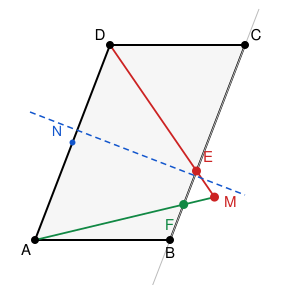

## Statement

Soit $ABCD$ un parallélogramme. On construit :

- $E$, le point où la **bissectrice de l'angle $\widehat{ADC}$** coupe la droite $(BC)$ ;
- $M$, le point où la **médiatrice du segment $[AD]$** coupe la droite $(DE)$ ;
- $F$, le point où la droite $(AM)$ coupe la droite $(BC)$.

Montrer que :

1. $DE = AF$ ;
2. $AB \times AD = DE \times DM$.

## Hints

1. Commence par une remarque sur la bissectrice : que peux-tu dire du triangle $DCE$ ? Pense
   aux angles alternes-internes, puisque $(AD)$ et $(BC)$ sont parallèles.
2. Tu devrais trouver que $CD = CE$, donc que le triangle $DCE$ est isocèle en $C$.
3. Pour la question 1, la médiatrice donne $MA = MD$. Que dire alors du triangle $MAD$, et
   du triangle $MFE$ ?
4. Les droites $(AD)$ et $(FE)$ sont parallèles. Que vaut le rapport
   $\dfrac{MF}{MA}$ comparé à $\dfrac{ME}{MD}$ ?
5. Pour la question 2, appelle $N$ le milieu de $[AD]$ et $K$ le milieu de $[DE]$. Repère deux
   triangles rectangles qui ont le même angle en $D$.

## Solution

**Préliminaire : le triangle $DCE$ est isocèle.**

Dans le parallélogramme $ABCD$, les droites $(AD)$ et $(BC)$ sont parallèles. La droite
$(DE)$ les coupe toutes les deux, donc les angles alternes-internes sont égaux :
$$\widehat{ADE} = \widehat{DEC} .$$

Par ailleurs $(DE)$ est la bissectrice de $\widehat{ADC}$, donc
$$\widehat{ADE} = \widehat{EDC} .$$

En combinant, $\widehat{DEC} = \widehat{EDC}$ : le triangle $DCE$ a deux angles égaux, il est
donc **isocèle en $C$** :
$$CD = CE .$$

### Question 1 : $DE = AF$

La médiatrice de $[AD]$ est l'ensemble des points à égale distance de $A$ et de $D$. Comme $M$
est dessus,
$$MA = MD .$$

Regardons maintenant les points $A$, $M$, $F$ (alignés par construction) et $D$, $M$, $E$
(alignés aussi, sur la bissectrice). Les droites $(AD)$ et $(FE)$ sont parallèles, puisque
$F$ et $E$ sont sur $(BC)$.

Le théorème de Thalès dans cette configuration donne
$$\frac{MF}{MA} = \frac{ME}{MD} .$$

Notons $k$ cette valeur commune. En termes de vecteurs, cela s'écrit
$$\overrightarrow{MF} = k\,\overrightarrow{MA} \qquad \text{et} \qquad
\overrightarrow{ME} = k\,\overrightarrow{MD} .$$

Alors
$$\overrightarrow{AF} = \overrightarrow{MF} - \overrightarrow{MA} = (k-1)\,\overrightarrow{MA}
\qquad \text{et} \qquad
\overrightarrow{DE} = \overrightarrow{ME} - \overrightarrow{MD} = (k-1)\,\overrightarrow{MD} .$$

En prenant les longueurs :
$$AF = |k-1| \times MA \qquad \text{et} \qquad DE = |k-1| \times MD .$$

Comme $MA = MD$, on conclut
$$\boxed{AF = DE .}$$

### Question 2 : $AB \times AD = DE \times DM$

Introduisons deux milieux :

- $N$, le milieu de $[AD]$. Alors $DN = \dfrac{AD}{2}$, et la médiatrice de $[AD]$ passe par
  $N$ perpendiculairement à $(AD)$. Le triangle $DNM$ est donc **rectangle en $N$**.
- $K$, le milieu de $[DE]$. Alors $DK = \dfrac{DE}{2}$. Comme le triangle $DCE$ est isocèle en
  $C$, la droite $(CK)$ est à la fois médiane et hauteur : le triangle $DKC$ est **rectangle
  en $K$**.

Ces deux triangles rectangles, $DNM$ et $DKC$, ont le même angle en $D$. En effet :

- l'angle de $DNM$ en $D$ est l'angle entre $(DA)$ et $(DM)$, c'est-à-dire
  $\widehat{ADE}$ ;
- l'angle de $DKC$ en $D$ est l'angle entre $(DE)$ et $(DC)$, c'est-à-dire
  $\widehat{EDC}$ ;
- et ces deux angles sont égaux, puisque $(DE)$ est la bissectrice.

Deux triangles rectangles qui ont un angle aigu égal sont semblables. Donc
$$\frac{DN}{DM} = \frac{DK}{DC} ,$$
c'est-à-dire, en croisant les produits,
$$DN \times DC = DK \times DM .$$

En remplaçant $DN = \dfrac{AD}{2}$ et $DK = \dfrac{DE}{2}$ :
$$\frac{AD}{2} \times DC = \frac{DE}{2} \times DM ,$$
puis en multipliant par $2$ :
$$AD \times DC = DE \times DM .$$

Enfin, dans un parallélogramme les côtés opposés sont égaux, donc $DC = AB$, et on obtient
$$\boxed{AB \times AD = DE \times DM .}$$

$\blacksquare$

## Going further

La question 2 a une lecture amusante. Elle dit que le produit $DE \times DM$ ne dépend **pas**
de l'angle du parallélogramme : quelle que soit l'inclinaison, il vaut toujours $AB \times AD$.

Si l'on aplatit le parallélogramme, l'angle $\widehat{ADC}$ grandit, le point $E$ s'éloigne et
$DE$ augmente ; mais alors $DM$ diminue d'autant, et le produit reste le même.

La question 1, elle, dit que le quadrilatère $ADEF$ est un **trapèze isocèle** : ses côtés
$[AD]$ et $[FE]$ sont parallèles, et ses deux autres côtés sont de même longueur.

On peut même voir directement d'où vient cette égalité, sans calcul. Appelons $\sigma$ la
symétrie d'axe la médiatrice de $[AD]$. Elle échange $A$ et $D$, et elle fixe le point $M$,
qui est sur l'axe. Donc elle envoie la droite $(AM)$ sur la droite $(DM)$, c'est-à-dire
$(AF)$ sur $(DE)$. Et comme $MF = ME$ (c'est ce qu'on a établi dans la solution), elle envoie
$F$ sur $E$.

Autrement dit, $\sigma$ échange $A$ avec $D$ et $F$ avec $E$ : le trapèze $ADEF$ est
symétrique par rapport à la médiatrice de $[AD]$, ce qui redonne $AF = DE$ d'un seul coup.
