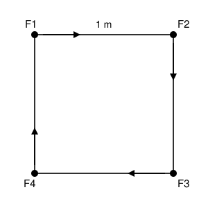

## Statement

Quatre fourmis sont posées aux quatre sommets d'un carré de $1$ mètre de côté.

Au même instant, chacune se tourne vers sa voisine dans le sens des aiguilles d'une montre, puis toutes se mettent à marcher à la même vitesse, en visant **en permanence** la voisine qu'elles ont choisie. Chaque fourmi change donc de direction sans arrêt.

Au bout d'un certain temps, les quatre fourmis se rejoignent au centre du carré.

Quelle distance chaque fourmi a-t-elle parcourue ?

## Hints

1. La trajectoire d'une fourmi est une courbe compliquée : n'essaie surtout pas de la calculer. Cherche plutôt à calculer le **temps** mis pour se rejoindre.
2. La figure garde une symétrie tout au long du mouvement. Laquelle ? Que peux-tu en déduire sur la forme du quadrilatère formé par les quatre fourmis à chaque instant ?
3. Concentre-toi sur deux fourmis voisines, $F_1$ qui poursuit $F_2$. À quelle vitesse la distance $F_1F_2$ diminue-t-elle ?
4. Le mouvement de $F_2$ se fait dans quelle direction par rapport à la droite $(F_1F_2)$ ? Est-ce que cela rapproche ou éloigne $F_1$ ?
5. Si la distance $F_1F_2$ diminue à vitesse constante, tu connais le temps total. La distance parcourue s'en déduit immédiatement.

## Solution

**Réponse : chaque fourmi parcourt exactement $1$ mètre.**

**Étape 1. La figure reste un carré.**

Numérotons les fourmis $F_1, F_2, F_3, F_4$ dans le sens des aiguilles d'une montre, $F_1$ poursuivant $F_2$, $F_2$ poursuivant $F_3$, et ainsi de suite jusqu'à $F_4$ qui poursuit $F_1$.

Le quart de tour autour du centre du carré qui envoie $F_1$ sur $F_2$, $F_2$ sur $F_3$, $F_3$ sur $F_4$ et $F_4$ sur $F_1$ laisse la situation de départ inchangée, **et** il laisse la règle du jeu inchangée (« chacune vise sa voisine dans le sens des aiguilles d'une montre »). Le mouvement possède donc cette symétrie à chaque instant : à tout moment, les quatre fourmis forment encore un carré, simplement plus petit et tourné.

En particulier, à chaque instant :

$$(F_1F_2) \perp (F_2F_3).$$

**Étape 2. À quelle vitesse $F_1$ se rapproche-t-elle de $F_2$ ?**

Notons $v$ la vitesse commune des fourmis, et regardons la distance $F_1F_2$.

- La fourmi $F_1$ se déplace **droit vers** $F_2$, donc le long de la droite $(F_1F_2)$. Son mouvement réduit la distance à la vitesse $v$.
- La fourmi $F_2$ se déplace droit vers $F_3$, donc le long de la droite $(F_2F_3)$, qui est **perpendiculaire** à $(F_1F_2)$ d'après l'étape 1. Un déplacement perpendiculaire à la droite $(F_1F_2)$ ne rapproche ni n'éloigne $F_1$ de $F_2$ : il ne change pas la distance.

Au total, la distance $F_1F_2$ diminue à la vitesse constante $v$.

**Étape 3. Le temps, puis la distance.**

La distance $F_1F_2$ part de $1$ mètre et diminue à la vitesse constante $v$. Elle s'annule donc au bout du temps

$$T = \frac{1}{v}.$$

C'est à cet instant que les fourmis se rejoignent. Chaque fourmi a marché à la vitesse $v$ pendant la durée $T$, donc a parcouru

$$v \times T = v \times \frac{1}{v} = 1 \text{ mètre}.$$

**Conclusion.** Chaque fourmi parcourt exactement $1$ mètre, c'est-à-dire la longueur du côté du carré. Et cela ne dépend pas de la vitesse : des fourmis lentes mettront plus de temps, mais feront le même chemin.

## Going further

Le tour de force est d'avoir trouvé une quantité qui varie **simplement** (la distance entre deux fourmis voisines) alors que tout le reste varie de façon compliquée. C'est un réflexe qu'on retrouve partout en mathématiques.

Un mot de rigueur : « la distance diminue à la vitesse $v$ » est une affirmation sur une dérivée, et sa démonstration complète passe par le calcul différentiel, hors programme ici. L'idée physique, elle, est exacte : seul le déplacement le long de la droite $(F_1F_2)$ modifie la longueur $F_1F_2$, au premier ordre.

La trajectoire de chaque fourmi porte un nom : c'est une **spirale logarithmique**. Elle s'enroule une infinité de fois autour du centre (chaque fourmi tourne donc infiniment autour du centre) et pourtant sa longueur totale est finie, $1$ mètre. Ce n'est pas plus paradoxal que la somme $\frac12 + \frac14 + \frac18 + \cdots = 1$.

Et avec trois fourmis aux sommets d'un triangle équilatéral de côté $1$ ? Cette fois l'angle du polygone en $F_2$ vaut $60°$, et le déplacement de $F_2$ vers $F_3$ la **rapproche** aussi de $F_1$, à la vitesse $v\cos(60°) = \tfrac{v}{2}$. La distance diminue donc à la vitesse $v + \tfrac{v}{2} = \tfrac{3v}{2}$, et chaque fourmi parcourt seulement $\tfrac23$ de mètre.

Avec six fourmis sur un hexagone régulier de côté $1$, l'angle du polygone vaut $120°$ : le déplacement de $F_2$ **éloigne** cette fois $F_1$ à la vitesse $\tfrac{v}{2}$, la distance ne diminue plus qu'à la vitesse $\tfrac{v}{2}$, et chaque fourmi parcourt $2$ mètres. Sauras-tu écrire la formule générale pour un polygone régulier à $n$ côtés ?
