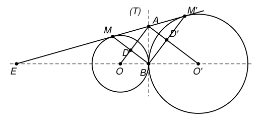

## Statement

Deux cercles sont **tangents extérieurement** en un point $B$ : le premier a pour centre $O$ et pour rayon $R$, le second a pour centre $O'$ et pour rayon $R'$, avec $R < R'$. Tangents extérieurement veut dire qu'ils se touchent en $B$ et que chacun est à l'extérieur de l'autre.

On note $(T)$ la tangente commune aux deux cercles qui passe par $B$.

On trace ensuite l'autre tangente commune aux deux cercles, celle qui ne passe pas par $B$ : elle touche le premier cercle en $M$ et le second en $M'$. Cette droite $(MM')$ coupe $(T)$ en un point $A$.

Enfin :

- la droite $(OA)$ coupe le segment $[BM]$ en $D$ ;
- la droite $(O'A)$ coupe le segment $[BM']$ en $D'$ ;
- les droites $(OO')$ et $(MM')$ se coupent en $E$.

1. Montrer que $(DD')$ est parallèle à $(MM')$.
2. Montrer que le triangle $OAO'$ est rectangle en $A$.
3. Calculer la longueur $EO$ en fonction de $R$ et $R'$.
4. Calculer la longueur $DD'$ en fonction de $R$ et $R'$.

*On rappelle qu'une tangente à un cercle est perpendiculaire au rayon qui aboutit au point de contact, et que les deux tangentes menées d'un même point à un cercle ont la même longueur.*

## Hints

1. **Question 1.** De $A$ partent deux tangentes au premier cercle : $(AM)$ et $(AB)$. Que peux-tu dire des longueurs $AM$ et $AB$ ? Et des longueurs $OM$ et $OB$ ?
2. Deux points équidistants de $M$ et de $B$ : la droite $(OA)$ est donc une droite bien connue du segment $[MB]$. Où coupe-t-elle $[MB]$ ?
3. **Question 2.** Tu sais maintenant que $AM = AB = AM'$, et que $A$ est sur la droite $(MM')$. Quelle est la position de $A$ sur le segment $[MM']$ ? Quel cercle passe par $M$, $B$ et $M'$ ?
4. **Question 3.** Les rayons $[OM]$ et $[O'M']$ sont tous les deux perpendiculaires à $(MM')$. Le théorème de Thalès s'applique au point $E$.
5. **Question 4.** Le quadrilatère $ADBD'$ a trois angles droits. Puis applique deux fois le théorème de Pythagore, dans $OBA$ et dans $O'BA$, et additionne.

## Solution

**Question 1 : $(DD')$ est parallèle à $(MM')$.**

De $A$ partent deux tangentes au premier cercle : la droite $(AM)$ et la droite $(AB)$. Les deux tangentes menées d'un même point à un cercle ont la même longueur, donc

$$AM = AB .$$

Par ailleurs $OM = OB = R$, puisque ce sont deux rayons.

Ainsi $A$ et $O$ sont tous les deux à égale distance de $M$ et de $B$ : la droite $(OA)$ est **la médiatrice de $[MB]$**. Elle coupe donc $[MB]$ en son milieu. Or elle coupe $[MB]$ en $D$ : donc

$$D \text{ est le milieu de } [MB] .$$

Le même raisonnement avec le second cercle donne que $D'$ est le milieu de $[M'B]$.

Dans le triangle $BMM'$, la droite qui joint les milieux de $[BM]$ et de $[BM']$ est parallèle au troisième côté : c'est le théorème des milieux. Donc

$$(DD') \parallel (MM') .$$

**Question 2 : $OAO'$ est rectangle en $A$.**

Comme à la question 1, $AM = AB$ et $AM' = AB$, donc

$$AM = AB = AM' .$$

Le point $A$ est sur la droite $(MM')$ et il est à la même distance de $M$ et de $M'$ : c'est donc le **milieu** de $[MM']$. Le cercle de centre $A$ et de rayon $AB$ passe par $M$, $M'$ et $B$, et $[MM']$ en est un diamètre.

Un triangle inscrit dans un cercle dont un côté est un diamètre est rectangle : le triangle $MBM'$ est donc rectangle en $B$, c'est-à-dire

$$(BM) \perp (BM') .$$

Regardons maintenant le quadrilatère $ADBD'$ :

- en $D$ : $(OA)$ est la médiatrice de $[MB]$, donc $(AD) \perp (BD)$, angle droit ;
- en $D'$ : de même, $(AD') \perp (BD')$, angle droit ;
- en $B$ : on vient de voir que $(BD) \perp (BD')$, puisque $D$ est sur $(BM)$ et $D'$ sur $(BM')$.

Un quadrilatère qui a trois angles droits est un rectangle, donc l'angle en $A$ est droit lui aussi :

$$\widehat{DAD'} = 90^\circ .$$

Comme $D$ est sur la demi-droite $[AO)$ et $D'$ sur la demi-droite $[AO')$, cet angle est exactement $\widehat{OAO'}$. **Le triangle $OAO'$ est rectangle en $A$.**

**Question 3 : la longueur $EO$.**

Les rayons $[OM]$ et $[O'M']$ aboutissent tous deux au point de contact d'une tangente, donc

$$(OM) \perp (MM') \qquad \text{et} \qquad (O'M') \perp (MM') .$$

Deux droites perpendiculaires à une même droite sont parallèles, donc $(OM) \parallel (O'M')$.

Le point $E$ est sur la droite $(OO')$ et sur la droite $(MM')$. Le théorème de Thalès, appliqué au sommet $E$ avec les parallèles $(OM)$ et $(O'M')$, donne

$$\frac{EO}{EO'} = \frac{OM}{O'M'} = \frac{R}{R'} .$$

Or $E$, $O$, $O'$ sont alignés dans cet ordre et $OO' = R + R'$ (les cercles sont tangents extérieurement en $B$, qui est sur $[OO']$). Donc $EO' = EO + R + R'$, et

$$\frac{EO}{EO + R + R'} = \frac{R}{R'} .$$

En multipliant en croix :

$$R' \times EO = R \times (EO + R + R') = R \times EO + R(R + R') ,$$

puis

$$(R' - R) \times EO = R(R + R') .$$

Comme $R < R'$, on peut diviser :

$$\boxed{\; EO = \frac{R(R+R')}{R' - R} \;}$$

**Question 4 : la longueur $DD'$.**

On a vu que $ADBD'$ est un rectangle. Ses deux diagonales sont $[AB]$ et $[DD']$, et les diagonales d'un rectangle ont la même longueur :

$$DD' = AB .$$

Il reste à calculer $AB$. La droite $(T)$ est tangente au premier cercle en $B$, donc elle est perpendiculaire au rayon $[OB]$, c'est-à-dire à $(OO')$. Comme $A$ est sur $(T)$, les triangles $OBA$ et $O'BA$ sont rectangles en $B$. Le théorème de Pythagore donne

$$OA^2 = OB^2 + AB^2 = R^2 + AB^2 , \qquad O'A^2 = O'B^2 + AB^2 = R'^2 + AB^2 .$$

Additionnons ces deux égalités :

$$OA^2 + O'A^2 = R^2 + R'^2 + 2 \, AB^2 .$$

Mais le triangle $OAO'$ est rectangle en $A$ (question 2), donc par Pythagore $OA^2 + O'A^2 = OO'^2 = (R+R')^2$. D'où

$$(R + R')^2 = R^2 + R'^2 + 2 \, AB^2 .$$

En développant le membre de gauche, $R^2 + 2RR' + R'^2 = R^2 + R'^2 + 2\,AB^2$, donc

$$2RR' = 2\,AB^2, \qquad \text{c'est-à-dire} \qquad AB^2 = RR' .$$

**Conclusion :**

$$\boxed{\; DD' = AB = \sqrt{RR'} \;}$$

## Going further

Le résultat $AB^2 = OB \times BO'$ de la question 4 est un cas de la relation métrique dans un triangle rectangle : dans le triangle $OAO'$ rectangle en $A$, le point $B$ est le pied de la hauteur issue de $A$, et la hauteur est la moyenne géométrique des deux morceaux de l'hypoténuse.

Au passage, la question 4 donne la longueur de la tangente commune : $MM' = 2\,DD' = 2\sqrt{RR'}$, puisque $[DD']$ joint les milieux de $[BM]$ et $[BM']$ dans le triangle $BMM'$.
