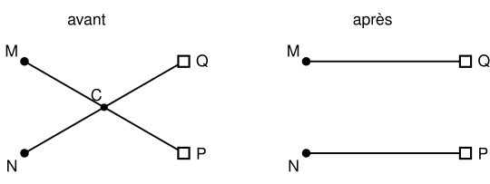

## Statement

Dans une plaine, on a $n$ maisons et $n$ puits, soit $2n$ points en tout. On suppose que **trois de ces points ne sont jamais alignés**.

On veut attribuer à chaque maison un puits, et un seul, de sorte que chaque puits soit attribué à une seule maison. Puis on relie chaque maison à son puits par une route en ligne droite.

Montrer qu'on peut faire cette attribution de façon qu'**aucune des $n$ routes n'en croise une autre**.

## Hints

1. Il y a un nombre fini d'attributions possibles : exactement $n!$. Parmi toutes ces attributions, choisis-en une qui rende une certaine quantité la plus petite possible.
2. La bonne quantité est la **longueur totale** des $n$ routes.
3. Suppose que dans cette attribution, deux routes se croisent. Dessine les deux routes et leur point de croisement, puis échange les deux puits.
4. Compare la longueur des deux nouvelles routes à celle des deux anciennes, en utilisant l'inégalité triangulaire dans deux triangles.
5. Pourquoi l'inégalité triangulaire est-elle **stricte** ici ? C'est là que sert l'hypothèse sur les alignements.

## Solution

**L'idée : prendre l'attribution la plus courte possible, et montrer qu'elle ne peut pas contenir de croisement.**

**Une attribution la plus courte existe.** Une attribution est une façon d'associer à chaque maison un puits différent : il y en a $n!$, donc un nombre fini. Chaque attribution a une longueur totale, qui est la somme des longueurs des $n$ routes. Parmi un nombre fini de nombres, il y en a un plus petit : choisissons donc une attribution dont la longueur totale est **minimale**.

**Montrons qu'elle n'a pas de croisement.** Supposons par l'absurde que deux routes se croisent. Notons $M$ et $N$ les deux maisons concernées, $P$ le puits attribué à $M$, $Q$ le puits attribué à $N$, et $C$ le point où les segments $[MP]$ et $[NQ]$ se croisent.

**On échange les deux puits.** Modifions l'attribution en donnant $Q$ à $M$ et $P$ à $N$, sans rien changer d'autre. C'est encore une attribution valable.

Comparons les longueurs. D'après l'**inégalité triangulaire** appliquée aux points $M$, $C$, $Q$ :

$$MQ \leqslant MC + CQ .$$

Cette inégalité est même **stricte**, car elle ne devient une égalité que si $C$ appartient au segment $[MQ]$, c'est-à-dire si $M$, $C$, $Q$ sont alignés. Or $C$ est sur la droite $(MP)$ : si $M$, $C$, $Q$ étaient alignés, alors $Q$ serait sur la droite $(MP)$ et les trois points $M$, $P$, $Q$ seraient alignés, ce que l'énoncé interdit. Donc

$$MQ < MC + CQ .$$

De la même façon, avec les points $N$, $C$, $P$ :

$$NP < NC + CP .$$

Additionnons ces deux inégalités :

$$MQ + NP \; < \; (MC + CP) + (NC + CQ) .$$

Or $C$ est sur le segment $[MP]$, donc $MC + CP = MP$ ; et $C$ est sur le segment $[NQ]$, donc $NC + CQ = NQ$. D'où

$$MQ + NP \; < \; MP + NQ .$$

**La contradiction.** Les deux nouvelles routes sont donc strictement plus courtes, à elles deux, que les deux anciennes. Comme les $n-2$ autres routes n'ont pas changé, la nouvelle attribution a une longueur totale strictement plus petite que l'ancienne. Cela contredit le fait que l'attribution choisie était la plus courte.

**Conclusion : l'attribution de longueur totale minimale ne contient aucun croisement. Une attribution sans croisement existe donc toujours.**

## Going further

La démonstration ne construit pas l'attribution : elle prouve seulement qu'elle existe. C'est la marque du principe de l'extremum. Si l'on veut vraiment la trouver, on peut partir d'une attribution quelconque et échanger les puits de deux routes qui se croisent, encore et encore : la longueur totale diminue strictement à chaque échange, et comme il n'y a qu'un nombre fini d'attributions, le procédé s'arrête. Quand il s'arrête, il n'y a plus de croisement.

Attention : un échange peut supprimer un croisement et en créer d'autres. Ce n'est pas le nombre de croisements qui diminue à coup sûr, c'est la longueur totale.
