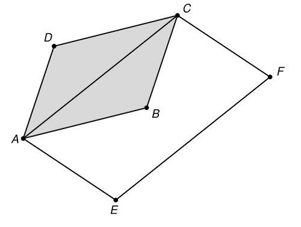

## Statement

Soit $ABCD$ un parallélogramme.

On construit un point $E$ tel que $AE = BD$ et $(AE)$ parallèle à $(BD)$, puis un point $F$ tel que $EF = AC$ et $(EF)$ parallèle à $(AC)$, comme sur la figure.

Exprimer l'aire du quadrilatère $AEFC$ en fonction de l'aire de $ABCD$.

## Hints

1. Un quadrilatère dont deux côtés opposés sont parallèles **et** de même longueur est un parallélogramme. Utilise cela deux fois.
2. Que peux-tu dire du quadrilatère $AEBD$ ? Et donc de la longueur et de la direction de $[EB]$ ?
3. Compare $[EB]$ et $[BC]$. Que représente alors le point $B$ pour le segment $[EC]$ ?
4. Le quadrilatère $AEFC$ est un parallélogramme et $B$ est le point de croisement de ses diagonales. Découpe les deux figures en triangles et compare-les.

## Solution

**L'aire de $AEFC$ vaut le double de l'aire de $ABCD$.**

**Étape 1 : $AEBD$ est un parallélogramme.** Par construction, $AE = DB$ et $(AE)$ est parallèle à $(DB)$. Un quadrilatère dont deux côtés opposés sont parallèles et de même longueur est un parallélogramme, donc $AEBD$ en est un (les sommets étant pris dans cet ordre, avec $[AE]$ et $[DB]$ pour côtés opposés).

On en déduit que ses deux autres côtés opposés sont eux aussi parallèles et de même longueur :

$$EB = AD \qquad \text{et} \qquad (EB) \parallel (AD) .$$

**Étape 2 : $B$ est le milieu de $[EC]$.** Comme $ABCD$ est un parallélogramme, on a aussi

$$BC = AD \qquad \text{et} \qquad (BC) \parallel (AD) .$$

Donc $EB = BC$, et les droites $(EB)$ et $(BC)$ sont toutes deux parallèles à $(AD)$ : comme elles passent par le même point $B$, elles sont confondues. Les points $E$, $B$, $C$ sont donc alignés, avec $EB = BC$ :

$$B \text{ est le milieu de } [EC] .$$

**Étape 3 : $AEFC$ est un parallélogramme et $B$ est le centre de ses diagonales.** Par construction, $EF = AC$ et $(EF)$ est parallèle à $(AC)$, donc $AEFC$ est un parallélogramme (côtés opposés $[AE]$ et $[CF]$, côtés opposés $[EF]$ et $[AC]$).

Ses diagonales sont $[AF]$ et $[EC]$, et elles se coupent en leur milieu commun. Or le milieu de $[EC]$ est $B$ : donc $B$ est aussi le milieu de $[AF]$, et c'est le point de croisement des diagonales de $AEFC$.

**Étape 4 : on compare les aires.** Les diagonales d'un parallélogramme le partagent en quatre triangles de même aire. Appliquons cela deux fois.

- Dans $ABCD$, les diagonales $[AC]$ et $[BD]$ se coupent en leur milieu $M$, et découpent $ABCD$ en quatre triangles de même aire. Donc

$$\text{aire}(ABC) = \frac{1}{2}\,\text{aire}(ABCD) ,$$

puisque le triangle $ABC$ est formé de deux de ces quatre triangles.

- Dans $AEFC$, la diagonale $[AF]$ passe par $B$, et $B$ est le milieu de $[EC]$. Le triangle $AEC$ est donc la moitié de $AEFC$ :

$$\text{aire}(AEC) = \frac{1}{2}\,\text{aire}(AEFC) .$$

Il reste à comparer $\text{aire}(ABC)$ et $\text{aire}(AEC)$. Les triangles $ABC$ et $AEC$ ont la même base $[AC]$ et... plus simplement : dans le triangle $AEC$, le point $B$ est le milieu de $[EC]$, donc la médiane $[AB]$ le partage en deux triangles de même aire, $ABE$ et $ABC$. Donc

$$\text{aire}(AEC) = 2\,\text{aire}(ABC) .$$

**On rassemble.**

$$\text{aire}(AEFC) = 2\,\text{aire}(AEC) = 4\,\text{aire}(ABC) = 4 \times \frac{1}{2}\,\text{aire}(ABCD) = 2\,\text{aire}(ABCD) .$$

**Conclusion : $\text{aire}(AEFC) = 2 \times \text{aire}(ABCD)$.**

## Going further

Le point $E$ peut se construire de deux façons, selon le sens dans lequel on reporte $[BD]$, et de même pour $F$. On obtient des figures différentes, mais le résultat ne change pas : l'aire est toujours doublée.

En fait, $AEFC$ est le parallélogramme construit sur les deux **diagonales** de $ABCD$. Le résultat se retient ainsi : le parallélogramme bâti sur les diagonales d'un parallélogramme a une aire double.
