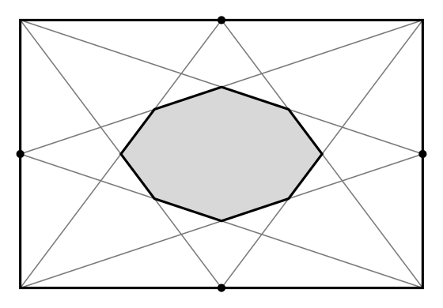

## Statement

On part d'un rectangle d'aire $1$.

Pour chacun de ses quatre côtés, on joint le **milieu** de ce côté aux **deux sommets du côté opposé**. Cela fait huit segments, qui dessinent un octogone au centre du rectangle.

Quelle est l'aire de cet octogone ?

## Hints

1. Commence par le cas le plus simple : le carré de côté $1$. On verra à la fin que la réponse est la même pour tous les rectangles.
2. Place un repère dont l'origine est un sommet du carré, et écris l'équation de chacun des huit segments. Elles sont toutes de la forme $y = 2x + \ldots$ ou $y = \tfrac{x}{2} + \ldots$
3. Calcule les huit sommets de l'octogone. Ils sortent avec des dénominateurs $3$ et $4$ seulement.
4. Pour l'aire, ne te lance pas dans un calcul global. Repère les quatre sommets qui forment un petit carré, puis les quatre petits triangles qui dépassent.
5. Pour passer du carré à un rectangle quelconque : étirer une figure d'un facteur $\lambda$ dans une direction multiplie toutes les aires par $\lambda$. Les milieux restent des milieux et les segments restent des segments.

## Solution

**L'aire de l'octogone vaut $\dfrac{1}{6}$.**

### Étape 1 : on se ramène au carré

Supposons le résultat connu pour le carré de côté $1$, d'aire $1$, et passons à un rectangle de côtés $L$ et $\ell$ avec $L\ell = 1$.

On obtient ce rectangle à partir du carré en multipliant toutes les abscisses par $L$ et toutes les ordonnées par $\ell$. Cette transformation envoie droites sur droites, milieux sur milieux et sommets sur sommets : la figure des huit segments se transforme donc en la figure des huit segments du rectangle.

Et elle multiplie **toutes** les aires par le même facteur $L\ell = 1$. L'aire de l'octogone est donc la même dans le rectangle que dans le carré.

Il suffit donc de traiter le carré.

### Étape 2 : les huit droites du carré

Plaçons le carré dans un repère, avec les sommets

$$A(0,\,0), \quad B(1,\,0), \quad C(1,\,1), \quad D(0,\,1) ,$$

et les milieux des côtés

$$M(\tfrac12,\,0), \quad N(1,\,\tfrac12), \quad P(\tfrac12,\,1), \quad Q(0,\,\tfrac12) .$$

Les huit segments sont $[MD]$, $[MC]$, $[PA]$, $[PB]$, $[NA]$, $[ND]$, $[QB]$, $[QC]$. Leurs équations s'obtiennent immédiatement :

| segment | équation |
|---|---|
| $[MD]$ | $y = 1 - 2x$ |
| $[MC]$ | $y = 2x - 1$ |
| $[PA]$ | $y = 2x$ |
| $[PB]$ | $y = 2 - 2x$ |
| $[NA]$ | $y = \tfrac{x}{2}$ |
| $[ND]$ | $y = 1 - \tfrac{x}{2}$ |
| $[QB]$ | $y = \tfrac12 - \tfrac{x}{2}$ |
| $[QC]$ | $y = \tfrac12 + \tfrac{x}{2}$ |

### Étape 3 : les huit sommets de l'octogone

On résout les systèmes deux par deux, en prenant à chaque fois les deux droites qui se coupent sur le bord de l'octogone. Par exemple $[MD]$ et $[QB]$ :

$$1 - 2x = \frac12 - \frac{x}{2} \ \Longleftrightarrow\ \frac12 = \frac{3x}{2} \ \Longleftrightarrow\ x = \frac13, \quad \text{puis } y = \frac13 .$$

En procédant de même pour les sept autres, on trouve les huit sommets :

$$\left(\tfrac13, \tfrac13\right), \ \left(\tfrac12, \tfrac14\right), \ \left(\tfrac23, \tfrac13\right), \ \left(\tfrac34, \tfrac12\right), \ \left(\tfrac23, \tfrac23\right), \ \left(\tfrac12, \tfrac34\right), \ \left(\tfrac13, \tfrac23\right), \ \left(\tfrac14, \tfrac12\right) .$$

On les reconnaît : ils se répondent par les symétries du carré, ce qui est rassurant, car la figure de départ possède ces symétries.

### Étape 4 : on découpe l'octogone

Quatre de ces sommets sautent aux yeux :

$$\left(\tfrac13, \tfrac13\right), \ \left(\tfrac23, \tfrac13\right), \ \left(\tfrac23, \tfrac23\right), \ \left(\tfrac13, \tfrac23\right) .$$

Ils forment un **carré de côté $\tfrac13$**, d'aire

$$\left(\frac13\right)^2 = \frac19 .$$

Les quatre autres sommets dépassent de ce carré, un de chaque côté. Prenons celui du bas, $\left(\tfrac12, \tfrac14\right)$. Avec les deux sommets $\left(\tfrac13, \tfrac13\right)$ et $\left(\tfrac23, \tfrac13\right)$, il forme un triangle de base

$$\frac23 - \frac13 = \frac13$$

et de hauteur

$$\frac13 - \frac14 = \frac{1}{12} .$$

Son aire vaut donc

$$\frac12 \times \frac13 \times \frac{1}{12} = \frac{1}{72} .$$

Par symétrie, les quatre triangles qui dépassent ont la même aire.

### Étape 5 : on additionne

$$\text{aire de l'octogone} = \frac19 + 4 \times \frac{1}{72} = \frac19 + \frac{1}{18} = \frac{2}{18} + \frac{1}{18} = \frac{3}{18} = \frac16 .$$

**Conclusion : l'octogone a pour aire $\dfrac16$, soit le sixième de l'aire du rectangle, quelles que soient les dimensions de celui-ci.**

## Going further

L'octogone obtenu n'est pas régulier, même dans le carré : ses côtés n'ont pas tous la même longueur. Il est seulement invariant par les quatre symétries du carré.

Le raisonnement de l'étape 1 mérite d'être retenu pour lui-même. Un **étirement** dans une direction, ou plus généralement toute transformation affine, conserve l'alignement, le parallélisme et les milieux, et multiplie toutes les aires par un même facteur. Dès qu'un problème ne porte que sur ces notions et demande un **rapport** d'aires, on a le droit de remplacer la figure par la plus commode de sa famille : un rectangle quelconque par un carré, un triangle quelconque par un triangle équilatéral, un parallélogramme quelconque par un carré.

Ici, cela transforme un calcul fait avec deux lettres $L$ et $\ell$ en un calcul fait avec des nombres.
