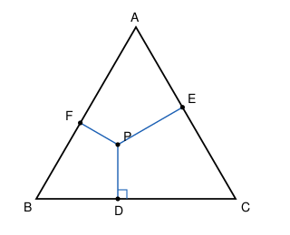

## Statement

Soit $ABC$ un triangle équilatéral et $P$ un point à l'intérieur de ce triangle. On note $D$, $E$ et $F$ les pieds des perpendiculaires abaissées de $P$ sur $[BC]$, $[CA]$ et $[AB]$ respectivement.

Montrer que

$$AF + BD + CE = AE + BF + CD .$$

## Hints

1. Les six longueurs de l'énoncé sont les côtés de six petits triangles rectangles. Lesquels ?
2. Calcule $PA^2$ de deux façons, avec le théorème de Pythagore. Fais de même pour $PB^2$ et $PC^2$.
3. Additionne les trois égalités obtenues : les distances $PD$, $PE$, $PF$ disparaissent. Que reste-t-il ?
4. Tu obtiens une égalité entre des **carrés**. Pour en déduire l'égalité des sommes, sers-toi de ce que $AF + FB = AB$, et de même sur les deux autres côtés. Pose $x = AF$, $y = BD$, $z = CE$.

## Solution

Notons $a$ la longueur du côté du triangle.

**Étape 1 : Pythagore, six fois.**

Le point $F$ est le pied de la perpendiculaire à $(AB)$, donc les triangles $AFP$ et $BFP$ sont rectangles en $F$. De même pour les quatre autres. On obtient :

$$PA^2 = AF^2 + PF^2 \qquad \text{et} \qquad PA^2 = AE^2 + PE^2 ,$$
$$PB^2 = BD^2 + PD^2 \qquad \text{et} \qquad PB^2 = BF^2 + PF^2 ,$$
$$PC^2 = CE^2 + PE^2 \qquad \text{et} \qquad PC^2 = CD^2 + PD^2 .$$

**Étape 2 : on soustrait et on additionne.**

De la première ligne : $AF^2 - AE^2 = PE^2 - PF^2$.
De la deuxième : $BD^2 - BF^2 = PF^2 - PD^2$.
De la troisième : $CE^2 - CD^2 = PD^2 - PE^2$.

Additionnons ces trois égalités. À droite, tout se simplifie : $PE^2 - PF^2 + PF^2 - PD^2 + PD^2 - PE^2 = 0$. Il reste

$$AF^2 + BD^2 + CE^2 = AE^2 + BF^2 + CD^2 . \qquad (\star)$$

**Étape 3 : on passe des carrés aux longueurs.**

Posons

$$x = AF , \qquad y = BD , \qquad z = CE .$$

Comme $F$ est sur $[AB]$, $D$ sur $[BC]$ et $E$ sur $[CA]$, et comme les trois côtés mesurent $a$ :

$$BF = a - x , \qquad CD = a - y , \qquad AE = a - z .$$

L'égalité $(\star)$ s'écrit alors

$$x^2 + y^2 + z^2 = (a-z)^2 + (a-x)^2 + (a-y)^2 .$$

Développons le membre de droite :

$$(a-x)^2 + (a-y)^2 + (a-z)^2 = 3a^2 - 2a(x+y+z) + x^2 + y^2 + z^2 .$$

Les carrés se simplifient de part et d'autre, et il reste

$$0 = 3a^2 - 2a(x+y+z) , \qquad \text{donc} \qquad x + y + z = \frac{3a}{2} .$$

**Étape 4 : conclusion.**

D'une part

$$AF + BD + CE = x + y + z = \frac{3a}{2} .$$

D'autre part

$$AE + BF + CD = (a - z) + (a - x) + (a - y) = 3a - (x+y+z) = 3a - \frac{3a}{2} = \frac{3a}{2} .$$

Les deux sommes sont égales, et valent toutes deux la moitié du périmètre du triangle.

## Going further

L'égalité $(\star)$ de l'étape 2 n'utilise à aucun moment que le triangle est équilatéral : elle est vraie pour **tout** triangle et tout point $P$ du plan. C'est seulement à l'étape 3 que les trois côtés égaux interviennent.

Remarque aussi que la somme commune vaut toujours $\frac{3a}{2}$, c'est-à-dire la moitié du périmètre, **quel que soit** le point $P$ choisi à l'intérieur.
