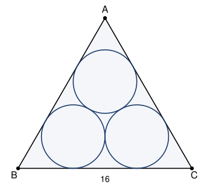

## Statement

Soit $ABC$ un triangle équilatéral de côté $16$.

Trois cercles de même rayon $r$ sont placés à l'intérieur : ils sont tangents entre eux deux à
deux, et chacun d'eux est tangent à deux côtés du triangle.

Déterminer $r$.

## Hints

1. Un cercle tangent à deux côtés a son centre sur la bissectrice de l'angle formé par ces
   deux côtés. Quel angle fait cette bissectrice avec le côté $[BC]$ ?
2. Note $O$ le centre du cercle logé dans le coin $B$, et $H$ son projeté sur $[BC]$. Que
   valent $OH$ et l'angle $\widehat{OBH}$ ?
3. Calcule $BH$ à l'aide de la tangente d'un angle de $30^\circ$.
4. Les deux cercles du bas sont tangents entre eux et tous deux tangents à $[BC]$ : quelle est
   la distance entre leurs deux points de contact avec $[BC]$ ? Découpe maintenant $[BC]$ en
   trois morceaux.

## Solution

**Le centre du cercle du bas à gauche.** Notons $O$ le centre du cercle logé dans le coin $B$,
et $H$ son projeté orthogonal sur la droite $(BC)$. Comme le cercle est tangent à $(BC)$, on a

$$OH = r .$$

Ce cercle est tangent aux deux côtés $[BA]$ et $[BC]$, donc son centre est à égale distance des
deux : il est sur la bissectrice de l'angle $\widehat{ABC}$. Le triangle étant équilatéral,
$\widehat{ABC} = 60^\circ$, donc

$$\widehat{OBH} = 30^\circ .$$

**On en déduit $BH$.** Dans le triangle $OBH$, rectangle en $H$ :

$$\tan\left(30^\circ\right) = \frac{OH}{BH} = \frac{r}{BH} .$$

Comme $\tan(30^\circ) = \dfrac{1}{\sqrt{3}}$, on obtient

$$BH = r\sqrt{3} .$$

**Le même calcul dans le coin $C$.** Notons $O'$ le centre du cercle logé dans le coin $C$ et
$K$ son projeté sur $(BC)$. Par le même raisonnement,

$$CK = r\sqrt{3} .$$

**La distance entre les deux points de contact.** Les deux cercles du bas ont leur centre à la
hauteur $r$ au-dessus de $(BC)$, et ils sont tangents entre eux, donc la distance entre leurs
centres vaut $2r$. Comme $O$ et $O'$ sont à la même hauteur, le segment $[OO']$ est parallèle à
$(BC)$, et

$$HK = OO' = 2r .$$

**On recompose le côté.** Les points $B$, $H$, $K$, $C$ sont alignés dans cet ordre, donc

$$BC = BH + HK + KC = r\sqrt{3} + 2r + r\sqrt{3} = 2r + 2r\sqrt{3}.$$

Comme $BC = 16$ :

$$2r\,(1 + \sqrt{3}) = 16, \qquad \text{donc} \qquad r = \frac{8}{1 + \sqrt{3}} .$$

**On rend le dénominateur entier.** Multiplions haut et bas par $\sqrt{3} - 1$ :

$$r = \frac{8\,(\sqrt{3} - 1)}{(\sqrt{3} + 1)(\sqrt{3} - 1)} = \frac{8\,(\sqrt{3} - 1)}{3 - 1} = 4\,(\sqrt{3} - 1).$$

**Le rayon vaut $r = 4\sqrt{3} - 4$, soit environ $\text{2,93}$.**

## Going further

On peut écrire ce résultat sous la forme $r = \sqrt{48} - 4$, puisque
$4\sqrt{3} = \sqrt{16 \times 3} = \sqrt{48}$. C'est sous cette forme que le concours posait la
question, en demandant la valeur de $a + b$ pour $r = \sqrt{a} - b$.

Vérification de bon sens : le cercle inscrit dans un triangle équilatéral de côté $16$ a pour
rayon $\dfrac{16}{2\sqrt{3}} \approx \text{4,62}$. Nos trois cercles sont plus petits, ce qui est
rassurant.
