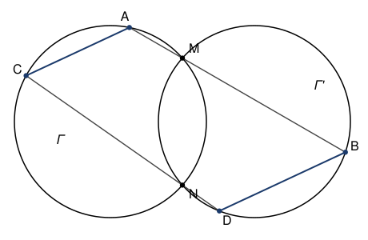

## Statement

Deux cercles $\Gamma$ et $\Gamma'$ se coupent en deux points distincts $M$ et $N$.

Une droite passant par $M$ recoupe $\Gamma$ en $A$ et $\Gamma'$ en $B$.
Une droite passant par $N$ recoupe $\Gamma$ en $C$ et $\Gamma'$ en $D$.

On se place dans la configuration dessinée ci-dessous : $M$ est entre $A$ et $B$, $N$ est entre
$C$ et $D$, et les points $A$ et $B$ sont du même côté de la droite $(CD)$.

Montrer que les droites $(AC)$ et $(BD)$ sont parallèles.

## Hints

1. Repère les quatre points de $\Gamma$ : $A$, $M$, $N$, $C$. Ils sont sur un même cercle. Que
   sait-on des angles opposés d'un quadrilatère inscrit dans un cercle ?
2. Fais la même chose sur $\Gamma'$ avec $B$, $M$, $N$, $D$.
3. Additionne les deux relations obtenues. Utilise ensuite que $A$, $M$, $B$ sont alignés dans
   cet ordre.
4. Tu obtiens deux angles supplémentaires de part et d'autre de la droite $(CD)$. Quel critère
   de parallélisme cela déclenche-t-il ?

## Solution

**L'outil.** Dans un quadrilatère dont les quatre sommets sont sur un même cercle, deux angles
opposés sont supplémentaires : leur somme vaut $180^\circ$. C'est une conséquence du théorème
de l'angle inscrit.

**Sur le cercle $\Gamma$.** Les points $M$, $A$, $C$, $N$ sont sur $\Gamma$ et, dans la
configuration de la figure, ils s'y succèdent dans cet ordre. Le quadrilatère $MACN$ est donc
inscrit dans $\Gamma$, et ses angles en $M$ et en $C$ sont opposés :

$$\widehat{AMN} + \widehat{ACN} = 180^\circ .$$

**Sur le cercle $\Gamma'$.** De même, les points $M$, $N$, $D$, $B$ sont sur $\Gamma'$ dans cet
ordre, donc le quadrilatère $MNDB$ est inscrit dans $\Gamma'$, et ses angles en $M$ et en $D$
sont opposés :

$$\widehat{BMN} + \widehat{BDN} = 180^\circ .$$

**On additionne.**

$$\widehat{ACN} + \widehat{BDN} = 360^\circ - \left(\widehat{AMN} + \widehat{BMN}\right).$$

**On utilise l'alignement de $A$, $M$, $B$.** Le point $M$ est entre $A$ et $B$, donc les
demi-droites $[MA)$ et $[MB)$ sont opposées et les angles $\widehat{AMN}$ et $\widehat{BMN}$
sont supplémentaires :

$$\widehat{AMN} + \widehat{BMN} = 180^\circ .$$

En reportant :

$$\widehat{ACN} + \widehat{BDN} = 360^\circ - 180^\circ = 180^\circ .$$

**On utilise l'alignement de $C$, $N$, $D$.** Le point $N$ est entre $C$ et $D$, donc la
demi-droite $[CN)$ est la demi-droite $[CD)$, et la demi-droite $[DN)$ est la demi-droite
$[DC)$. Par conséquent

$$\widehat{ACN} = \widehat{ACD} \qquad \text{et} \qquad \widehat{BDN} = \widehat{BDC},$$

et donc

$$\widehat{ACD} + \widehat{BDC} = 180^\circ .$$

**Conclusion.** Coupons les deux droites $(AC)$ et $(BD)$ par la sécante $(CD)$. Les angles
$\widehat{ACD}$ et $\widehat{BDC}$ sont les deux angles intérieurs situés du même côté de cette
sécante, puisque $A$ et $B$ sont du même côté de $(CD)$. Ils sont supplémentaires, donc les
deux droites sont parallèles.

**Les droites $(AC)$ et $(BD)$ sont parallèles.**

## Going further

Le résultat reste vrai dans toutes les positions, même lorsque $M$ n'est pas entre $A$ et $B$,
ou lorsque les points ne se présentent plus dans le même ordre sur les cercles. Seule la
rédaction change : il faut alors remplacer les angles ordinaires par des angles orientés de
droites, un outil qui absorbe d'un coup toutes les configurations. C'est exactement ce genre de
problème qui a motivé l'invention de cet outil.

Cas limite amusant : si les deux droites sont confondues avec $(MN)$, les points $A$, $B$, $C$,
$D$ se confondent deux à deux et la conclusion devient vide. Il faut donc bien deux droites
distinctes de $(MN)$.
