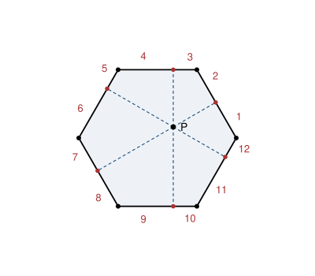

## Statement

Soit $A_1A_2\ldots A_n$ un polygone régulier à $n$ côtés, et soit $P$ un point intérieur à ce
polygone. On suppose que, pour chacun des $n$ côtés, le projeté orthogonal de $P$ sur la droite
qui porte ce côté tombe **à l'intérieur du côté**, et non sur son prolongement.

Ces $n$ projetés découpent le contour du polygone en $2n$ petits segments. On les numérote de
$1$ à $2n$ en partant d'un segment quelconque, puis en tournant toujours dans le même sens le
long du contour.

Montrer que la somme des longueurs des segments de numéro **pair** est égale à la somme des
longueurs des segments de numéro **impair**.

## Hints

1. Appelle $s$ la longueur commune des côtés. Sur un côté donné, les deux segments ont pour
   somme $s$. Que devient alors la conclusion à démontrer ?
2. Les segments de numéro impair et ceux de numéro pair alternent le long du contour. Comme
   chaque côté porte exactement un segment de chaque parité, note $x_i$ la longueur du segment
   du côté $[A_iA_{i+1}]$ qui touche $A_i$, et $y_i$ celle de l'autre. Que faut-il démontrer,
   en termes de $x_1, \ldots, x_n$ ?
3. Le point $B_i$ est le pied d'une perpendiculaire : les triangles $PB_iA_i$ et
   $PB_iA_{i+1}$ sont rectangles en $B_i$. Écris le théorème de Pythagore dans chacun d'eux.
4. Soustrais les deux égalités obtenues. Il apparaît $x_i^2 - y_i^2$ d'un côté et
   $PA_i^2 - PA_{i+1}^2$ de l'autre. Additionne maintenant toutes ces égalités, pour $i$
   allant de $1$ à $n$, en refermant la boucle.

## Solution

### Les notations

Le polygone est régulier, donc tous ses côtés ont la même longueur, que l'on note $s$.

Pour chaque $i$ de $1$ à $n$, notons $B_i$ le projeté orthogonal de $P$ sur le côté
$[A_iA_{i+1}]$, avec la convention $A_{n+1} = A_1$ qui referme la boucle. Posons

$$x_i = A_iB_i , \qquad y_i = B_iA_{i+1} .$$

Par hypothèse, $B_i$ est strictement à l'intérieur du côté, donc $x_i > 0$, $y_i > 0$ et

$$(\star) \qquad x_i + y_i = s .$$

### Ce qu'il faut vraiment démontrer

En parcourant le contour à partir de $A_1$, on rencontre les segments dans l'ordre

$$[A_1B_1],\ [B_1A_2],\ [A_2B_2],\ [B_2A_3],\ \ldots,\ [A_nB_n],\ [B_nA_1] ,$$

c'est-à-dire, en longueurs, $x_1, y_1, x_2, y_2, \ldots, x_n, y_n$. Les segments de type $x$
et ceux de type $y$ **alternent** tout au long du contour. Comme il y en a $2n$, un nombre
pair, la numérotation donne à tous les $x_i$ la même parité et à tous les $y_i$ l'autre,
quel que soit le segment de départ choisi et quel que soit le sens de parcours.

Il s'agit donc de montrer que

$$x_1 + x_2 + \cdots + x_n \ = \ y_1 + y_2 + \cdots + y_n .$$

En additionnant les $n$ égalités $(\star)$, on obtient

$$(x_1 + \cdots + x_n) + (y_1 + \cdots + y_n) = n\,s ,$$

donc la conclusion cherchée équivaut à

$$x_1 + x_2 + \cdots + x_n = \frac{n\,s}{2} .$$

### Le théorème de Pythagore, côté par côté

Le segment $[PB_i]$ est perpendiculaire au côté $[A_iA_{i+1}]$. Les triangles $PB_iA_i$ et
$PB_iA_{i+1}$ sont donc rectangles en $B_i$, et Pythagore donne

$$PA_i^2 = PB_i^2 + x_i^2 , \qquad PA_{i+1}^2 = PB_i^2 + y_i^2 .$$

En soustrayant, la longueur $PB_i$, qui est inconnue, disparaît :

$$PA_i^2 - PA_{i+1}^2 = x_i^2 - y_i^2 .$$

Le membre de droite se factorise, et $(\star)$ intervient :

$$x_i^2 - y_i^2 = (x_i - y_i)(x_i + y_i) = s\,(x_i - y_i) = s\,(2x_i - s) ,$$

la dernière écriture parce que $y_i = s - x_i$. On retient donc, pour chaque $i$,

$$PA_i^2 - PA_{i+1}^2 = s\,(2x_i - s) .$$

### On referme la boucle

Additionnons ces $n$ égalités, pour $i = 1, 2, \ldots, n$. À gauche, la somme se télescope le
long du cycle : chaque terme $-PA_{i+1}^2$ est annulé par le terme $+PA_{i+1}^2$ de la ligne
suivante, et le tout dernier, $-PA_{n+1}^2 = -PA_1^2$, annule le tout premier, $+PA_1^2$. Il
reste

$$\sum_{i=1}^{n} \big(PA_i^2 - PA_{i+1}^2\big) = PA_1^2 - PA_1^2 = 0 .$$

À droite, on obtient

$$\sum_{i=1}^{n} s\,(2x_i - s) = s\left(2\sum_{i=1}^{n} x_i - n\,s\right) .$$

Donc

$$s\left(2\sum_{i=1}^{n} x_i - n\,s\right) = 0 .$$

Comme $s > 0$, on peut simplifier :

$$\sum_{i=1}^{n} x_i = \frac{n\,s}{2} .$$

C'est exactement ce qu'il fallait démontrer. Les segments de numéro impair et ceux de numéro
pair ont donc la même longueur totale, à savoir la moitié du périmètre.

## Going further

Regardons ce que la démonstration a vraiment utilisé. Les angles du polygone n'apparaissent
nulle part : la seule chose qui a servi est que **tous les côtés ont la même longueur**. Le
résultat vaut donc pour n'importe quel polygone équilatéral, par exemple un losange aplati,
et pas seulement pour un polygone régulier.

Et si les côtés n'ont pas tous la même longueur ? La première partie du calcul reste valable
et donne, en notant $s_i$ la longueur du côté numéro $i$ :

$$\sum_{i=1}^{n} s_i\,(x_i - y_i) = 0 .$$

On obtient donc toujours une égalité, mais une égalité **pondérée** par les longueurs des
côtés. Ce n'est que lorsque tous les $s_i$ sont égaux qu'on peut les mettre en facteur et
retrouver l'énoncé.
