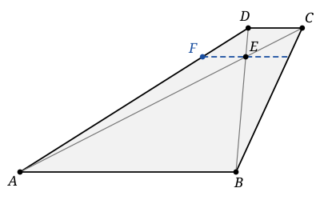

## Statement

Soit $ABCD$ un trapèze : les droites $(AB)$ et $(CD)$ sont parallèles. On suppose de plus que

$$AB + CD = AD.$$

Les diagonales $(AC)$ et $(BD)$ se coupent en un point $E$. La droite passant par $E$ et parallèle à $(AB)$ coupe le côté $[AD]$ en un point $F$.

Montrer que $\widehat{BFC} = 90^\circ$.

## Hints

1. Dans le triangle $ACD$, le point $F$ est sur $[AD]$, le point $E$ est sur $[AC]$, et $(FE)$ est parallèle à $(CD)$. Que dit le théorème de Thalès ?
2. Les droites $(AB)$ et $(CD)$ étant parallèles, les triangles $AEB$ et $CED$ sont semblables. Quel rapport cela te donne-t-il pour $\dfrac{AE}{EC}$ ?
3. Tu obtiens $\dfrac{AF}{FD} = \dfrac{AB}{CD}$. Ajoute $1$ de chaque côté, puis sers-toi de l'hypothèse $AB + CD = AD$.
4. Tu découvriras deux triangles isocèles. Calcule alors les angles $\widehat{AFB}$ et $\widehat{DFC}$ en fonction des angles du trapèze.
5. Enfin, $F$ est sur le segment $[AD]$ : les trois angles en $F$ font un angle plat. Et dans un trapèze, deux angles consécutifs du même côté sont supplémentaires.

## Solution

Notons $\widehat{A} = \widehat{DAB}$ et $\widehat{D} = \widehat{ADC}$ les deux angles du trapèze situés du côté de $[AD]$.

**Étape 1 : un rapport de longueurs sur $[AD]$.**

Dans le triangle $ACD$, le point $F$ appartient à $[AD]$, le point $E$ appartient à $[AC]$, et $(FE) \parallel (CD)$. Le théorème de Thalès donne

$$\frac{AF}{FD} = \frac{AE}{EC}.$$

Par ailleurs, $(AB) \parallel (CD)$, donc dans les triangles $AEB$ et $CED$ les angles alternes-internes sont égaux : $\widehat{EAB} = \widehat{ECD}$ et $\widehat{EBA} = \widehat{EDC}$. Ces deux triangles sont donc semblables, et

$$\frac{AE}{EC} = \frac{AB}{CD}.$$

En combinant les deux égalités :

$$\frac{AF}{FD} = \frac{AB}{CD}. \qquad (\star)$$

**Étape 2 : $FD = CD$ et $AF = AB$.**

Ajoutons $1$ à chaque membre de $(\star)$ :

$$\frac{AF}{FD} + 1 = \frac{AB}{CD} + 1, \qquad \text{c'est-à-dire} \qquad \frac{AF + FD}{FD} = \frac{AB + CD}{CD}.$$

Comme $F$ est sur $[AD]$, on a $AF + FD = AD$. Et par hypothèse $AB + CD = AD$. Donc

$$\frac{AD}{FD} = \frac{AD}{CD}, \qquad \text{d'où} \qquad FD = CD.$$

Reprenons $(\star)$ à l'envers : $\dfrac{FD}{AF} = \dfrac{CD}{AB}$, et en ajoutant $1$ de la même manière,

$$\frac{AD}{AF} = \frac{AD}{AB}, \qquad \text{d'où} \qquad AF = AB.$$

**Étape 3 : deux triangles isocèles.**

De $AF = AB$ on tire que le triangle $ABF$ est isocèle en $A$, donc ses deux angles à la base sont égaux et leur somme vaut $180^\circ - \widehat{A}$ :

$$\widehat{AFB} = \frac{180^\circ - \widehat{A}}{2} = 90^\circ - \frac{\widehat{A}}{2}.$$

De $FD = CD$ on tire que le triangle $DFC$ est isocèle en $D$, donc de même

$$\widehat{DFC} = 90^\circ - \frac{\widehat{D}}{2}.$$

**Étape 4 : l'angle cherché.**

Le point $F$ est sur le segment $[AD]$, et $B$ et $C$ sont du même côté de la droite $(AD)$. Les trois angles $\widehat{AFB}$, $\widehat{BFC}$ et $\widehat{CFD}$ se suivent et forment ensemble l'angle plat $\widehat{AFD}$ :

$$\widehat{AFB} + \widehat{BFC} + \widehat{CFD} = 180^\circ.$$

Donc

$$\widehat{BFC} = 180^\circ - \left(90^\circ - \frac{\widehat{A}}{2}\right) - \left(90^\circ - \frac{\widehat{D}}{2}\right) = \frac{\widehat{A} + \widehat{D}}{2}.$$

Enfin, comme $(AB) \parallel (CD)$ et que $(AD)$ coupe ces deux parallèles, les angles $\widehat{A}$ et $\widehat{D}$ sont supplémentaires :

$$\widehat{A} + \widehat{D} = 180^\circ.$$

**Conclusion :**

$$\widehat{BFC} = \frac{180^\circ}{2} = 90^\circ.$$
