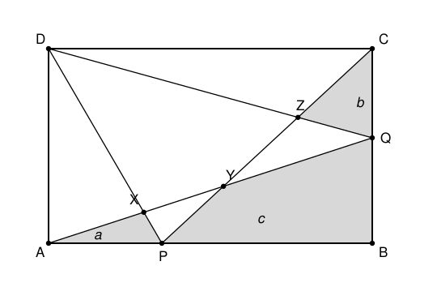

## Statement

$ABCD$ est un rectangle. On place un point $P$ sur le côté $[AB]$ et un point $Q$ sur le côté $[BC]$, puis on trace les quatre segments $[AQ]$, $[DP]$, $[CP]$ et $[DQ]$.

Ces segments se coupent en trois points :

- $X$ est l'intersection de $[AQ]$ et $[DP]$ ;
- $Y$ est l'intersection de $[AQ]$ et $[CP]$ ;
- $Z$ est l'intersection de $[CP]$ et $[DQ]$.

On note $a$ l'aire du triangle $APX$, $b$ l'aire du triangle $CQZ$, et $c$ l'aire du quadrilatère $BPYQ$ (les trois régions grisées sur la figure).

Montrer que l'aire du quadrilatère $DXYZ$ vaut exactement $a + b + c$, et cela quelle que soit la position de $P$ sur $[AB]$ et de $Q$ sur $[BC]$.

## Hints

1. On ne peut pas calculer $a$, $b$, $c$ séparément : leurs valeurs dépendent de $P$ et $Q$. Il faut donc trouver des **grandes** figures dont ces petites régions sont des morceaux, et faire des différences.
2. Cherche un triangle qui contient $DXYZ$ et dont le reste se décompose bien. Le triangle $DCP$ est un bon candidat : quelles sont les trois régions qui le composent ?
3. De même, le triangle $CDQ$ se coupe en deux morceaux par le segment $[CZ]$, et l'un des deux est le triangle d'aire $b$.
4. Et le triangle $ABQ$ se coupe en trois morceaux par les segments $[PX]$ et $[PY]$ : deux d'entre eux ont pour aires $a$ et $c$.
5. Rassemble tout : tu obtiendras l'aire cherchée sous la forme $a + b + c + (\text{aire de } DCP) - (\text{aire de } CDQ) - (\text{aire de } ABQ)$. Il ne reste qu'à montrer que ces trois dernières aires se compensent.
6. Pour cela, calcule-les avec la formule « base $\times$ hauteur $\div\ 2$ » en prenant $[CD]$ ou $[AB]$ comme base, et souviens-toi que $QB + QC = BC$.

## Solution

Notons $[\,XYZ\,]$ l'aire d'une figure. Toute la démonstration consiste à découper trois grands triangles et à recoller.

**Étape 1 : découper le triangle $DCP$.**

Le triangle $DCP$ a pour sommets $D$, $C$ et $P$. Regardons ce qu'il contient.

Le point $X$ est sur le segment $[DP]$, et les points $Y$ et $Z$ sont tous deux sur le segment $[CP]$, dans l'ordre $C$, $Z$, $Y$, $P$. Les deux segments $[XY]$ (porté par $(AQ)$) et $[DZ]$ (porté par $(DQ)$) découpent alors le triangle $DCP$ en exactement trois morceaux :

- le triangle $PXY$, du côté de $P$ ;
- le quadrilatère $DXYZ$, celui qui nous intéresse ;
- le triangle $DZC$, du côté de $C$.

D'où

$$[\,DXYZ\,] = [\,DCP\,] - [\,DZC\,] - [\,PXY\,] . \qquad (1)$$

**Étape 2 : exprimer $[\,DZC\,]$.**

Le point $Z$ est sur le segment $[DQ]$. Dans le triangle $CDQ$, le segment $[CZ]$ part du sommet $C$ et aboutit sur le côté opposé $[DQ]$ : il coupe donc ce triangle en deux, le triangle $CDZ$ et le triangle $CZQ$. Or $CZQ$ est précisément le triangle d'aire $b$. Donc

$$[\,DZC\,] = [\,CDQ\,] - b . \qquad (2)$$

**Étape 3 : exprimer $[\,PXY\,]$.**

Regardons le triangle $ABQ$. Le point $P$ est sur $[AB]$, et les points $X$ et $Y$ sont sur $[AQ]$, dans l'ordre $A$, $X$, $Y$, $Q$. Les deux segments $[PX]$ et $[PY]$ partent de $P$ et découpent $ABQ$ en trois morceaux :

- le triangle $APX$, d'aire $a$ ;
- le triangle $PXY$ ;
- le quadrilatère $BPYQ$, d'aire $c$.

D'où

$$[\,PXY\,] = [\,ABQ\,] - a - c . \qquad (3)$$

**Étape 4 : tout rassembler.**

En reportant $(2)$ et $(3)$ dans $(1)$ :

$$[\,DXYZ\,] = [\,DCP\,] - ([\,CDQ\,] - b) - ([\,ABQ\,] - a - c) ,$$

c'est-à-dire

$$[\,DXYZ\,] = a + b + c + [\,DCP\,] - [\,CDQ\,] - [\,ABQ\,] . \qquad (4)$$

Il reste donc une seule chose à prouver :

$$[\,DCP\,] = [\,CDQ\,] + [\,ABQ\,] .$$

**Étape 5 : les trois grands triangles se compensent.**

Notons $L = AB = CD$ la longueur du rectangle et $h = BC = AD$ sa largeur.

*Le triangle $DCP$.* Prenons $[CD]$ pour base. Le sommet $P$ est sur le côté $[AB]$, qui est parallèle à $(CD)$ et à distance $h$ de cette droite. Donc

$$[\,DCP\,] = \frac{1}{2} \times L \times h .$$

*Le triangle $CDQ$.* Prenons encore $[CD]$ pour base. Le sommet $Q$ est sur $[BC]$, et $(BC)$ est perpendiculaire à $(CD)$ : la distance de $Q$ à la droite $(CD)$ vaut donc simplement $QC$. Donc

$$[\,CDQ\,] = \frac{1}{2} \times L \times QC .$$

*Le triangle $ABQ$.* Prenons $[AB]$ pour base. De la même façon, la distance de $Q$ à la droite $(AB)$ vaut $QB$. Donc

$$[\,ABQ\,] = \frac{1}{2} \times L \times QB .$$

En additionnant les deux dernières :

$$[\,CDQ\,] + [\,ABQ\,] = \frac{1}{2} \times L \times (QC + QB) = \frac{1}{2} \times L \times BC = \frac{1}{2} \times L \times h = [\,DCP\,] ,$$

où l'on a utilisé que $Q$ est **sur** le segment $[BC]$, donc $QC + QB = BC$.

**Conclusion.**

Les trois derniers termes de $(4)$ se compensent, et il reste

$$\boxed{[\,DXYZ\,] = a + b + c} .$$

Remarquons que la démonstration n'a utilisé la position de $P$ et de $Q$ nulle part, sauf pour dire qu'ils sont sur leurs côtés respectifs. Le résultat est donc bien vrai pour toutes les positions.

## Going further

La propriété reste-t-elle vraie si $ABCD$ est seulement un parallélogramme, et non un rectangle ? Reprendre l'étape 5 : quelles hauteurs faut-il utiliser, et l'argument tient-il encore ?
