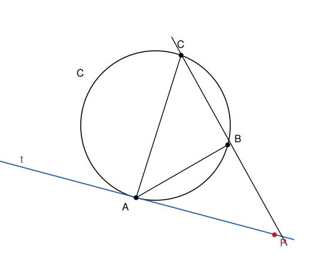

## Statement

$ABC$ est un triangle, et $\mathcal{C}$ est le cercle qui passe par ses trois sommets.

On trace la tangente $t$ au cercle $\mathcal{C}$ au point $A$, c'est-à-dire la droite qui touche le
cercle en $A$ sans le traverser. Cette tangente coupe la droite $(BC)$ en un point $P$.

Démontrer que

$$PA^2 = PB \times PC .$$

## Hints

1. Une égalité de produits cache presque toujours une égalité de rapports. Récris $PA^2 = PB \times PC$ sous la forme $\dfrac{PA}{PB} = \dfrac{PC}{PA}$.
2. Ces deux rapports sont les rapports de côtés de deux triangles : lesquels ? Regarde $PAB$ et $PCA$.
3. Deux triangles sont semblables dès qu'ils ont deux angles égaux. Les triangles $PAB$ et $PCA$ ont déjà un angle commun. Lequel ?
4. Il te reste à montrer que $\widehat{PAB} = \widehat{PCA}$, c'est-à-dire que l'angle entre la tangente et la corde $[AB]$ est égal à l'angle inscrit $\widehat{ACB}$.
5. Pour démontrer ce dernier point, fais apparaître le centre $O$ du cercle. Le rayon $[OA]$ est perpendiculaire à la tangente, et le triangle $OAB$ est isocèle.

## Solution

**Étape 1 : ce qu'il faut vraiment démontrer.**

Les longueurs $PA$, $PB$ et $PC$ sont toutes strictement positives, donc l'égalité

$$PA^2 = PB \times PC$$

équivaut à

$$\frac{PA}{PB} = \frac{PC}{PA} .$$

Sous cette forme, on reconnaît une égalité de rapports entre les côtés des deux triangles
$PAB$ et $PCA$. Nous allons montrer que ces deux triangles sont **semblables**.

**Étape 2 : l'angle entre la tangente et la corde.**

C'est le cœur du problème. Montrons que

$$\widehat{PAB} = \widehat{ACB} .$$

Appelons $O$ le centre du cercle $\mathcal{C}$ et $R$ son rayon. Notons $\alpha = \widehat{PAB}$,
l'angle entre la tangente et la corde $[AB]$.

Le rayon $[OA]$ est perpendiculaire à la tangente en $A$, donc

$$\widehat{OAB} = 90° - \alpha .$$

Le triangle $OAB$ est isocèle en $O$, puisque $OA = OB = R$. Ses deux angles à la base sont donc
égaux :

$$\widehat{OBA} = \widehat{OAB} = 90° - \alpha .$$

La somme des angles du triangle $OAB$ vaut $180°$, donc l'angle au sommet vaut

$$\widehat{AOB} = 180° - 2(90° - \alpha) = 2\alpha .$$

Or $\widehat{AOB}$ est l'angle au centre qui intercepte l'arc $AB$, et $\widehat{ACB}$ est l'angle
inscrit qui intercepte le même arc. Le théorème de l'angle inscrit donne

$$\widehat{ACB} = \frac{\widehat{AOB}}{2} = \alpha .$$

Donc

$$\widehat{PAB} = \widehat{ACB} ,$$

ce qu'on voulait.

**Étape 3 : les deux triangles sont semblables.**

Comparons les triangles $PAB$ et $PCA$.

- Ils ont l'angle en $P$ en commun : $\widehat{APB} = \widehat{CPA}$, car $B$ et $C$ sont tous deux sur la droite $(BC)$, du même côté de $P$.
- D'après l'étape 2, $\widehat{PAB} = \widehat{ACB} = \widehat{PCA}$, car $P$ est sur la droite $(CB)$ prolongée, donc les angles $\widehat{ACB}$ et $\widehat{PCA}$ sont le même angle.

Deux angles égaux suffisent : les triangles $PAB$ et $PCA$ sont semblables.

**Étape 4 : on écrit les rapports.**

Il faut apparier correctement les sommets. Dans le triangle $PAB$ et le triangle $PCA$, la
correspondance est

$$P \leftrightarrow P , \qquad A \leftrightarrow C , \qquad B \leftrightarrow A .$$

Les rapports des côtés correspondants sont donc égaux :

$$\frac{PA}{PC} = \frac{PB}{PA} = \frac{AB}{CA} .$$

En particulier

$$\frac{PA}{PC} = \frac{PB}{PA} ,$$

et le produit en croix donne

$$\boxed{PA^2 = PB \times PC} .$$

## Going further

Le nombre $PA^2 = PB \times PC$ porte un nom : c'est la **puissance du point $P$ par rapport au
cercle** $\mathcal{C}$. Elle vaut aussi $PO^2 - R^2$, où $O$ est le centre et $R$ le rayon, et
elle ne dépend donc que de $P$ et du cercle, pas de la droite qu'on a tracée.

Cela donne une seconde version du résultat : si deux droites passant par $P$ coupent le cercle,
la première en $B$ et $C$, la seconde en $D$ et $E$, alors

$$PB \times PC = PD \times PE .$$

La tangente est simplement le cas limite où les deux points d'intersection se confondent en $A$,
et le produit devient $PA \times PA$.

Le résultat de l'étape 2, « l'angle entre une tangente et une corde est égal à l'angle inscrit
qui intercepte cette corde de l'autre côté », s'appelle le **théorème de l'angle tangentiel**.
Il vaut la peine d'être retenu : il revient sans arrêt dès qu'une figure comporte une tangente.
