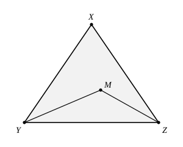
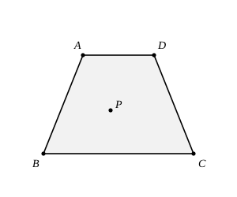

## Statement

**1.** Soit $XYZ$ un triangle et soit $M$ un point de ce triangle, intérieur ou situé sur un côté. Montrer que

$$MY + MZ \leqslant XY + XZ.$$

**2.** $ABCD$ est un quadrilatère convexe tel que les droites $(AD)$ et $(BC)$ sont parallèles, que $AB = CD$, que $AD < AB$ et que $BC < AB$. Soit $P$ un point situé strictement à l'intérieur de $ABCD$. Montrer que

$$PA + PB + PC + PD \;<\; 4AB \;<\; 2\,(PA + PB + PC + PD).$$

## Hints

1. Pour la question 1, n'essaie pas de comparer $MY$ à $XY$ d'un côté et $MZ$ à $XZ$ de l'autre : pris séparément, c'est faux. Il faut un raisonnement qui traite les deux longueurs ensemble.
2. Pour la question 1, prolonge le segment $[YM]$ au-delà de $M$ jusqu'au côté $[XZ]$, et appelle $N$ le point obtenu. Applique alors l'inégalité triangulaire deux fois : une fois avec les points $M$, $N$, $Z$, une fois avec les points $X$, $Y$, $N$.
3. Pour l'inégalité de gauche de la question 2, trace les deux diagonales. Elles découpent le quadrilatère en quatre triangles, et $P$ se trouve dans deux d'entre eux au moins.
4. La question 1 sert alors quatre fois, avec à chaque fois un sommet différent dans le rôle de $X$. Les hypothèses $AD < AB$, $BC < AB$ et $CD = AB$ servent à la toute fin.
5. Pour l'inégalité de droite, il suffit de l'inégalité triangulaire toute simple, appliquée une fois aux points $P$, $A$, $B$ et une fois aux points $P$, $C$, $D$. Pense à regarder quand elle est stricte.

## Solution

### Question 1

Si $M = Y$, alors $MY + MZ = YZ \leqslant YX + XZ$ par l'inégalité triangulaire, et c'est fini. Supposons donc $M \neq Y$.

**On construit un point auxiliaire.** La demi-droite issue de $Y$ et passant par $M$ sort du triangle par le côté opposé à $Y$, c'est-à-dire par $[XZ]$. Notons $N$ le point où elle le coupe. Le point $M$ est alors situé sur le segment $[YN]$, donc

$$YM + MN = YN.$$

**On applique deux fois l'inégalité triangulaire.** D'abord aux points $M$, $N$ et $Z$ :

$$MZ \leqslant MN + NZ.$$

En ajoutant $MY$ des deux côtés :

$$MY + MZ \leqslant MY + MN + NZ = YN + NZ.$$

Ensuite aux points $X$, $Y$ et $N$ :

$$YN \leqslant YX + XN.$$

En reportant :

$$MY + MZ \leqslant YX + XN + NZ.$$

**On recolle.** Le point $N$ appartient au segment $[XZ]$, donc $XN + NZ = XZ$. Finalement

$$MY + MZ \leqslant XY + XZ,$$

ce qu'il fallait démontrer.

### Question 2

Retenons de la question 1 l'énoncé suivant, qu'on utilisera quatre fois :

> Si un point $P$ appartient à un triangle $UVW$, alors $PV + PW \leqslant UV + UW$.

Autrement dit : depuis un point du triangle, la somme des distances à **deux** sommets ne dépasse pas la somme des deux côtés issus du troisième.

#### L'inégalité de gauche

**On majore $PA + PC$.** La diagonale $[AC]$ partage le quadrilatère convexe $ABCD$ en deux triangles : $ABC$ et $ACD$. Le point $P$ appartient donc à l'un des deux au moins.

- Si $P$ appartient au triangle $ABC$, l'énoncé encadré avec $U = B$, $V = A$, $W = C$ donne
$$PA + PC \leqslant BA + BC = AB + BC.$$
Comme $BC < AB$, on obtient $PA + PC < 2AB$.

- Si $P$ appartient au triangle $ACD$, l'énoncé encadré avec $U = D$, $V = A$, $W = C$ donne
$$PA + PC \leqslant DA + DC = AD + CD.$$
Comme $AD < AB$ et $CD = AB$, on obtient là encore $PA + PC < 2AB$.

Dans les deux cas :

$$PA + PC < 2AB.$$

**On majore $PB + PD$.** Cette fois c'est la diagonale $[BD]$ qui partage $ABCD$ en deux triangles, $ABD$ et $BCD$.

- Si $P$ appartient au triangle $ABD$, avec $U = A$, $V = B$, $W = D$ :
$$PB + PD \leqslant AB + AD < AB + AB = 2AB.$$

- Si $P$ appartient au triangle $BCD$, avec $U = C$, $V = B$, $W = D$ :
$$PB + PD \leqslant CB + CD = BC + AB < AB + AB = 2AB.$$

Dans les deux cas :

$$PB + PD < 2AB.$$

**On additionne :**

$$PA + PB + PC + PD < 2AB + 2AB = 4AB.$$

#### L'inégalité de droite

Le point $P$ est strictement à l'intérieur du quadrilatère : il n'est donc ni sur le segment $[AB]$, ni sur le segment $[CD]$.

L'inégalité triangulaire appliquée aux points $P$, $A$, $B$ donne $PA + PB \geqslant AB$, avec égalité seulement lorsque $P$ appartient à $[AB]$. Ce n'est pas le cas, donc

$$PA + PB > AB.$$

De même, avec les points $P$, $C$, $D$ :

$$PC + PD > CD = AB.$$

En additionnant :

$$PA + PB + PC + PD > 2AB,$$

et en multipliant par $2$ :

$$2\,(PA + PB + PC + PD) > 4AB.$$

#### Conclusion

Les deux inégalités mises bout à bout donnent bien

$$PA + PB + PC + PD < 4AB < 2\,(PA + PB + PC + PD).$$

## Going further

Une erreur très fréquente sur la question 1 consiste à écrire « $MY \leqslant XY$ et $MZ \leqslant XZ$, donc c'est fini ». Ces deux inégalités sont fausses en général : si $[YZ]$ est le plus grand côté du triangle et si on place $M$ tout près de $Z$, alors $MY$ dépasse $XY$. Tout l'intérêt de l'exercice est justement de faire apparaître la **compensation** entre une longueur qui grandit et l'autre qui rapetisse, et une compensation, cela se quantifie : c'est le rôle du point auxiliaire $N$.

De la même façon, à la question 2, il serait faux d'affirmer que chacune des quatre distances $PA$, $PB$, $PC$, $PD$ est plus petite que $AB$ : en plaçant $P$ assez près de $C$, on obtient $PA > AB$.
