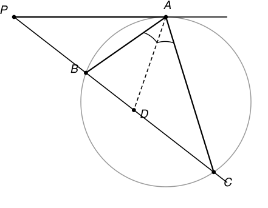

## Statement

Soit $ABC$ un triangle dont les côtés $[AB]$ et $[AC]$ n'ont pas la même longueur.

La bissectrice de l'angle $\widehat{BAC}$ coupe le côté $[BC]$ en un point $D$. La tangente en $A$ au cercle circonscrit au triangle $ABC$ coupe la droite $(BC)$ en un point $P$.

Montrer que le triangle $PAD$ est isocèle en $P$.

## Hints

1. Pour montrer que $PA = PD$, il suffit de montrer que les deux angles $\widehat{PAD}$ et $\widehat{PDA}$ sont égaux. Cherche donc à calculer chacun d'eux en fonction des angles du triangle.
2. Notons $2\alpha$, $2\beta$ et $2\gamma$ les angles du triangle en $A$, $B$ et $C$. La bissectrice coupe l'angle en $A$ en deux angles de $\alpha$ chacun.
3. L'angle $\widehat{PDA}$ est un angle extérieur du triangle $ADC$. Que vaut un angle extérieur d'un triangle, en fonction des deux angles qui ne lui sont pas adjacents ?
4. Il reste l'angle $\widehat{PAB}$, entre la tangente $(PA)$ et la corde $[AB]$. Fais intervenir le centre $O$ du cercle : le rayon $[OA]$ est perpendiculaire à la tangente, et le triangle $OAB$ est isocèle.

## Solution

Notons

$$\widehat{BAC} = 2\alpha, \qquad \widehat{ABC} = 2\beta, \qquad \widehat{BCA} = 2\gamma,$$

de sorte que $2\alpha + 2\beta + 2\gamma = 180°$, c'est-à-dire

$$\alpha + \beta + \gamma = 90°.$$

Sur la figure, $P$ se trouve du côté de $B$. (C'est le cas quand $AB < AC$ ; si $AB > AC$, $P$ est du côté de $C$ et l'on échange les rôles de $B$ et de $C$ dans tout ce qui suit.)

### Étape 1. L'angle entre la tangente et la corde

**Affirmation :** $\widehat{PAB} = \widehat{BCA} = 2\gamma$.

Notons $O$ le centre du cercle circonscrit. La tangente en $A$ est perpendiculaire au rayon $[OA]$, donc

$$\widehat{PAB} = 90° - \widehat{OAB}.$$

Le triangle $OAB$ est isocèle en $O$, puisque $OA = OB$ sont deux rayons. Ses deux angles à la base sont donc égaux, et comme la somme des angles vaut $180°$ :

$$\widehat{OAB} = \frac{180° - \widehat{AOB}}{2} = 90° - \frac{\widehat{AOB}}{2}.$$

En reportant :

$$\widehat{PAB} = 90° - \left(90° - \frac{\widehat{AOB}}{2}\right) = \frac{\widehat{AOB}}{2}.$$

Or le théorème de l'angle inscrit dit exactement que l'angle au centre $\widehat{AOB}$ vaut le double de l'angle inscrit $\widehat{ACB}$ qui intercepte le même arc $AB$. Donc

$$\widehat{PAB} = \widehat{ACB} = 2\gamma.$$

### Étape 2. L'angle $\widehat{PAD}$

Comme $P$ et $B$ sont du même côté, la demi-droite $[AB)$ est à l'intérieur de l'angle $\widehat{PAD}$, et l'angle se coupe en deux :

$$\widehat{PAD} = \widehat{PAB} + \widehat{BAD} = 2\gamma + \alpha.$$

### Étape 3. L'angle $\widehat{PDA}$

Les points $P$, $B$, $D$, $C$ sont alignés dans cet ordre, donc l'angle $\widehat{PDA}$ est l'angle extérieur en $D$ du triangle $ADC$.

Un angle extérieur d'un triangle est égal à la somme des deux angles qui ne lui sont pas adjacents. Ici, ces deux angles sont $\widehat{DAC} = \alpha$ et $\widehat{ACD} = \widehat{ACB} = 2\gamma$. Donc

$$\widehat{PDA} = \alpha + 2\gamma.$$

(On peut aussi le voir directement : dans le triangle $ADC$, la somme des angles donne $\widehat{ADC} = 180° - \alpha - 2\gamma$, et $\widehat{PDA} = 180° - \widehat{ADC} = \alpha + 2\gamma$.)

### Étape 4. Conclusion

Les deux étapes précédentes donnent

$$\widehat{PAD} = 2\gamma + \alpha = \widehat{PDA}.$$

Le triangle $PAD$ a donc deux angles égaux, ceux en $A$ et en $D$. Il est isocèle, et les deux côtés égaux sont ceux opposés à ces angles :

$$\boxed{PA = PD.}$$

## Going further

Le résultat de l'étape 1 porte un nom : c'est le **théorème de l'angle tangentiel**, ou angle entre une tangente et une corde. Il dit que l'angle entre la tangente en $A$ et la corde $[AB]$ est égal à l'angle inscrit $\widehat{ACB}$ vu depuis l'autre arc. On peut le retenir comme le théorème de l'angle inscrit poussé jusqu'au cas limite où le point inscrit vient se confondre avec $A$.

Une conséquence agréable de l'exercice : puisque $PA = PD$, le point $P$ est le centre d'un cercle passant par $A$ et par $D$. Et comme la puissance du point $P$ par rapport au cercle circonscrit vaut $PA^2 = PB \times PC$, on obtient au passage la relation

$$PD^2 = PB \times PC,$$

ce qui se lit aussi ainsi : la droite $(PA)$, qui est tangente au cercle circonscrit, est à la même distance de $B$ et de $C$ « au sens de la puissance ». On peut le vérifier en mesurant sur la figure.
