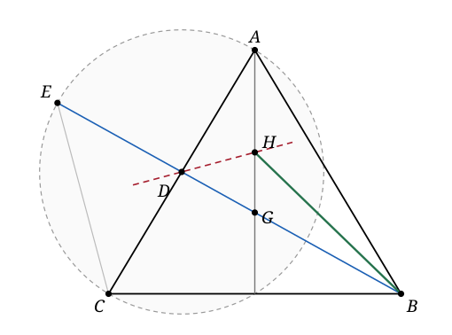

## Statement

Soit $ABC$ un triangle isocèle en $A$. Soit $D$ le milieu du segment $[AC]$ et soit $G$ le centre de gravité du triangle $ABC$.

La droite $(BD)$ recoupe le cercle de diamètre $[AC]$ en un point $E$, situé de l'autre côté de la droite $(AC)$ par rapport à $B$. La médiatrice du segment $[EC]$ coupe la droite $(AG)$ en un point $H$.

Montrer que la droite $(BH)$ est la bissectrice de l'angle $\widehat{GBA}$.

## Hints

1. Le point $G$ n'est là que pour désigner une droite. Sur quelle droite remarquable du triangle $ABC$ se trouve-t-il ? Et que devient cette droite parce que le triangle est isocèle en $A$ ?
2. Les points $A$, $D$ et $C$ sont alignés, et les points $E$, $D$ et $B$ aussi. Le point $D$ est donc le sommet de deux angles opposés par le sommet. Lesquels ?
3. Oublie $B$ un instant et regarde seulement le **triangle $ABD$**. Que sont, pour ce triangle, la droite $(AG)$ et la médiatrice de $[EC]$ ?
4. Pourquoi $D$ est-il sur la médiatrice de $[EC]$ ? Parce que $D$ est le centre d'un certain cercle passant par $E$ et par $C$.
5. Si tu as montré que $H$ est le point de rencontre de deux bissectrices du triangle $ABD$, la troisième bissectrice passe forcément par $H$ aussi.

## Solution

L'idée de l'exercice est cachée dans sa formulation : le point $H$, défini par deux constructions qui n'ont rien à voir l'une avec l'autre, est en réalité **le centre du cercle inscrit du triangle $ABD$**. Une fois cela vu, tout suit.

### Étape 1 : la droite $(AG)$ est la bissectrice de l'angle $\widehat{DAB}$

Le centre de gravité $G$ est sur les trois médianes de $ABC$. La droite $(AG)$ est donc la **médiane issue de $A$**.

Comme le triangle $ABC$ est isocèle en $A$, cette médiane est aussi la bissectrice de l'angle $\widehat{BAC}$.

Enfin, $D$ est sur le segment $[AC]$, donc les demi-droites $[AD)$ et $[AC)$ sont la même. Par conséquent $\widehat{DAB} = \widehat{CAB}$, et

$$(AG) \text{ est la bissectrice de } \widehat{DAB}.$$

C'est donc une bissectrice du **triangle $ABD$**, celle issue de $A$.

### Étape 2 : la médiatrice de $[EC]$ est la bissectrice de l'angle $\widehat{ADB}$

**D'abord, $D$ est sur cette médiatrice.** Le point $D$ est le milieu de $[AC]$, donc le centre du cercle de diamètre $[AC]$. Le point $E$ est sur ce cercle, et $C$ aussi. Donc

$$DE = DC ,$$

et $D$ est bien sur la médiatrice de $[EC]$. La médiatrice de $[EC]$ est donc exactement la droite $(DH)$.

**Ensuite, cette médiatrice est la bissectrice de $\widehat{EDC}$.** Le triangle $DEC$ est isocèle en $D$. Dans un triangle isocèle, la médiatrice de la base est aussi la bissectrice de l'angle au sommet. Donc la médiatrice de $[EC]$ est la bissectrice de $\widehat{EDC}$.

**Enfin, $\widehat{EDC}$ et $\widehat{ADB}$ sont opposés par le sommet.** En effet :

- $E$, $D$, $B$ sont alignés, et $D$ est entre $E$ et $B$ (puisque $E$ et $B$ sont de part et d'autre de la droite $(AC)$, sur laquelle se trouve $D$) : les demi-droites $[DE)$ et $[DB)$ sont opposées ;
- $A$, $D$, $C$ sont alignés et $D$ est le milieu de $[AC]$ : les demi-droites $[DC)$ et $[DA)$ sont opposées.

Les angles $\widehat{EDC}$ et $\widehat{BDA}$ sont donc opposés par le sommet, et deux angles opposés par le sommet ont la même bissectrice, au sens où les deux bissectrices sont portées par la même droite.

Conclusion de l'étape :

$$\text{la médiatrice de } [EC] \text{ est la bissectrice de } \widehat{ADB},$$

c'est-à-dire la bissectrice du triangle $ABD$ issue de $D$.

### Étape 3 : $H$ est le centre du cercle inscrit de $ABD$, et on conclut

Le point $H$ est défini comme l'intersection de la droite $(AG)$ et de la médiatrice de $[EC]$. D'après les étapes 1 et 2, c'est donc l'intersection de **deux bissectrices du triangle $ABD$** : celle issue de $A$ et celle issue de $D$.

Or les trois bissectrices d'un triangle sont concourantes, en un point qui est le centre du cercle inscrit. Donc $H$ est le centre du cercle inscrit du triangle $ABD$, et la troisième bissectrice passe par $H$ :

$$(BH) \text{ est la bissectrice de } \widehat{ABD}.$$

Il ne reste qu'un détail. Le point $G$ est le centre de gravité de $ABC$ : il est sur la médiane issue de $B$, qui joint $B$ au milieu de $[AC]$, c'est-à-dire à $D$. Donc $G$ est sur le segment $[BD]$, et les demi-droites $[BG)$ et $[BD)$ sont la même. Par conséquent

$$\widehat{GBA} = \widehat{DBA},$$

et $(BH)$ est bien la bissectrice de l'angle $\widehat{GBA}$.

**C'est ce qu'il fallait démontrer.**

*Ce qu'il faut retenir.* Un point défini comme l'intersection de deux objets sans rapport apparent est souvent un point remarquable déguisé. Ici, la seule vraie difficulté est de penser au triangle $ABD$, que l'énoncé ne mentionne jamais.

## Going further

1. **La suite de l'exercice, posée aux lycéens.** Soit $F$ le pied de la hauteur issue de $A$ dans le triangle $ABC$. Montrer que les droites $(EF)$ et $(BH)$ sont parallèles.

   *Indications.* L'angle $\widehat{AFC}$ est droit, donc $F$ est sur le cercle de diamètre $[AC]$ : le triangle $DEF$ est donc isocèle en $D$. Calcule $\widehat{FED}$ en fonction de $\widehat{FDB}$. Par ailleurs, comme le triangle $ABC$ est isocèle en $A$, le point $F$ est le milieu de $[BC]$ ; la droite $(DF)$ est alors une droite des milieux, donc parallèle à $(AB)$, ce qui donne $\widehat{FDB} = \widehat{DBA}$. Conclus avec la question principale et des angles alternes-internes.

2. Où se trouve exactement le point $H$ sur la droite $(AG)$ par rapport à $G$ ? Est-il toujours au-dessus, toujours au-dessous, ou cela dépend-il de la forme du triangle ? Construis la figure pour un triangle très aplati, puis pour un triangle très pointu.

3. Un piège relevé par les correcteurs : beaucoup de copies affirment sans justification que $D$ est sur la médiatrice de $[EC]$. C'est pourtant le point clé de tout l'exercice. Rédige cette justification en deux lignes, sans rien sauter.
