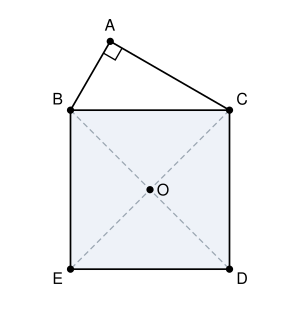

## Statement

Soit $BCDE$ un carré et soit $O$ son centre, c'est-à-dire le point où ses diagonales se croisent.

Soit $A$ un point situé à l'extérieur du carré, tel que le triangle $ABC$ soit rectangle en $A$.

Montrer que le point $O$ appartient à la bissectrice de l'angle $\widehat{BAC}$.

## Hints

1. Le point $A$ n'est pas fixé : l'énoncé dit seulement que l'angle $\widehat{BAC}$ est droit. Où se promène un point d'où l'on voit le segment $[BC]$ sous un angle droit ?
2. Combien vaut l'angle $\widehat{BOC}$ dans un carré ? Regardez les diagonales.
3. Vous devriez maintenant avoir deux points, $A$ et $O$, qui voient $[BC]$ sous le même angle. Que peut-on en dire ?
4. Une fois $A$, $B$, $O$, $C$ placés sur un même cercle, comparez les cordes $[OB]$ et $[OC]$. Que valent alors les angles inscrits $\widehat{BAO}$ et $\widehat{OAC}$ ?

## Solution

**L'idée : faire apparaître un cercle qui contient à la fois $A$ et $O$.**

### Étape 1 : $A$ et $O$ sont sur le même cercle

Un point d'où l'on voit le segment $[BC]$ sous un angle droit est sur le cercle de diamètre $[BC]$, et réciproquement. Appelons $\Gamma$ ce cercle.

- Le triangle $ABC$ est rectangle en $A$, donc $\widehat{BAC} = 90^\circ$ : le point $A$ est sur $\Gamma$.
- Dans un carré, les diagonales sont perpendiculaires, donc $\widehat{BOC} = 90^\circ$ : le point $O$ est aussi sur $\Gamma$.

Les quatre points $A$, $B$, $O$, $C$ sont donc tous sur le cercle $\Gamma$.

### Étape 2 : $A$ et $O$ sont de part et d'autre de $(BC)$

Le cercle $\Gamma$ a pour diamètre $[BC]$, donc son rayon vaut $\tfrac{BC}{2}$, c'est-à-dire la moitié du côté du carré. Le demi-disque de $\Gamma$ situé du côté du carré tient donc entièrement à l'intérieur du carré $BCDE$.

Comme le point $A$ est à l'extérieur du carré, il n'est pas dans ce demi-disque : $A$ est donc sur l'autre arc, de l'autre côté de la droite $(BC)$ par rapport à $O$. Autrement dit, $O$ est sur l'arc $BC$ qui ne contient pas $A$.

### Étape 3 : $O$ est au milieu de cet arc

Le point $O$ est le centre du carré, donc il est à la même distance des quatre sommets. En particulier

$$OB = OC.$$

Les deux cordes $[OB]$ et $[OC]$ du cercle $\Gamma$ sont donc de même longueur, et elles découpent deux arcs de même longueur : $O$ est le milieu de l'arc $BC$ ne contenant pas $A$.

### Étape 4 : conclusion par les angles inscrits

Dans un cercle, deux angles inscrits qui interceptent des arcs de même longueur sont égaux. Vus depuis $A$, les arcs $BO$ et $OC$ (ceux qui ne contiennent pas $A$) sont de même longueur, donc

$$\widehat{BAO} = \widehat{OAC}.$$

Enfin, comme $O$ et $A$ sont de part et d'autre de $(BC)$, la demi-droite $[AO)$ passe entre les demi-droites $[AB)$ et $[AC)$ : elle est bien à l'intérieur de l'angle $\widehat{BAC}$, et elle le coupe en deux angles égaux.

$$\boxed{\text{La demi-droite } [AO) \text{ est la bissectrice de } \widehat{BAC}.}$$

*Le nom de ce point.* Dans un triangle $ABC$ inscrit dans un cercle, le milieu de l'arc $BC$ ne contenant pas $A$ s'appelle le **pôle Sud** de $A$. Ce que l'on vient de démontrer est sa propriété de base : la bissectrice issue de $A$ passe par le pôle Sud de $A$. C'est un des outils les plus utilisés en géométrie de compétition.

## Going further

1. Le point $A$ peut se promener sur tout un arc de cercle. Pendant ce temps, la bissectrice de $\widehat{BAC}$ bouge aussi. Que reste-t-il fixe ?
2. Le résultat utilise-t-il vraiment que $BCDE$ est un carré ? Remplacez le carré par un triangle isocèle $BCD$ de sommet $D$, et $O$ par un point de la médiatrice de $[BC]$ tel que $\widehat{BOC} = 90^\circ$. Le résultat tient-il encore ?
