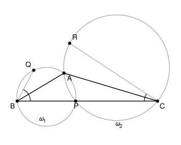

## Statement

Soit $ABC$ un triangle dont l'angle $\widehat{BAC}$ est obtus, et soit $P$ un point du segment $[BC]$.

On note $\omega_1$ le cercle circonscrit au triangle $APB$ et $\omega_2$ le cercle circonscrit au triangle $APC$.

- $Q$ est le point de $\omega_1$, situé du même côté de $(BP)$ que $A$, tel que la demi-droite $[BA)$ coupe l'angle $\widehat{QBP}$ en deux angles égaux : $\widehat{QBA} = \widehat{ABP}$.
- $R$ est le point de $\omega_2$, situé du même côté de $(PC)$ que $A$, tel que la demi-droite $[CA)$ coupe l'angle $\widehat{PCR}$ en deux angles égaux : $\widehat{PCA} = \widehat{ACR}$.

Montrer que le triangle $QAR$ est isocèle en $A$.

## Hints

1. Vous devez montrer que $AQ = AR$. Ces deux longueurs vivent dans deux cercles différents. Cherchez donc une longueur intermédiaire, présente dans les deux.
2. Quel segment appartient à la fois à $\omega_1$ et à $\omega_2$ ? Les deux cercles passent par deux points communs : lesquels ?
3. Travaillez d'abord dans $\omega_1$ seul, et montrez que le triangle $AQP$ est isocèle en $A$.
4. Dans un cercle, deux angles inscrits qui interceptent le même arc sont égaux. Comparez $\widehat{AQP}$ à un angle de sommet $B$, puis $\widehat{APQ}$ à un autre angle de sommet $B$.

## Solution

**L'idée : le segment $[AP]$ est le pont entre les deux cercles.**

Les cercles $\omega_1$ et $\omega_2$ passent tous les deux par $A$ et par $P$. Nous allons montrer

$$AQ = AP \qquad \text{(dans } \omega_1\text{)} \qquad \text{et} \qquad AR = AP \qquad \text{(dans } \omega_2\text{)},$$

et le résultat suivra immédiatement.

### Dans le cercle $\omega_1$ : le triangle $AQP$ est isocèle en $A$

Les quatre points $A$, $Q$, $P$, $B$ sont sur $\omega_1$. Comparons les deux angles à la base du triangle $AQP$.

- Les angles $\widehat{AQP}$ et $\widehat{ABP}$ sont deux angles inscrits dans $\omega_1$ qui interceptent le même arc $AP$ (celui qui ne contient ni $Q$ ni $B$), donc ils sont égaux :
$$\widehat{AQP} = \widehat{ABP}.$$

- Les angles $\widehat{APQ}$ et $\widehat{ABQ}$ sont deux angles inscrits dans $\omega_1$ qui interceptent le même arc $AQ$, donc
$$\widehat{APQ} = \widehat{ABQ}.$$

Or l'hypothèse sur $Q$ dit exactement que $\widehat{QBA} = \widehat{ABP}$. Les deux angles de droite ci-dessus sont donc égaux, et par conséquent

$$\widehat{AQP} = \widehat{APQ}.$$

Le triangle $AQP$ a deux angles égaux : il est isocèle, et son sommet est le troisième, c'est-à-dire $A$. Donc

$$AQ = AP.$$

### Dans le cercle $\omega_2$ : le triangle $ARP$ est isocèle en $A$

Le raisonnement est identique, en remplaçant $\omega_1$ par $\omega_2$, $B$ par $C$ et $Q$ par $R$. Les quatre points $A$, $R$, $P$, $C$ sont sur $\omega_2$, et

$$\widehat{ARP} = \widehat{ACP} \qquad \text{et} \qquad \widehat{APR} = \widehat{ACR}.$$

L'hypothèse $\widehat{PCA} = \widehat{ACR}$ donne alors $\widehat{ARP} = \widehat{APR}$, donc le triangle $ARP$ est isocèle en $A$ et

$$AR = AP.$$

### Conclusion

$$AQ = AP = AR,$$

donc $AQ = AR$ et le triangle $QAR$ est isocèle en $A$.

$$\boxed{AQ = AR.}$$

*Le nom de ce résultat.* Ce que l'on vient de démontrer deux fois est le **théorème du pôle Sud** : dans un triangle $QBP$ inscrit dans un cercle, la bissectrice issue de $B$ recoupe le cercle au point $A$ qui est à égale distance de $Q$ et de $P$ (c'est le milieu de l'arc $QP$). Une fois ce théorème connu, l'exercice tient en une ligne : on l'applique dans $\omega_1$, puis dans $\omega_2$, et les deux longueurs obtenues valent $AP$.

## Going further

1. Où l'hypothèse « $\widehat{BAC}$ est obtus » sert-elle ? Refaites la figure avec un triangle où $\widehat{BAC}$ est aigu et regardez ce qui change.
2. Le point $P$ se promène sur $[BC]$. Pendant ce temps, la longueur $AQ$ change. Que devient le point $Q$ quand $P$ arrive en $B$ ?
