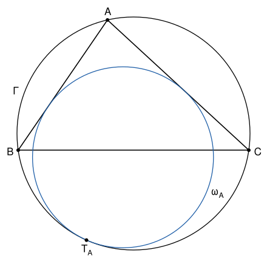

## Statement

Soit $ABC$ un triangle et $\Gamma$ son cercle circonscrit. Soit $\omega_A$ le cercle situé à l'intérieur de l'angle $\widehat{BAC}$, tangent aux droites $(AB)$ et $(AC)$, et tangent intérieurement à $\Gamma$. On note $T_A$ le point de contact de $\omega_A$ et de $\Gamma$. On définit de même $\omega_B$ et $T_B$, puis $\omega_C$ et $T_C$.

Montrer que les droites $(AT_A)$, $(BT_B)$ et $(CT_C)$ sont concourantes.

## Hints

1. Pour deux cercles de centres $O_1$, $O_2$ et de rayons différents $r_1$, $r_2$, il existe un seul point $X$ tel que $r_2\,\overrightarrow{XO_1} = r_1\,\overrightarrow{XO_2}$. Si les deux cercles sont tangents intérieurement en $T$, montre que $X = T$.
2. Fais intervenir le cercle inscrit $\omega$, de centre $I$. Montre que le point $X$ associé à $\omega_A$ et à $\omega$ est le point $A$.
3. Montre que, pour trois cercles de rayons deux à deux différents, les trois points $X$ associés aux trois paires de cercles sont alignés.
4. Le point $Z$ associé à $\Gamma$ et à $\omega$ ne dépend pas du sommet choisi.

## Solution

On note $O$ et $R$ le centre et le rayon de $\Gamma$, $\omega$ le cercle inscrit dans $ABC$, de centre $I$ et de rayon $r$, et $O_A$, $\rho_A$ le centre et le rayon de $\omega_A$.

### Étape 1 : le point associé à deux cercles

Soit deux cercles de centres $O_1$, $O_2$ et de rayons $r_1 \neq r_2$. On cherche un point $X$ tel que
$$r_2\,\overrightarrow{XO_1} = r_1\,\overrightarrow{XO_2} .$$
Pour un point $P$ quelconque, cette égalité s'écrit $r_2\,(\overrightarrow{PO_1} - \overrightarrow{PX}) = r_1\,(\overrightarrow{PO_2} - \overrightarrow{PX})$, c'est-à-dire
$$(r_2 - r_1)\,\overrightarrow{PX} = r_2\,\overrightarrow{PO_1} - r_1\,\overrightarrow{PO_2} .$$
Comme $r_2 - r_1 \neq 0$, **il existe un seul tel point $X$**. On l'appelle le point associé aux deux cercles. L'égalité est la même quand on échange les deux cercles, donc l'ordre ne compte pas.

L'égalité dit que $\overrightarrow{XO_1}$ et $\overrightarrow{XO_2}$ ont le même sens, avec $r_2 \times XO_1 = r_1 \times XO_2$.

### Étape 2 : deux cas où l'on connaît ce point

**Deux cercles tangents intérieurement.** Les cercles $\Gamma$ et $\omega_A$ ont la même tangente en $T_A$. Leurs centres $O$ et $O_A$ sont donc tous les deux sur la perpendiculaire à cette tangente en $T_A$, et du même côté de $T_A$, puisque $\omega_A$ est à l'intérieur de $\Gamma$. Si $\vec{w}$ est le vecteur de longueur $1$ qui va de $T_A$ vers l'intérieur de $\Gamma$,
$$\overrightarrow{T_A O} = R\,\vec{w} \qquad \text{et} \qquad \overrightarrow{T_A O_A} = \rho_A\,\vec{w} ,$$
donc $\rho_A\,\overrightarrow{T_A O} = R\,\overrightarrow{T_A O_A}$ : **le point associé à $\Gamma$ et à $\omega_A$ est $T_A$**.

**Deux cercles inscrits dans le même angle.** Les cercles $\omega_A$ et $\omega$ sont tous les deux à l'intérieur de l'angle $\widehat{BAC}$ et tangents à ses deux côtés. Leurs centres sont à égale distance des droites $(AB)$ et $(AC)$, donc sur la bissectrice de l'angle, sur la même demi-droite issue de $A$. Soit $K$ et $L$ les pieds des perpendiculaires à $(AB)$ issues de $O_A$ et de $I$. Les droites $(O_A K)$ et $(IL)$ sont toutes les deux perpendiculaires à $(AB)$, donc parallèles, et le théorème de Thalès donne
$$\frac{AO_A}{AI} = \frac{O_A K}{IL} = \frac{\rho_A}{r} .$$
Ainsi $r\,\overrightarrow{AO_A} = \rho_A\,\overrightarrow{AI}$ : **le point associé à $\omega_A$ et à $\omega$ est $A$**.

### Étape 3 : les rayons sont différents

- $r < R$ : le cercle inscrit est dans le triangle, lui-même dans le disque limité par $\Gamma$.
- $\rho_A < R$ : le cercle $\omega_A$ est à l'intérieur de $\Gamma$ et n'est pas $\Gamma$, car $\Gamma$ n'est pas tangent à la droite $(AB)$.
- $\rho_A \neq r$ : sinon, d'après l'étape 2, on aurait $O_A = I$ et $\omega_A = \omega$. Or le cercle inscrit ne touche pas $\Gamma$ : ses points sont dans le triangle, et le triangle ne touche $\Gamma$ qu'en $A$, $B$ et $C$, que le cercle inscrit ne contient pas.

### Étape 4 : trois cercles et trois points alignés

**Lemme.** Soit trois cercles de centres $O_1$, $O_2$, $O_3$ et de rayons $r_1$, $r_2$, $r_3$ deux à deux différents. Soit $X$ le point associé aux cercles 1 et 2, $Y$ celui des cercles 2 et 3, et $Z$ celui des cercles 3 et 1. Alors $X$, $Y$ et $Z$ sont alignés.

*Preuve.* On applique l'étape 1 en prenant $P = Z$ :
$$(r_2 - r_1)\,\overrightarrow{ZX} = r_2\,\overrightarrow{ZO_1} - r_1\,\overrightarrow{ZO_2}, \qquad (r_3 - r_2)\,\overrightarrow{ZY} = r_3\,\overrightarrow{ZO_2} - r_2\,\overrightarrow{ZO_3} .$$
De plus, par définition de $Z$, on a $r_1\,\overrightarrow{ZO_3} = r_3\,\overrightarrow{ZO_1}$. On multiplie la première égalité par $r_3$, la deuxième par $r_1$, et on les ajoute :
$$r_3\,(r_2 - r_1)\,\overrightarrow{ZX} + r_1\,(r_3 - r_2)\,\overrightarrow{ZY} = r_2 r_3\,\overrightarrow{ZO_1} - r_1 r_2\,\overrightarrow{ZO_3} = r_2\left(r_3\,\overrightarrow{ZO_1} - r_1\,\overrightarrow{ZO_3}\right) = \vec{0} .$$
Le nombre $r_3\,(r_2 - r_1)$ n'est pas nul, donc $\overrightarrow{ZX}$ est un multiple de $\overrightarrow{ZY}$ : les points $X$, $Y$, $Z$ sont alignés. $\square$

### Étape 5 : conclusion

Soit $Z$ le point associé à $\Gamma$ et à $\omega$. Il existe d'après l'étape 3, et **il ne dépend d'aucun sommet** du triangle.

On applique le lemme aux cercles $\Gamma$, $\omega_A$ et $\omega$. D'après l'étape 2, le point associé à $\Gamma$ et $\omega_A$ est $T_A$, et celui associé à $\omega_A$ et $\omega$ est $A$. Donc $T_A$, $A$ et $Z$ sont alignés.

Les points $A$ et $T_A$ sont distincts : sinon le cercle $\omega_A$ passerait par $A$ en étant tangent aux deux droites $(AB)$ et $(AC)$, qui se coupent en $A$, ce qui est impossible. Donc **$Z$ est sur la droite $(AT_A)$**.

De même, avec les sommets $B$ et $C$, le même point $Z$ est sur $(BT_B)$ et sur $(CT_C)$. **Les trois droites $(AT_A)$, $(BT_B)$ et $(CT_C)$ sont concourantes en $Z$.**

## Going further

- Le point associé à deux cercles s'appelle leur **centre d'homothétie**. L'homothétie de centre $X$ et de rapport $r_2 / r_1$ envoie le premier cercle sur le second. Le lemme de l'étape 4 s'appelle le théorème de Monge.
- Montre que le point $Z$ est sur la droite $(OI)$, et que $r \times ZO = R \times ZI$.
- Le corrigé officiel compose les homothéties de centres $T_A$ et $A$. Pourquoi cette composée envoie-t-elle $\Gamma$ sur $\omega$ ?
