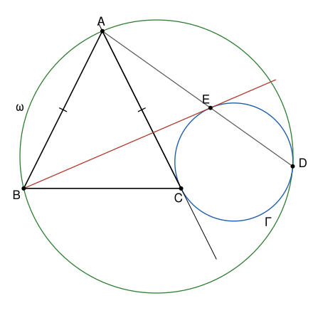

## Statement

Soit $ABC$ un triangle isocèle en $A$. Soit $\Gamma$ un cercle tangent à la droite $(AC)$ au point $C$, situé de l'autre côté de $(AC)$ par rapport à $B$.

Soit $\omega$ le cercle qui passe par $A$ et $B$ et qui est tangent intérieurement à $\Gamma$ en un point $D$ : le cercle $\Gamma$ est à l'intérieur de $\omega$ et le touche en $D$. La droite $(AD)$ recoupe $\Gamma$ en un point $E$.

Montrer que la droite $(BE)$ est tangente au cercle $\Gamma$.

## Hints

1. La droite $(AC)$ est tangente à $\Gamma$. Montre que $AC^2 = AE \times AD$, en comparant les triangles $ACE$ et $ADC$.
2. Comme $AB = AC$, on a aussi $AB^2 = AE \times AD$. Déduis-en que les triangles $ABE$ et $ADB$ sont semblables. Quelle égalité d'angles obtiens-tu ?
3. L'angle $\widehat{ADB}$ est aussi l'angle entre la tangente à $\omega$ en $A$ et la corde $[AB]$. Montre que $(BE)$ est parallèle à la tangente à $\omega$ en $A$.
4. Il reste à voir que la tangente à $\omega$ en $A$ et la tangente à $\Gamma$ en $E$ sont parallèles. On note $G$ et $W$ les centres de $\Gamma$ et de $\omega$, $\rho$ et $R$ leurs rayons. Compare les vecteurs $\overrightarrow{DG}$ et $\overrightarrow{DW}$, puis $\overrightarrow{DE}$ et $\overrightarrow{DA}$.

## Solution

**Rappel.**

- *Angle entre une tangente et une corde.* Soit $X$, $Y$, $Z$ trois points d'un cercle et $\delta$ la tangente au cercle en $X$. L'angle entre $\delta$ et la corde $[XY]$, mesuré du côté de la droite $(XY)$ qui ne contient pas $Z$, est égal à l'angle inscrit $\widehat{XZY}$.
- *Triangles semblables.* Deux triangles qui ont deux angles égaux deux à deux sont semblables : leurs côtés sont proportionnels. Deux triangles qui ont un angle égal, compris entre des côtés proportionnels, sont semblables : leurs angles sont égaux deux à deux.
- *Tangente.* La tangente à un cercle en un point est perpendiculaire au rayon qui aboutit en ce point.
- *Cercles tangents intérieurement.* Si un cercle de centre $G$ et de rayon $\rho$ est à l'intérieur d'un cercle de centre $W$ et de rayon $R$, et le touche en $D$, alors $G$ est sur le segment $[WD]$, et $\rho < R$.

On note $G$ et $\rho$ le centre et le rayon de $\Gamma$, $W$ et $R$ ceux de $\omega$. On pose $k = \rho/R$, de sorte que $0 < k < 1$.

Deux remarques pour commencer. Le cercle $\Gamma$ est d'un seul côté de sa tangente $(AC)$ et ne la touche qu'en $C$. Donc $A$ n'est pas sur $\Gamma$, et $B$ non plus, puisque $B$ est de l'autre côté de $(AC)$. Les points $A$ et $B$ sont donc différents de $D$.

### Étape 1 : la position du point $E$

D'après le rappel, $G$ est sur le segment $[DW]$, avec $DG = \rho$ et $DW = R$, donc
$$\overrightarrow{DG} = k\,\overrightarrow{DW} .$$
Soit $E'$ le point tel que $\overrightarrow{DE'} = k\,\overrightarrow{DA}$. Alors
$$\overrightarrow{GE'} = \overrightarrow{GD} + \overrightarrow{DE'} = k\,\overrightarrow{WD} + k\,\overrightarrow{DA} = k\,\overrightarrow{WA} .$$
Donc $GE' = k \times WA = k R = \rho$ : le point $E'$ est sur $\Gamma$. Il est aussi sur la droite $(AD)$, et il n'est pas $D$, car $k \neq 0$. Une droite coupe un cercle en au plus deux points, donc $E' = E$. On retient deux choses :

- $\overrightarrow{DE} = k\,\overrightarrow{DA}$ avec $0 < k < 1$, donc **$E$ est sur le segment $[AD]$, et différent de $A$ et de $D$** ;
- $\overrightarrow{GE} = k\,\overrightarrow{WA}$, donc **les droites $(GE)$ et $(WA)$ sont parallèles**.

### Étape 2 : $AE \times AD = AB^2$

Le point $C$ n'est pas sur la droite $(AD)$ : sinon cette droite serait $(AC)$, qui ne touche $\Gamma$ qu'en un point, alors qu'elle passe par $D$ et $E$. Comme $E$ est entre $A$ et $D$, les points $A$ et $D$ sont de part et d'autre de la droite $(CE)$.

On applique le rappel au cercle $\Gamma$, à sa tangente $(CA)$ en $C$ et à la corde $[CE]$. L'angle $\widehat{ACE}$ est du côté de $(CE)$ qui ne contient pas $D$, donc
$$\widehat{ACE} = \widehat{CDE} = \widehat{CDA} ,$$
la dernière égalité parce que $E$ est sur $[DA]$.

Les triangles $ACE$ et $ADC$ ont donc deux angles égaux : $\widehat{CAE} = \widehat{DAC}$, puisque $E$ est sur $[AD]$, et $\widehat{ACE} = \widehat{ADC}$. Ils sont semblables, avec $A$, $C$, $E$ qui correspondent à $A$, $D$, $C$. Leurs côtés sont proportionnels :
$$\frac{AC}{AD} = \frac{AE}{AC}, \qquad \text{donc} \qquad AC^2 = AE \times AD .$$
Comme $AB = AC$, on obtient
$$AB^2 = AE \times AD .$$

### Étape 3 : $\widehat{ABE} = \widehat{ADB}$

L'égalité précédente s'écrit
$$\frac{AB}{AD} = \frac{AE}{AB} .$$
Les triangles $ABE$ et $ADB$ ont le même angle en $A$, car $E$ est sur $[AD]$, et cet angle est compris entre des côtés proportionnels. D'après le rappel, ils sont semblables, avec $A$, $B$, $E$ qui correspondent à $A$, $D$, $B$. Donc
$$\widehat{ABE} = \widehat{ADB} .$$

### Étape 4 : la droite $(BE)$ est parallèle à la tangente à $\omega$ en $A$

Soit $t$ la tangente à $\omega$ en $A$. Le point $D$ n'est pas sur la droite $(AB)$, car cette droite ne coupe $\omega$ qu'en $A$ et $B$. Soit $T$ un point de $t$ situé du côté de $(AB)$ qui ne contient pas $D$.

D'après le rappel, appliqué au cercle $\omega$, à la corde $[AB]$ et au point $D$,
$$\widehat{TAB} = \widehat{ADB} = \widehat{ABE} .$$
Le point $E$ est sur $[AD]$ sans être $A$, donc il est du même côté de $(AB)$ que $D$. Ainsi $T$ et $E$ sont de part et d'autre de $(AB)$ : les angles $\widehat{TAB}$ et $\widehat{ABE}$ sont alternes-internes pour les droites $t$ et $(BE)$ coupées par $(AB)$. Ils sont égaux, donc
$$(BE) \parallel t .$$

### Étape 5 : conclusion

D'après le rappel sur les tangentes, la tangente à $\omega$ en $A$ est perpendiculaire à $(WA)$, et la tangente à $\Gamma$ en $E$ est perpendiculaire à $(GE)$. Les droites $(WA)$ et $(GE)$ sont parallèles d'après l'étape 1, donc la tangente à $\Gamma$ en $E$ est parallèle à $t$, et donc à $(BE)$.

La droite $(BE)$ passe par $E$ et elle est parallèle à la tangente à $\Gamma$ en $E$ : c'est cette tangente. **La droite $(BE)$ est tangente au cercle $\Gamma$, au point $E$.**

## Going further

- Soit $B'$ le second point de $\omega$ tel que $AB' = AB$. Montre que $E$ est sur la droite $(BB')$.
- Refais l'étape 1 sans vecteurs : montre que les triangles $GDE$ et $WDA$ sont isocèles et ont le même angle en $D$, puis déduis-en que $(GE)$ et $(WA)$ sont parallèles.
