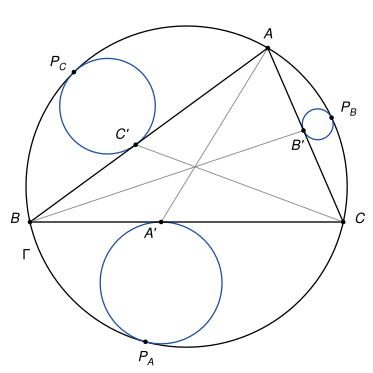
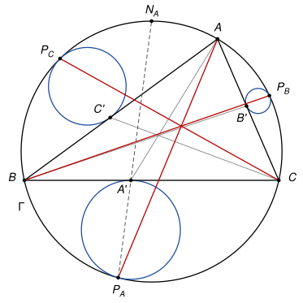

## Statement

Soit $ABC$ un triangle et $\Gamma$ son cercle circonscrit. Soit $A'$, $B'$ et $C'$ des points situés à l'intérieur des côtés $[BC]$, $[CA]$ et $[AB]$, tels que les droites $(AA')$, $(BB')$ et $(CC')$ soient concourantes.

- Soit $\omega_A$ le cercle tangent à $[BC]$ en $A'$ et tangent à $\Gamma$, situé dans la région limitée par le segment $[BC]$ et l'arc $BC$ de $\Gamma$ qui ne contient pas $A$. On note $P_A$ le point de contact des cercles $\omega_A$ et $\Gamma$.
- On définit de même le cercle $\omega_B$, tangent à $[CA]$ en $B'$ et tangent à $\Gamma$ en $P_B$, du côté de $(CA)$ opposé à $B$, et le cercle $\omega_C$, tangent à $[AB]$ en $C'$ et tangent à $\Gamma$ en $P_C$, du côté de $(AB)$ opposé à $C$.

Montrer que les droites $(AP_A)$, $(BP_B)$ et $(CP_C)$ sont concourantes.

## Hints

1. Considérez l'homothétie de centre $P_A$ qui envoie le cercle $\omega_A$ sur $\Gamma$. Sur quel point envoie-t-elle $A'$ ? Montrez que la droite $(P_A A')$ passe par le milieu $N_A$ de l'arc $BC$ qui contient $A$.
2. Déduisez-en que $(P_A A')$ est la bissectrice de l'angle $\widehat{BP_AC}$, puis que $\frac{A'B}{A'C} = \frac{P_AB}{P_AC}$.
3. La droite $(AP_A)$ coupe $[BC]$ en un point $A''$. Avec deux paires de triangles semblables, montrez que $\frac{A''B}{A''C} = \frac{AB \times P_AB}{AC \times P_AC}$. Concluez avec le théorème de Céva, que l'on peut démontrer avec des aires.

## Solution

*Rappels.*

- *Angle inscrit.* Si $X$ et $Y$ sont deux points d'un cercle, tous les angles $\widehat{XZY}$, où $Z$ parcourt le cercle d'un même côté de la droite $(XY)$, sont égaux.
- *Cercles tangents intérieurement.* Si un cercle de centre $K$ et de rayon $r$ est tangent intérieurement en $T$ à un cercle de centre $O$ et de rayon $R > r$, les points $T$, $K$, $O$ sont alignés, $K$ et $O$ du même côté de $T$. L'homothétie de centre $T$ et de rapport $\frac{R}{r}$ envoie donc $K$ sur $O$ et le petit cercle sur le grand. Une homothétie envoie une droite sur une droite parallèle, et une tangente à un cercle sur une tangente au cercle image.
- *Théorème de la bissectrice.* Si la bissectrice de l'angle $\widehat{UZV}$ coupe $[UV]$ en $T$, alors $\frac{TU}{TV} = \frac{ZU}{ZV}$. (Le point $T$ est à la même distance $d$ des droites $(ZU)$ et $(ZV)$, donc le rapport des aires des triangles $ZTU$ et $ZTV$ vaut $\frac{ZU \times d}{ZV \times d}$ ; ces deux triangles ont aussi la même hauteur issue de $Z$, donc ce rapport vaut $\frac{TU}{TV}$.)

On note $O$ le centre de $\Gamma$ et $R$ son rayon.

**Étape 1 : la droite $(P_A A')$ passe par le milieu de l'arc $BC$ qui contient $A$.** Soit $h$ l'homothétie de centre $P_A$ qui envoie $\omega_A$ sur $\Gamma$ (deuxième rappel), et soit $N = h(A')$. Le point $N$ est sur $\Gamma$. La droite $(BC)$ est tangente à $\omega_A$ en $A'$, donc son image, la parallèle à $(BC)$ passant par $N$, est tangente à $\Gamma$ en $N$. Cette tangente est perpendiculaire au rayon $[ON]$, donc $(ON) \perp (BC)$ : le point $N$ est sur la médiatrice de $[BC]$, c'est l'un des deux milieux des arcs $BC$.

Lequel ? Le rapport de $h$ est positif et plus grand que $1$, donc $N$ est sur la demi-droite $[P_A A')$, au-delà de $A'$. Or $P_A$ est sur $\omega_A$, donc du côté de $(BC)$ opposé à $A$. La demi-droite $[P_A A')$ traverse $(BC)$ en $A'$, puis reste du côté de $A$. Donc $N$ est du côté de $A$ : c'est le milieu $N_A$ de l'arc $BC$ qui contient $A$. Les points $P_A$, $A'$, $N_A$ sont alignés, avec $A'$ entre $P_A$ et $N_A$.

**Étape 2 : $\frac{A'B}{A'C} = \frac{P_AB}{P_AC}$.** Le point $P_A$ est sur l'arc $BC$ qui ne contient pas $A$, et $N_A$ sur l'autre arc. Les points $P_A$ et $C$ sont du même côté de la droite $(BN_A)$, et les points $P_A$ et $B$ du même côté de la droite $(CN_A)$. Avec le premier rappel, puis le triangle $BN_AC$ isocèle en $N_A$ :

$$\widehat{BP_AN_A} = \widehat{BCN_A} = \widehat{CBN_A} = \widehat{CP_AN_A}.$$

La droite $(P_AN_A)$ est donc la bissectrice de l'angle $\widehat{BP_AC}$, et elle coupe $[BC]$ en $A'$ d'après l'étape 1. Le théorème de la bissectrice donne

$$\frac{A'B}{A'C} = \frac{P_AB}{P_AC}.$$

**Étape 3 : où la droite $(AP_A)$ coupe $[BC]$.** Les points $A$ et $P_A$ sont de part et d'autre de $(BC)$, donc le segment $[AP_A]$ coupe $(BC)$ en un point $A''$. Ce point est à l'intérieur du cercle $\Gamma$, donc sur la corde $[BC]$.

- Les triangles $A''AB$ et $A''CP_A$ ont des angles égaux en $A''$ (opposés par le sommet), et $\widehat{A''AB} = \widehat{P_AAB} = \widehat{P_ACB} = \widehat{A''CP_A}$ (angles inscrits interceptant la corde $[P_AB]$, avec $A$ et $C$ du même côté de $(P_AB)$). Ils sont semblables, donc $\frac{A''B}{A''P_A} = \frac{AB}{CP_A}$.
- De même, les triangles $A''AC$ et $A''BP_A$ sont semblables, car $\widehat{A''AC} = \widehat{P_AAC} = \widehat{P_ABC} = \widehat{A''BP_A}$. Donc $\frac{A''C}{A''P_A} = \frac{AC}{BP_A}$.

En divisant la première égalité par la seconde, puis avec l'étape 2 :

$$\frac{A''B}{A''C} = \frac{AB}{AC} \times \frac{P_AB}{P_AC} = \frac{AB}{AC} \times \frac{A'B}{A'C}.$$

En faisant tourner les rôles de $A$, $B$, $C$, on obtient de la même façon les points $B''$ de $[CA]$ sur $(BP_B)$ et $C''$ de $[AB]$ sur $(CP_C)$, avec

$$\frac{B''C}{B''A} = \frac{BC}{BA} \times \frac{B'C}{B'A}, \qquad \frac{C''A}{C''B} = \frac{CA}{CB} \times \frac{C'A}{C'B}.$$

**Étape 4 : le théorème de Céva.** *Soit $A_1$, $B_1$, $C_1$ des points à l'intérieur des côtés $[BC]$, $[CA]$, $[AB]$. Les droites $(AA_1)$, $(BB_1)$, $(CC_1)$ sont concourantes si et seulement si*

$$\frac{A_1B}{A_1C} \times \frac{B_1C}{B_1A} \times \frac{C_1A}{C_1B} = 1.$$

On note $[XYZ]$ l'aire du triangle $XYZ$.

- *Si les trois droites passent par un même point $M$*, ce point est à l'intérieur du triangle. Les triangles $ABA_1$ et $ACA_1$ ont la même hauteur issue de $A$, donc $\frac{[ABA_1]}{[ACA_1]} = \frac{A_1B}{A_1C}$, et de même $\frac{[MBA_1]}{[MCA_1]} = \frac{A_1B}{A_1C}$. Si $\frac{x}{y} = \frac{u}{v} = k$, alors $x - u = k(y - v)$ ; en soustrayant, on obtient $\frac{[ABM]}{[ACM]} = \frac{A_1B}{A_1C}$. De même $\frac{B_1C}{B_1A} = \frac{[BCM]}{[BAM]}$ et $\frac{C_1A}{C_1B} = \frac{[CAM]}{[CBM]}$. Le produit des trois rapports vaut donc $1$.
- *Réciproquement, si le produit vaut $1$*, les droites $(BB_1)$ et $(CC_1)$ se coupent en un point $M$ intérieur au triangle, et la droite $(AM)$ coupe $[BC]$ en un point $A_2$. D'après le premier point, $\frac{A_2B}{A_2C} \times \frac{B_1C}{B_1A} \times \frac{C_1A}{C_1B} = 1$, donc $\frac{A_2B}{A_2C} = \frac{A_1B}{A_1C}$. Si $k$ est cette valeur, $A_2C = A_1C = \frac{BC}{1 + k}$, donc $A_2 = A_1$, et $(AA_1)$ passe par $M$.

**Étape 5 : conclusion.** Les droites $(AA')$, $(BB')$, $(CC')$ sont concourantes, donc d'après l'étape 4

$$\frac{A'B}{A'C} \times \frac{B'C}{B'A} \times \frac{C'A}{C'B} = 1.$$

En multipliant les trois égalités de l'étape 3 :

$$\frac{A''B}{A''C} \times \frac{B''C}{B''A} \times \frac{C''A}{C''B} = \left(\frac{AB}{AC} \times \frac{BC}{BA} \times \frac{CA}{CB}\right) \times 1 = 1.$$

D'après la réciproque de l'étape 4, les droites $(AA'')$, $(BB'')$, $(CC'')$ sont concourantes. Ce sont les droites $(AP_A)$, $(BP_B)$ et $(CP_C)$ : **elles sont concourantes.**

*Remarque.* L'énoncé original dit seulement que $\omega_A$ est tangent à $\Gamma$ et à $[BC]$ en $A'$. Il y a deux tels cercles, un de chaque côté de $(BC)$. Le corrigé officiel prend celui qui est du côté opposé à $A$, comme ici. Avec les trois cercles de l'autre côté, une vérification numérique montre que les trois droites ne sont en général pas concourantes. Le corrigé conclut avec la forme trigonométrique du théorème de Céva et la loi des sinus. Les triangles semblables de l'étape 3 font le même travail.

## Going further

1. Montrer que si $A'$, $B'$, $C'$ sont les points de contact du cercle inscrit avec les côtés, les droites $(AA')$, $(BB')$, $(CC')$ sont concourantes, et que l'exercice s'applique donc à eux.
2. On prend pour $A'$, $B'$, $C'$ les milieux des côtés. Montrer que les droites $(AP_A)$, $(BP_B)$, $(CP_C)$ se coupent alors au centre du cercle inscrit du triangle $ABC$. (Indication : dans ce cas, $\frac{A''B}{A''C} = \frac{AB}{AC}$.)
