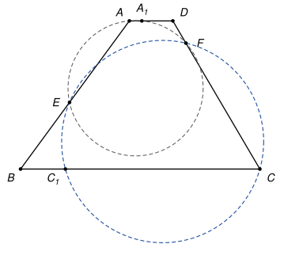
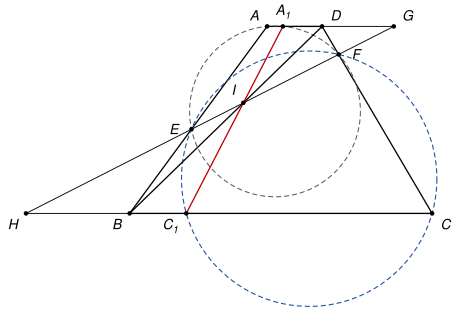

## Statement

Soit $ABCD$ un trapèze dont les côtés $[AD]$ et $[BC]$ sont parallèles. Soit $E$ un point du segment $[AB]$ et $F$ un point du segment $[DC]$, différents des sommets.

Le cercle qui passe par $A$, $E$ et $F$ recoupe la droite $(AD)$ en un point $A_1$, et le cercle qui passe par $C$, $E$ et $F$ recoupe la droite $(BC)$ en un point $C_1$.

Montrer que les droites $(BD)$, $(EF)$ et $(A_1C_1)$ passent par un même point.

## Hints

1. Supposez d'abord que $(EF)$ n'est pas parallèle à $(AD)$. Appelez $G$ et $H$ les points où la droite $(EF)$ coupe $(AD)$ et $(BC)$, et $I$ le point où $(BD)$ coupe $(EF)$. Il suffit de montrer que $I$ est sur $(A_1C_1)$, et pour cela que $\frac{HC_1}{GA_1} = \frac{IH}{IG}$.
2. Le théorème de Thalès donne trois égalités de rapports, avec les trois droites $(AB)$, $(DC)$ et $(BD)$ qui coupent $(GH)$. Les deux cercles donnent $GA \times GA_1 = GE \times GF$ et $HC \times HC_1 = HE \times HF$.
3. N'oubliez pas le cas où $(EF)$ est parallèle à $(AD)$. La médiatrice de $[EF]$ est alors un axe de symétrie commun aux deux cercles.

## Solution

*Rappels.*

- *Théorème de Thalès.* Deux droites se coupent en un point $P$. Les points $U$ et $U'$ sont sur la première, $V$ et $V'$ sur la seconde, tous différents de $P$. Si $(UV) \parallel (U'V')$, alors $\frac{PU}{PU'} = \frac{PV}{PV'} = \frac{UV}{U'V'}$, que $U$ et $U'$ soient du même côté de $P$ ou non.
- *Puissance d'un point.* Soit $Q$ un point extérieur à un cercle. Si une droite passant par $Q$ coupe le cercle en $U$ et $U'$, et une autre en $V$ et $V'$, alors $QU \times QU' = QV \times QV'$.
  *Preuve.* Nommons les points pour que $U$ soit entre $Q$ et $U'$, et $V$ entre $Q$ et $V'$. Les points $U'$ et $V'$ sont du même côté de la droite $(UV)$, celui qui ne contient pas $Q$. Par l'angle inscrit, $\widehat{UU'V} = \widehat{UV'V}$, c'est-à-dire $\widehat{QU'V} = \widehat{QV'U}$. Les triangles $QU'V$ et $QV'U$ ont donc le même angle en $Q$ et un deuxième angle égal : ils sont semblables, et $\frac{QU'}{QV'} = \frac{QV}{QU}$, d'où l'égalité.
- *Corde et extérieur.* Si $[UV]$ est une corde d'un cercle, les points du segment $[UV]$ sont à l'intérieur du disque, et les autres points de la droite $(UV)$ sont à l'extérieur.

**Étape 0 : la disposition.** Le segment $[AB]$ coupe la droite $(EF)$ en $E$, donc $A$ et $B$ sont de part et d'autre de $(EF)$. De même $D$ et $C$ sont de part et d'autre de $(EF)$. Comme le trapèze est convexe et que la droite $(EF)$ ne coupe son bord qu'en $E$ et $F$, elle le partage en deux morceaux : $A$ et $D$ sont d'un même côté de $(EF)$, et $B$ et $C$ de l'autre. En particulier, la droite $(EF)$ coupe le segment $[BD]$ en un point $I$, qui est strictement entre les deux droites parallèles $(AD)$ et $(BC)$.

Il suffit de montrer que $I$ est sur la droite $(A_1C_1)$. On distingue deux cas.

### Premier cas : $(EF)$ n'est pas parallèle à $(AD)$

La droite $(EF)$ coupe alors $(AD)$ en un point $G$ et $(BC)$ en un point $H$. Les points $E$ et $F$ sont strictement entre les deux parallèles, donc tout le segment $[EF]$ aussi : $G$ et $H$ sont sur la droite $(EF)$ mais hors du segment $[EF]$. D'après le dernier rappel, $G$ et $H$ sont à l'extérieur des deux cercles.

**Étape 1 : trois fois Thalès.** Les parallèles $(AD)$ et $(BC)$ coupent la droite $(GH)$ en $G$ et en $H$.

- Les droites $(AB)$ et $(GH)$ se coupent en $E$, et $(GA) \parallel (HB)$ : $\quad \frac{HB}{GA} = \frac{HE}{GE}$.
- Les droites $(DC)$ et $(GH)$ se coupent en $F$, et $(GD) \parallel (HC)$ : $\quad \frac{HC}{GD} = \frac{HF}{GF}$.
- Les droites $(BD)$ et $(GH)$ se coupent en $I$, et $(GD) \parallel (HB)$ : $\quad \frac{IH}{IG} = \frac{HB}{GD}$.

**Étape 2 : deux fois la puissance d'un point.** Le point $G$ est extérieur au cercle qui passe par $A$, $E$, $F$, $A_1$. La droite $(AD)$ coupe ce cercle en $A$ et $A_1$, et la droite $(EF)$ le coupe en $E$ et $F$. D'après le rappel,

$$GA \times GA_1 = GE \times GF.$$

De même, avec le point $H$ et le cercle qui passe par $C$, $E$, $F$, $C_1$ :

$$HC \times HC_1 = HE \times HF.$$

**Étape 3 : on combine.** D'après l'étape 2,

$$\frac{HC_1}{GA_1} = \frac{HE \times HF}{HC} \times \frac{GA}{GE \times GF} = \frac{HE}{GE} \times \frac{HF}{GF} \times \frac{GA}{HC}.$$

On remplace les deux premiers rapports grâce à l'étape 1 :

$$\frac{HC_1}{GA_1} = \frac{HB}{GA} \times \frac{HC}{GD} \times \frac{GA}{HC} = \frac{HB}{GD} = \frac{IH}{IG}.$$

**Étape 4 : conclusion du premier cas.** La droite $(C_1I)$ n'est pas parallèle à $(AD)$, puisqu'elle coupe $(BC)$ en $C_1$ et passe par $I$ qui n'est pas sur $(BC)$. Elle coupe donc $(AD)$ en un point $A'$, et $I$ est entre $C_1$ et $A'$, puisqu'il est strictement entre les deux parallèles. Le théorème de Thalès, pour les droites $(C_1A')$ et $(GH)$ qui se coupent en $I$, avec $(HC_1) \parallel (GA')$, donne $\frac{IH}{IG} = \frac{HC_1}{GA'}$. Avec l'étape 3, on obtient $GA' = GA_1$.

Il reste à voir que $A'$ et $A_1$ sont du même côté de $G$ :

- $G$ est hors du cercle, donc il n'est pas entre $A$ et $A_1$ : le point $A_1$ est du même côté de $(EF)$ que $A$. De même, $C_1$ est du même côté de $(EF)$ que $C$.
- $I$ est entre $C_1$ et $A'$, donc $A'$ est de l'autre côté de $(EF)$ que $C_1$, c'est-à-dire que $C$, c'est-à-dire du même côté que $A$ (étape 0).

Les points $A'$ et $A_1$ de la droite $(AD)$ sont donc du même côté de $(EF)$, donc du même côté de $G$, et à la même distance de $G$ : ils sont confondus. Le point $A_1$ est donc sur la droite $(C_1I)$, et les trois droites passent par $I$.

### Second cas : $(EF)$ est parallèle à $(AD)$

**Étape 5 : un axe de symétrie.** Soit $\Delta$ la médiatrice de $[EF]$. Dans le cercle qui passe par $A$, $E$, $F$, $A_1$, les cordes $[EF]$ et $[AA_1]$ sont parallèles. Leurs médiatrices passent toutes les deux par le centre du cercle et sont perpendiculaires à la même direction, donc elles sont confondues : $\Delta$ est aussi la médiatrice de $[AA_1]$. De même, $\Delta$ est la médiatrice de $[CC_1]$. La symétrie $s$ d'axe $\Delta$ échange donc $E$ et $F$, $A$ et $A_1$, $C$ et $C_1$. Elle envoie la droite $(AC)$ sur la droite $(A_1C_1)$.

**Étape 6 : deux longueurs égales.** Soit $J$ le point où $(AC)$ coupe $(EF)$. Comme $I$ et $J$ sont dans le trapèze, ils sont sur le segment $[EF]$. On pose $t = \frac{BE}{BA}$.

- Dans le triangle $BAD$, la droite $(EI)$ est parallèle à $(AD)$, donc par Thalès $EI = t \times AD$.
- Dans le triangle $ABC$, $(EJ) \parallel (BC)$, donc $\frac{AJ}{AC} = \frac{AE}{AB} = 1 - t$, et $\frac{CJ}{CA} = t$. Dans le triangle $CDA$, $(JF) \parallel (AD)$, donc $FJ = \frac{CJ}{CA} \times AD = t \times AD$.

**Étape 7 : conclusion du second cas.** Les points $I$ et $J$ du segment $[EF]$ vérifient $EI = FJ$ : ils sont symétriques par rapport à la médiatrice $\Delta$, donc $s(J) = I$. Comme $J$ est sur $(AC)$, son image $I$ est sur l'image de $(AC)$, qui est $(A_1C_1)$. Les trois droites passent encore par $I$.

**Conclusion.** Dans tous les cas, **les droites $(BD)$, $(EF)$ et $(A_1C_1)$ passent par un même point**, le point $I$.

*Remarque.* Le corrigé signale lui-même que sa preuve principale oublie le cas où $(EF)$ est parallèle aux bases, et le traite à part. C'est un bon réflexe à prendre : dès qu'on introduit un point d'intersection, il faut se demander s'il existe.

## Going further

1. Le résultat reste-t-il vrai si $(AD)$ et $(BC)$ ne sont pas parallèles ? Faites une figure soignée, ou un essai avec un logiciel de géométrie.
2. Dans le second cas, montrer que le trapèze $AA_1FE$ est isocèle.
