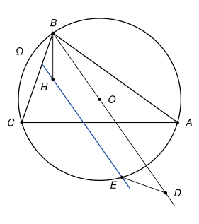

## Statement

Soit $ABC$ un triangle dont les trois angles sont aigus, $\Omega$ son cercle circonscrit, $O$ le centre de $\Omega$ et $H$ l'orthocentre du triangle.

Soit $D$ le point de la demi-droite $[BO)$, autre que $B$, tel que $\widehat{ADC} = \widehat{ABC}$. La parallèle à $(BO)$ passant par $H$ coupe l'arc $AC$ de $\Omega$ qui ne contient pas $B$ en un point $E$.

Montrer que $DE = BH$.

## Hints

1. Pour comprendre où est $D$, introduisez le symétrique $B'$ de $B$ par rapport à $(AC)$ : il voit le segment $[AC]$ sous le même angle que $B$. Montrez que $D$ est sur le cercle $\Omega'$, symétrique de $\Omega$ par rapport à $(AC)$, de l'autre côté de $(AC)$ que $B$.
2. Soit $I$ le milieu de $[AC]$ et $B^*$ le point du cercle $\Omega$ diamétralement opposé à $B$. Montrez que $AHCB^*$ est un parallélogramme, puis que $\overrightarrow{BH} = 2\,\overrightarrow{OI}$.
3. La symétrie de centre $I$ envoie $\Omega$ sur $\Omega'$ et $H$ sur $B^*$. Sur quelle droite envoie-t-elle la droite $(HE)$ ? Où arrive le point $E$ ?
4. Appelez $D'$ l'image de $E$ et $F$ le milieu de $[DD']$. Montrez que $\overrightarrow{ED} = 2\,\overrightarrow{IF}$, puis regardez le triangle $OFO'$, où $O'$ est le centre de $\Omega'$.

## Solution

*Rappels.*

- *Angle inscrit.* Si $X$ et $Y$ sont deux points d'un cercle, tous les angles $\widehat{XMY}$, où $M$ parcourt le cercle d'un même côté de la droite $(XY)$, sont égaux.
- *Réciproque.* Si deux points $M$ et $M'$, situés du même côté de la droite $(XY)$, vérifient $\widehat{XMY} = \widehat{XM'Y}$, alors les points $X$, $Y$, $M$ et $M'$ sont sur un même cercle.
- *Demi-cercle.* Si $[XY]$ est un diamètre d'un cercle et $M$ un autre point de ce cercle, alors $\widehat{XMY} = 90°$. Réciproquement, si $\widehat{XMY} = 90°$, le point $M$ est sur le cercle de diamètre $[XY]$, donc à la distance $\frac{XY}{2}$ du milieu de $[XY]$.
- *Corde.* La droite qui joint le centre d'un cercle au milieu d'une corde est perpendiculaire à cette corde.

**Notations.** On note $R$ le rayon de $\Omega$, $I$ le milieu de $[AC]$ et $B^*$ le point de $\Omega$ diamétralement opposé à $B$. Le point $O$ est sur la médiatrice de $[AC]$, donc $I$ est le pied de la perpendiculaire menée de $O$ à $(AC)$. Le symétrique $O'$ de $O$ par rapport à $(AC)$ vérifie donc : $I$ est le milieu de $[OO']$. Enfin $\Omega'$ est le cercle de centre $O'$ et de rayon $R$ : c'est le symétrique de $\Omega$ par rapport à $(AC)$, et il passe par $A$ et $C$.

Comme le triangle a ses trois angles aigus, $O$ est à l'intérieur du triangle. La demi-droite $[BO)$ traverse donc le côté $[AC]$ en un point $X$. Ce point est à l'intérieur du cercle, donc entre $B$ et $B^*$ sur le diamètre $[BB^*]$. Ainsi **$B^*$ est de l'autre côté de $(AC)$ que $B$**.

![Le cercle Ω′ en pointillés, son centre O′, le milieu I de [AC], le point B*, le point D′ et le milieu F de [DD′]](10236-figure-2.svg)

**Étape 1 : $D$ est sur $\Omega'$, de l'autre côté de $(AC)$ que $B$.** Supposons d'abord que $D$ soit du même côté de $(AC)$ que $B$. Comme $\widehat{ADC} = \widehat{ABC}$, la réciproque de l'angle inscrit dit que $D$ est sur le cercle passant par $A$, $B$, $C$, c'est-à-dire $\Omega$. Mais la droite $(BO)$ ne coupe $\Omega$ qu'en $B$ et en $B^*$, et $D \neq B$, donc $D = B^*$, qui est de l'autre côté. C'est impossible. Donc $D$ est de l'autre côté de $(AC)$ que $B$.

Soit $B'$ le symétrique de $B$ par rapport à $(AC)$. Il est sur $\Omega'$, de l'autre côté de $(AC)$ que $B$, comme $D$. Une symétrie conserve les angles, donc $\widehat{AB'C} = \widehat{ABC} = \widehat{ADC}$. Par la réciproque de l'angle inscrit, $D$ est sur le cercle qui passe par $A$, $C$ et $B'$, c'est-à-dire sur $\Omega'$.

**Étape 2 : $\overrightarrow{BH} = \overrightarrow{OO'}$, et $I$ est le milieu de $[HB^*]$.** Comme $[BB^*]$ est un diamètre de $\Omega$, on a $\widehat{BCB^*} = 90°$ et $\widehat{BAB^*} = 90°$.

- Les droites $(AH)$ et $(CB^*)$ sont toutes les deux perpendiculaires à $(BC)$, donc parallèles.
- Les droites $(CH)$ et $(AB^*)$ sont toutes les deux perpendiculaires à $(AB)$, donc parallèles.

Le quadrilatère $AHCB^*$ est donc un parallélogramme. Ses diagonales $[AC]$ et $[HB^*]$ ont le même milieu : $I$ est le milieu de $[HB^*]$. Comme $O$ est le milieu de $[BB^*]$, la relation de Chasles donne

$$\overrightarrow{OI} = \overrightarrow{OB^*} + \overrightarrow{B^*I} = \frac{1}{2}\overrightarrow{BB^*} + \frac{1}{2}\overrightarrow{B^*H} = \frac{1}{2}\overrightarrow{BH}.$$

Donc $\overrightarrow{BH} = 2\,\overrightarrow{OI} = \overrightarrow{OO'}$, et en particulier $BH = OO'$.

**Étape 3 : la symétrie de centre $I$.** Notons $\sigma$ la symétrie de centre $I$.

- Elle envoie $O$ sur $O'$ et conserve les longueurs, donc elle envoie le cercle $\Omega$ sur le cercle $\Omega'$.
- Elle envoie $H$ sur $B^*$ (étape 2).
- Une symétrie centrale envoie une droite sur une droite parallèle. La droite $(HE)$ passe par $H$ et est parallèle à $(BO)$. Son image passe par $B^*$ et est parallèle à $(BO)$ : c'est la droite $(BO)$ elle-même, puisque $B^*$ est sur $(BO)$.

Le point $D' = \sigma(E)$ est donc sur $\Omega'$ et sur la droite $(BO)$. De plus, $I$ est sur $(AC)$, donc $\sigma$ échange les deux côtés de la droite $(AC)$. Le point $E$ est sur l'arc $AC$ qui ne contient pas $B$, donc de l'autre côté de $(AC)$ que $B$. Son image $D'$ est donc du même côté que $B$, alors que $D$ est de l'autre côté (étape 1). Ainsi $D' \neq D$ : **$D$ et $D'$ sont les deux points où la droite $(BO)$ coupe le cercle $\Omega'$**, et $I$ est le milieu de $[ED']$.

**Étape 4 : $DE = 2\,IF$.** Soit $F$ le milieu de $[D'D]$. Par la relation de Chasles,

$$\overrightarrow{ED} = \overrightarrow{ED'} + \overrightarrow{D'D} = 2\,\overrightarrow{ID'} + 2\,\overrightarrow{D'F} = 2\,\overrightarrow{IF}.$$

Donc $DE = 2\,IF$.

**Étape 5 : $IF = \frac{OO'}{2}$.** Le segment $[DD']$ est une corde de $\Omega'$ et $F$ est son milieu, donc $(O'F) \perp (BO)$ par le rappel sur les cordes. Si $F \neq O'$, le triangle $OFO'$ est rectangle en $F$ (et $F \neq O$, sinon $(OO')$ serait perpendiculaire à $(BO)$, donc $(BO)$ parallèle à $(AC)$, alors que $(BO)$ traverse $[AC]$). Par le rappel sur le demi-cercle, $F$ est sur le cercle de diamètre $[OO']$, dont le centre est $I$ : $IF = \frac{OO'}{2}$. Si $F = O'$, on a directement $IF = IO' = \frac{OO'}{2}$.

**Conclusion.** Avec les étapes 4, 5 et 2 :

$$DE = 2\,IF = OO' = BH.$$

**On a bien $DE = BH$.**

*Remarques.*

- La condition « $E$ est sur l'arc qui ne contient pas $B$ » est indispensable. L'autre point $E_2$ où la parallèle coupe $\Omega$ a pour image $D$ par $\sigma$, et en général $DE_2 \neq BH$. C'est l'étape 3 qui utilise cette condition.
- Au passage, $H = \sigma(B^*)$ est sur $\Omega'$. Autrement dit, le symétrique de l'orthocentre par rapport à $(AC)$ est sur le cercle circonscrit, un résultat classique.
- Le corrigé officiel montre que $H$, $O'$ et $E$ sont alignés, puis affirme que le quadrilatère $EO'OD$ est un trapèze isocèle. Un quadrilatère qui a deux côtés parallèles et deux diagonales égales peut aussi être un parallélogramme, et c'est justement la position de $E$ sur l'arc qui permet d'écarter ce cas.
