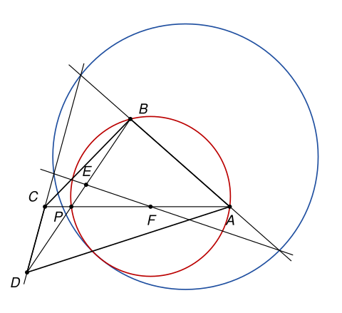

## Statement

Soit $ABCD$ un quadrilatère convexe dont les diagonales ont la même longueur, $AC = BD$, et dont les côtés $(AB)$ et $(CD)$ ne sont pas parallèles. On note $P$ le point d'intersection des diagonales $[AC]$ et $[BD]$.

Soit $E$ le point du segment $[BP]$ tel que $PE = PC$, et $F$ le point du segment $[AP]$ tel que $PF = PD$.

Montrer que le cercle circonscrit au triangle formé par les droites $(AB)$, $(CD)$ et $(EF)$ est tangent au cercle circonscrit au triangle $ABP$.

## Hints

1. Montrez d'abord que $AF = BE$. Regardez ensuite la symétrie par rapport à la bissectrice de l'angle $\widehat{APD}$ : que deviennent les points $F$ et $E$, et la droite $(EF)$ ?
2. Notez $Y$ et $Z$ les points où la droite $(AB)$ coupe $(CD)$ et $(EF)$. Calculez $\frac{YA}{YB}$ et $\frac{ZA}{ZB}$ avec des aires de triangles. Que remarquez-vous sur les milieux de $[AB]$ et de $[YZ]$ ?
3. Dans un triangle, une bissectrice issue d'un sommet et la médiatrice du côté opposé se coupent sur le cercle circonscrit. Utilisez ce fait dans les triangles $ABP$ et $XYZ$, avec la même bissectrice et la même médiatrice.
4. Deux cercles dont les centres sont sur une même droite $m$, et qui passent par un même point de $m$, sont tangents en ce point.

## Solution

*Rappels.*

- *Cordes égales.* Dans un cercle, deux cordes de même longueur sont vues sous le même angle depuis un point du cercle situé hors des arcs qu'elles sous-tendent. En effet, un angle inscrit vaut la moitié de l'angle au centre, et deux cordes égales ont des angles au centre égaux.
- *Demi-cercle.* Si $[NS]$ est un diamètre d'un cercle et $W$ un autre point de ce cercle, l'angle $\widehat{NWS}$ est droit.
- *Tangente.* La tangente à un cercle de centre $O$ en un point $M$ est la perpendiculaire à $(OM)$ en $M$. Deux cercles distincts qui passent par un même point et y ont la même tangente sont tangents en ce point.
- *Aire.* L'aire d'un triangle est la moitié du produit d'une base par la hauteur correspondante.

On note $p = PA$, $q = PB$, $c = PC = PE$ et $d = PD = PF$. On note $\alpha$ l'angle $\widehat{APB}$, qui est aussi l'angle $\widehat{CPD}$ (angles opposés par le sommet) et l'angle $\widehat{FPE}$. On note enfin $X$ le point d'intersection de $(CD)$ et $(EF)$, $Y$ celui de $(AB)$ et $(CD)$, et $Z$ celui de $(AB)$ et $(EF)$. Le cercle circonscrit à $ABP$ est noté $\Gamma_1$, celui de $XYZ$ est noté $\Gamma_2$.

![Les mêmes points avec X, Y, Z, le milieu H de [AB], la bissectrice ℓ de l'angle APD, la médiatrice m de [AB] et leur point commun M, où les cercles se touchent](10256-figure-2.svg)

**Étape 1 : $AF = BE$, et $c \neq d$.** Comme $F$ est sur $[AP]$, on a $AF = p - d$. Comme $E$ est sur $[BP]$, on a $BE = q - c$. De plus $AC = p + c$ et $BD = q + d$. L'égalité $AC = BD$ donne $p + c = q + d$, donc $p - d = q - c$, c'est-à-dire

$$AF = BE.$$

Si l'on avait $c = d$, on aurait aussi $p = q$, donc $\frac{PA}{PC} = \frac{PB}{PD}$, et la réciproque du théorème de Thalès donnerait $(AB) \parallel (CD)$, ce qui est exclu. Donc $c \neq d$ et $p \neq q$, c'est-à-dire $PA \neq PB$.

**Étape 2 : une symétrie.** Soit $\ell$ la bissectrice de l'angle $\widehat{APD}$, et $s$ la symétrie d'axe $\ell$. Elle échange les demi-droites $[PA)$ et $[PD)$, donc aussi les demi-droites opposées $[PC)$ et $[PB)$.

- Le point $F$ est sur $[PA)$ à la distance $d$ de $P$, son image est le point de $[PD)$ à la distance $d$ de $P$, c'est-à-dire $D$.
- Le point $E$ est sur $[PB)$ à la distance $c$ de $P$, son image est $C$.

Donc $s$ envoie la droite $(EF)$ sur la droite $(CD)$, et la droite $(CD)$ sur $(EF)$. Le point $s(X)$ est alors sur $(CD)$ et sur $(EF)$, c'est donc $X$ lui-même : **$X$ est sur $\ell$**. Comme $s$ échange les droites $(XY) = (CD)$ et $(XZ) = (EF)$, la droite $\ell$ est l'une des deux bissectrices de l'angle en $X$ du triangle $XYZ$ (la bissectrice intérieure ou la bissectrice extérieure, selon la figure).

En $P$, comme $D$ est sur le prolongement de $[BP]$ au-delà de $P$, la droite $\ell$ est la bissectrice extérieure de l'angle $\widehat{APB}$ du triangle $ABP$.

**Étape 3 : $[AB]$ et $[YZ]$ ont le même milieu.**

*Le rapport $\frac{YA}{YB}$.* Soient $A'$ et $B'$ les projetés orthogonaux de $A$ et $B$ sur $(CD)$. Les droites $(AA')$ et $(BB')$ sont parallèles, donc le théorème de Thalès donne $\frac{YA}{YB} = \frac{AA'}{BB'}$. Or $AA'$ et $BB'$ sont les hauteurs des triangles $ACD$ et $BCD$ relatives à la même base $[CD]$, donc

$$\frac{YA}{YB} = \frac{\text{aire}(ACD)}{\text{aire}(BCD)}.$$

Calculons ces aires avec une autre base. La distance de $D$ à la droite $(AC)$ vaut $d \sin \alpha$ (dans le triangle rectangle formé par $D$, $P$ et le projeté de $D$ sur $(AC)$). De même, la distance de $C$ à $(BD)$ vaut $c \sin \alpha$. Donc

$$\frac{\text{aire}(ACD)}{\text{aire}(BCD)} = \frac{\frac{1}{2}\, AC \times d \sin \alpha}{\frac{1}{2}\, BD \times c \sin \alpha} = \frac{d}{c},$$

puisque $AC = BD$. Ainsi $\frac{YA}{YB} = \frac{d}{c}$.

*Le rapport $\frac{ZA}{ZB}$.* De la même façon, $\frac{ZA}{ZB} = \frac{\text{aire}(AEF)}{\text{aire}(BEF)}$. On prend la base $[AF]$ pour le premier triangle, la hauteur est la distance de $E$ à $(AC)$, qui vaut $c \sin \alpha$. On prend la base $[BE]$ pour le second, la hauteur est la distance de $F$ à $(BD)$, qui vaut $d \sin \alpha$. Avec l'étape 1 :

$$\frac{ZA}{ZB} = \frac{AF \times c}{BE \times d} = \frac{c}{d}.$$

*Où sont $Y$ et $Z$ ?* Le quadrilatère $ABCD$ est convexe, donc $A$ et $B$ sont du même côté de la droite $(CD)$ : le point $Y$ n'est pas entre $A$ et $B$. Comme $F$ est entre $P$ et $A$, les points $A$ et $P$ sont de part et d'autre de $(EF)$ ; de même pour $B$ et $P$. Donc $A$ et $B$ sont du même côté de $(EF)$, et $Z$ n'est pas non plus entre $A$ et $B$.

*Le calcul.* Plaçons une abscisse sur la droite $(AB)$, avec $A$ en $0$ et $B$ en $1$. Un point $T$ d'abscisse $x$ hors du segment $[AB]$ vérifie $x < 0$ ou $x > 1$. Dans les deux cas $x$ et $x - 1$ ont le même signe, donc $\frac{TA}{TB} = \frac{x}{x-1}$.

- Pour $Y$, d'abscisse $y$ : $\frac{y}{y-1} = \frac{d}{c}$ donne $cy = dy - d$, soit $y = \frac{d}{d-c}$.
- Pour $Z$, d'abscisse $z$ : de même $z = \frac{c}{c-d}$.

Donc $y + z = \frac{d - c}{d - c} = 1$, et le milieu de $[YZ]$ a pour abscisse $\frac{1}{2}$ : **c'est le milieu $H$ de $[AB]$**. Par conséquent, la médiatrice $m$ de $[AB]$ est aussi la médiatrice de $[YZ]$.

**Étape 4 : un lemme.** *Soit $UVW$ un triangle tel que $WU \neq WV$, $\Gamma$ son cercle circonscrit et $m'$ la médiatrice de $[UV]$. Alors chacune des deux bissectrices de l'angle en $W$ coupe $m'$ en un seul point, et ce point est sur $\Gamma$.*

*Preuve.* Le centre de $\Gamma$ est sur $m'$, donc $m'$ coupe $\Gamma$ en deux points diamétralement opposés : $S$ sur l'arc $UV$ qui ne contient pas $W$, et $N$ sur l'autre arc. Comme $S$ est sur la médiatrice, $SU = SV$.

- Les cordes $[US]$ et $[SV]$ ont la même longueur, et $W$ n'est pas sur l'arc $UV$ qui les porte. Par le premier rappel, $\widehat{UWS} = \widehat{SWV}$. De plus $S$ et $W$ sont de part et d'autre de $(UV)$, donc la demi-droite $[WS)$ est à l'intérieur de l'angle $\widehat{UWV}$. Ainsi $(WS)$ est la bissectrice intérieure.
- Le point $W$ n'est pas sur $m'$, puisque $WU \neq WV$, donc $W$ est distinct de $N$ et de $S$. Comme $[NS]$ est un diamètre, $\widehat{NWS} = 90°$. La bissectrice extérieure est la perpendiculaire en $W$ à la bissectrice intérieure : c'est la droite $(WN)$.

Chaque bissectrice passe donc par $N$ ou par $S$, qui sont sur $m'$ et sur $\Gamma$. Elle n'est pas égale à $m'$, puisqu'elle passe par $W$, donc elle ne coupe $m'$ qu'en ce point. $\square$

**Étape 5 : le point commun $M$.** Dans le triangle $ABP$, on a $PA \neq PB$ (étape 1) et $\ell$ est la bissectrice extérieure en $P$ (étape 2). Le lemme dit que $\ell$ coupe $m$ en un seul point $M$, et que $M$ est sur $\Gamma_1$.

Passons au triangle $XYZ$. La droite $m$ est la médiatrice de $[YZ]$ (étape 3) et $\ell$ est une bissectrice de l'angle en $X$ (étape 2).

- Si $XY \neq XZ$, le lemme dit que $\ell$ coupe $m$ en un point de $\Gamma_2$. Ce point est le seul point commun de $\ell$ et $m$, c'est-à-dire $M$. Donc $M$ est sur $\Gamma_2$.
- Si $XY = XZ$, le point $X$ est sur $m$. Il est aussi sur $\ell$, donc $X = M$, et $M$ est encore sur $\Gamma_2$.

**Étape 6 : conclusion.** Le centre de $\Gamma_1$ est sur la médiatrice de sa corde $[AB]$, c'est-à-dire sur $m$. Le centre de $\Gamma_2$ est sur la médiatrice de sa corde $[YZ]$, qui est aussi $m$. Le point $M$ est sur $m$. Donc les deux rayons qui aboutissent en $M$ sont portés par $m$, et les deux cercles ont en $M$ la même tangente : la perpendiculaire à $m$ en $M$, qui est parallèle à $(AB)$.

Les deux cercles sont distincts : $\Gamma_1$ ne coupe la droite $(AB)$ qu'en $A$ et $B$, alors que $\Gamma_2$ passe par $Y$, qui n'est ni $A$ ni $B$ (son abscisse $\frac{d}{d-c}$ ne vaut ni $0$ ni $1$). Par le troisième rappel :

**le cercle circonscrit au triangle formé par $(AB)$, $(CD)$ et $(EF)$ est tangent en $M$ au cercle circonscrit au triangle $ABP$.**

*Remarques.*

- Le point $M$ est aussi le centre du cercle qui passe par $C$, $D$, $E$ et $F$ (voir la partie suivante). Le corrigé officiel le voit comme le centre de la rotation qui envoie $A$ sur $B$, $F$ sur $E$ et $C$ sur $D$ : les segments $[AC]$ et $[BD]$ ont la même longueur et sont découpés de la même façon, car $AF = BE$ et $FC = ED = c + d$.
- Dans le vocabulaire des olympiades, un point comme $M$, à la fois sur une bissectrice et sur la médiatrice du côté opposé, s'appelle un « pôle Nord » ou un « pôle Sud » du triangle.

## Going further

1. Montrer que $C$, $D$, $E$ et $F$ sont sur un même cercle, et que son centre est le point $M$. (On pourra remarquer que $DCEF$ est un trapèze isocèle d'axe $\ell$.)
2. On admet la puissance d'un point : si une droite passant par un point $T$ coupe un cercle de centre $M$ et de rayon $r$ en $U$ et $V$, alors $TU \times TV = |TM^2 - r^2|$. En l'appliquant aux points $A$ et $B$ et au cercle de la question 1, montrer directement que le centre de ce cercle est à la même distance de $A$ et de $B$.
