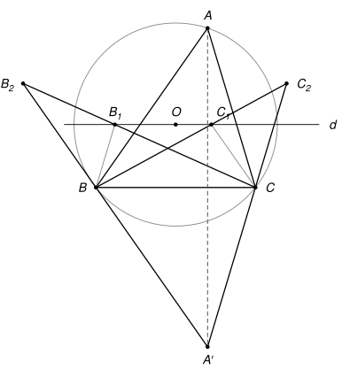
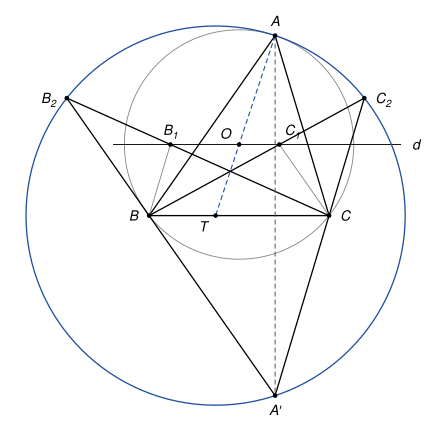

## Statement

Soit $ABC$ un triangle et $O$ le centre de son cercle circonscrit. Soit $d$ la droite parallèle à $(BC)$ qui passe par $O$, et $A'$ le symétrique de $A$ par rapport à la droite $(BC)$.

- La parallèle à $(A'B)$ qui passe par $C$ coupe $d$ en $C_1$, et les droites $(A'C)$ et $(BC_1)$ se coupent en $C_2$.
- La parallèle à $(A'C)$ qui passe par $B$ coupe $d$ en $B_1$, et les droites $(A'B)$ et $(CB_1)$ se coupent en $B_2$.

Montrer que les quatre points $A$, $A'$, $B_2$ et $C_2$ sont sur un même cercle.

## Hints

1. Placez-vous dans un repère bien choisi : l'origine au milieu de $[BC]$, l'axe des abscisses le long de $(BC)$, et $B(-1\,;0)$, $C(1\,;0)$, $A(p\,;q)$.
2. Le centre $O$ est sur la médiatrice de $[BC]$, donc $O(0\,;h)$. Écrivez $OA = OB$ pour relier $h$ à $p$ et $q$. Les calculs sont plus simples avec le nombre $k = \dfrac{h}{q}$.
3. Un cercle qui passe par $A$ et $A'$ a son centre sur la médiatrice de $[AA']$. Quelle est cette droite ?
4. Cherchez le centre sous la forme $T(t\,;0)$, et trouvez $t$ en écrivant $TB_2 = TC_2$. Il reste à vérifier que $TA = TC_2$.

## Solution

*Rappels.*

- *Colinéarité.* Dans un repère, les vecteurs $\vec{u}(x\,;y)$ et $\vec{v}(x'\,;y')$ sont colinéaires si et seulement si leur déterminant $xy' - yx'$ est nul.
- *Distance.* Dans un repère orthonormé, la distance entre $M(x\,;y)$ et $M'(x'\,;y')$ vérifie $MM'^2 = (x' - x)^2 + (y' - y)^2$.

**Étape 0 : le repère.** On prend un repère orthonormé dont l'origine est le milieu de $[BC]$, dont l'axe des abscisses est la droite $(BC)$, et dont l'unité de longueur est la moitié de $BC$. Alors $B(-1\,;0)$ et $C(1\,;0)$. On note $A(p\,;q)$, avec $q \neq 0$. Le symétrique de $A$ par rapport à l'axe des abscisses est $A'(p\,;-q)$.

**Étape 1 : le centre $O$.** Le point $O$ est à égale distance de $B$ et de $C$, donc il est sur la médiatrice de $[BC]$, qui est l'axe des ordonnées : $O(0\,;h)$. L'égalité $OB^2 = OA^2$ s'écrit $1 + h^2 = p^2 + (q - h)^2$, c'est-à-dire

$$2qh = p^2 + q^2 - 1. \qquad (\star)$$

La droite $d$ a pour équation $y = h$. On pose $k = \dfrac{h}{q}$, de sorte que $h = kq$.

**Étape 2 : les points $C_1$ et $B_1$.** Le vecteur $\overrightarrow{A'B}$ a pour coordonnées $(-1 - p\,;q)$. Les points de la parallèle à $(A'B)$ passant par $C$ sont les points $\left(1 + \tau(-1 - p)\,;\tau q\right)$, où $\tau$ est un réel. Un tel point est sur $d$ quand $\tau q = h$, c'est-à-dire $\tau = k$. Donc

$$C_1(1 - k - kp\,;kq).$$

De même, avec $\overrightarrow{A'C}(1 - p\,;q)$ et le point $B$, on trouve $B_1(-1 + k - kp\,;kq)$.

**Étape 3 : les points $C_2$ et $B_2$.** Un point $M$ de la droite $(A'C)$ s'écrit $\overrightarrow{CM} = \lambda\,\overrightarrow{CA'}$, soit $M\left(1 + \lambda(p - 1)\,;-\lambda q\right)$. Il est sur la droite $(BC_1)$ si et seulement si les vecteurs $\overrightarrow{BM}\left(2 + \lambda(p - 1)\,;-\lambda q\right)$ et $\overrightarrow{BC_1}(2 - k - kp\,;kq)$ sont colinéaires, c'est-à-dire si

$$\left(2 + \lambda(p - 1)\right) kq + \lambda q\,(2 - k - kp) = 0.$$

En développant, les termes en $kp$ se simplifient et il reste $2q\left(k + \lambda(1 - k)\right) = 0$, soit $\lambda(k - 1) = k$.

Si $k = 1$, il n'y a pas de solution : les deux droites sont parallèles et le point $C_2$ n'existe pas. L'énoncé suppose qu'il existe, donc $k \neq 1$, et on pose $s = \dfrac{1}{k - 1}$. Alors $\lambda = sk$, et l'abscisse de $C_2$ est $1 + sk(p - 1) = s\left((k - 1) + k(p - 1)\right) = s(kp - 1)$. Ainsi

$$C_2\left(s(kp - 1)\,;-skq\right).$$

Pour $B_2$, on refait le même calcul en échangeant les rôles de $B$ et de $C$. Cela revient à changer $x$ en $-x$ partout, donc $p$ en $-p$. Les nombres $h$, $k$ et $s$ ne changent pas, car d'après $(\star)$, $p$ n'y intervient que par $p^2$. On obtient

$$B_2\left(s(kp + 1)\,;-skq\right).$$

**Étape 4 : le centre du cercle.** Les points $A$ et $A'$ sont symétriques par rapport à $(BC)$, donc tout point $T$ de $(BC)$ vérifie $TA = TA'$. Cherchons $T(t\,;0)$ tel que $TB_2 = TC_2$. Les deux points ont la même ordonnée, donc, avec $a^2 - b^2 = (a - b)(a + b)$,

$$TB_2^2 - TC_2^2 = \left(s(kp + 1) - t\right)^2 - \left(s(kp - 1) - t\right)^2 = 2s \times 2(skp - t).$$

Comme $s \neq 0$, cela impose $t = skp$. On prend donc $T(skp\,;0)$. Alors $\overrightarrow{TC_2}(-s\,;-skq)$ et $\overrightarrow{TB_2}(s\,;-skq)$, et

$$TB_2^2 = TC_2^2 = s^2\left(1 + k^2q^2\right).$$

**Étape 5 : $TA = TC_2$.** On a $\overrightarrow{TA}\left(p(1 - sk)\,;q\right)$, et $1 - sk = \dfrac{(k - 1) - k}{k - 1} = -s$, donc $TA^2 = s^2p^2 + q^2$. En multipliant par $(k - 1)^2 = \dfrac{1}{s^2}$, l'égalité $TA^2 = TC_2^2$ devient successivement

$$p^2 + q^2(k - 1)^2 = 1 + k^2q^2,$$

$$p^2 + k^2q^2 - 2kq^2 + q^2 = 1 + k^2q^2,$$

$$p^2 + q^2 - 1 = 2kq^2 = 2qh,$$

et cette dernière égalité est vraie d'après $(\star)$. Donc $TA = TC_2$.

**Les quatre points $A$, $A'$, $B_2$ et $C_2$ sont à la même distance du point $T$ : ils sont sur le cercle de centre $T$ et de rayon $TA$.**

*Remarques.*

- Le point $T$ est aussi sur la droite $(AO)$ : les vecteurs $\overrightarrow{AT}(sp\,;-q)$ et $\overrightarrow{AO}\left(-p\,;q(k - 1)\right)$ ont pour déterminant $sp \times q(k - 1) - pq = 0$. Le centre du cercle est donc le point où $(AO)$ coupe $(BC)$.
- Le cas $k = 1$ est celui où $h = q$ : la droite $d$ passe alors par $A$, et $(AO)$ est parallèle à $(BC)$. Les points $B_2$ et $C_2$ n'existent pas, et le point $T$ non plus.
- Le corrigé officiel explique la figure avec une homothétie, une transformation qui n'est plus au programme du lycée. Soit $Q$ le symétrique de $A$ par rapport à la médiatrice de $[BC]$ (c'est aussi le quatrième sommet du parallélogramme $A'BQC$), et $P$ le point où se coupent $(BC_1)$ et $(CB_1)$. L'homothétie de centre $P$ qui envoie $Q$ sur $A'$ envoie aussi $B$ sur $C_2$, $C$ sur $B_2$ et $O$ sur $T$. Elle envoie donc le cercle circonscrit à $QBC$, qui est le cercle de centre $O$, sur le cercle de centre $T$ qui passe par $A'$, $B_2$ et $C_2$.
